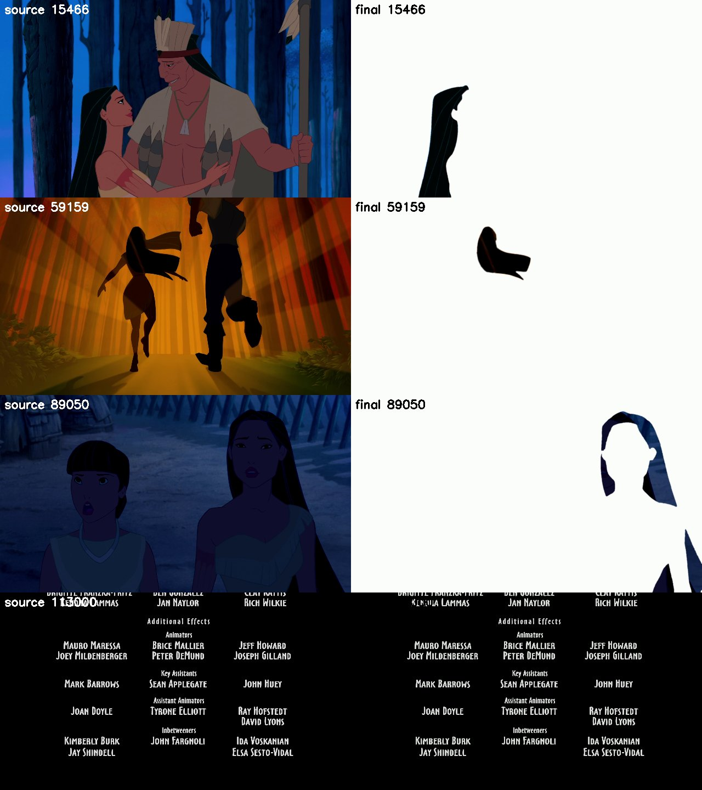
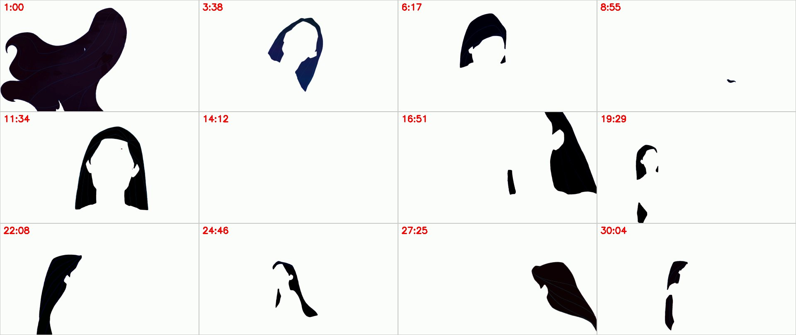

# Quantum Erasure

*Pocahontas* (1995) with everything erased except Pocahontas's hair. Every other pixel of the film is filled white. The original English soundtrack is kept, and the end credits run as they are.



## Outputs

| Output | What it is | Length |
|---|---|---|
| `film/final/Pocahontas_hair_only.mp4` | The full film: 1080p, 23.976 fps, with the BDrip's English AC3 5.1 audio | 1:21:08.77, 116,732 frames, identical to the source |
| `film/her_cut/Pocahontas_her_cut.mp4` | Only the 429 segments she appears in, back to back, with no audio. `index.csv` maps the cut back to the film | 31:04.49, 44,703 frames |

The videos, per-frame masks and source rips are too large for GitHub and aren't in the repo (see `.gitignore`). Everything needed to rebuild them is: the code, the segment list, the overrides, the per-segment QC logs and the docs.

## By the numbers

| | |
|---|---|
| Film frames | **116,732** (108,727 processed + 8,005 credit frames kept as-is) |
| Segments (shots) | **1,309**: 1,308 processed + the credits |
| Segments with her in them | **429** (267 passed QC, 162 flagged for checking); 879 have no Pocahontas and are all white |
| Frames run through full SAM3 masking | **44,703** |
| Frames with her hair in the final film | **34,716**: 34,616 SAM3 masks, 69 held masks, 31 SAM2 masks |
| GPU processing time, final version of every segment | **28.8 hours** |
| GPU processing time, all runs including reruns after review | **38.7 hours** (1,445 segment runs) |
| Hardware | One NVIDIA RTX 3080 Laptop GPU (16 GB), with ComfyUI running locally |

The times are the pipeline's measured time per segment, from `film/segments/STATUS.csv` and each segment's `qc.json`. That covers frame extraction, SAM3, identity classification, QC, any SAM2 fallback and the encode, all bound by the GPU. Earlier phases, such as shot detection, benchmarks and classifier training, aren't counted. Wall-clock time was longer, because of a crash and memory-pressure restarts.

## How it works

1. **Shot detection** (`docs/01`): the BDrip is split into 1,309 segments (`shots/shots_v1.csv`). All frames are read through `tools/frameio.py`, because the rip has a damaged span at 6:58.7 that breaks naive frame counting.
2. **Presence check:** SAM3 looks at a sample of each segment's frames. If none of them has her hair, the segment is written all white.
3. **SAM3 masks:** the prompt "long black hair" returns hair instances on every frame. They're grown and blurred slightly at the edges.
4. **Identity:** CLIP ViT-L/14 embeddings of each instance go to a logistic-regression classifier trained on hand labels (`film/id/`). Instances are linked into tracks, and only tracks that are *her* hair are kept. Nakoma's, Powhatan's, Kocoum's and everyone else's hair is erased too.
5. **QC on every frame:** checks for purity, missed hair, area jumps and dropouts, with scene-level switches for night, dusk and tinted scenes.
6. **Fixes after review** (`film/overrides.json`): per-segment `drop`/`keep` of tracks, `absent`, `hold_gaps` (hold the last mask through short dropouts) and opt-in `sam2` video propagation. The SAM2 fallback started out automatic. It was made opt-in after review found it never beat SAM3 (`film/README.md`, steps 17–19).
7. **Composite and assemble:** each frame is white except the masked hair. Segments are joined with stream copy, the source audio is added, and frame counts and duration are checked against the source.



## Repo layout

| Path | Contents |
|---|---|
| `tools/run_film.py` | Resumable full-film runner: `--only`, `--redo`, `--from`/`--to` |
| `tools/assemble_film.py`, `tools/assemble_her_cut.py` | Build the two outputs |
| `tools/frameio.py` | The only safe way to read frames from the BDrip |
| `checks/` | Review and inspection scripts, e.g. `fail_frames.py`, which renders a segment's failing frames |
| `shots/` | Segment list and damaged spans |
| `film/README.md` | **The full-film run log**: every step, issue, review decision and fix, with images |
| `film/overrides.json` | Manual per-segment decisions, each with a `why` |
| `film/segments/segNNNN/` | Per segment: `qc.json`, `README.md`, `sheet.jpg` (masks and video are local only) |
| `docs/` | Phase docs, from source selection to the SAM2/SAM3 experiments. Start with `docs/PROCESS_OVERVIEW.md` |

## Rebuild

ComfyUI must be running at `127.0.0.1:8188` with the SAM3 checkpoint (`sam3.1_multiplex_fp16.safetensors`), and the BDrip `.mkv` must be in the root folder. Then:

```
python tools/run_film.py           # skips segments that already have qc.json
python tools/assemble_film.py      # full film with audio
python tools/assemble_her_cut.py   # her segments only, no audio
```

## Known imperfections

- **Seg 119, f40–55:** about 16 frames where her hair is missing as she wades into the water at night.
- **About 100 `check` segments haven't been reviewed by hand.** In the ones reviewed, most flags were false alarms in dark or tinted scenes.
