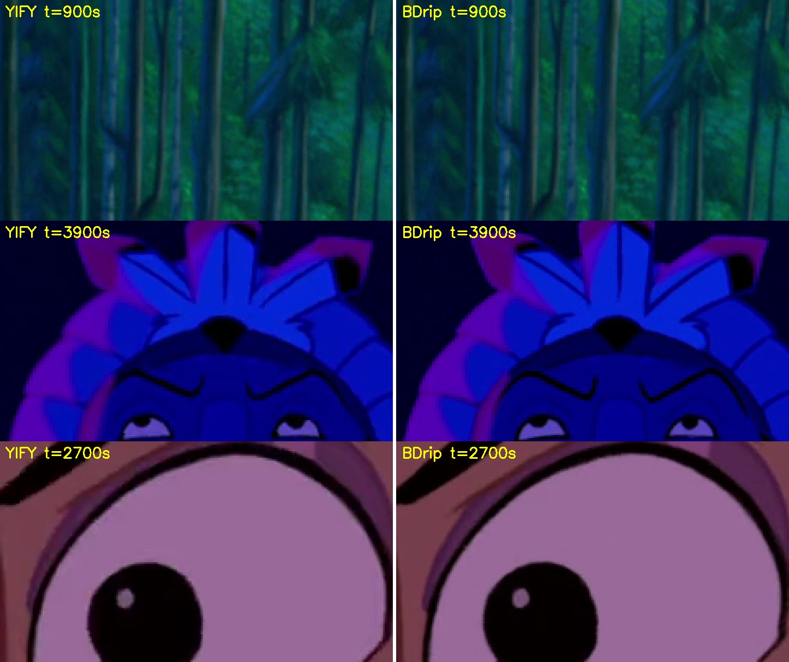

# 00 — Source selection

**Date:** 2026-09-30
**Decision:** use `Pocahontas (1995) BDrip 1080p ENG-ITA MultiSub x264 blyuray -Shiv@.mkv` (the "BDrip") as the master source for the full-film phase.

## Candidates

| | Trailer (Test 1) | YIFY `.mp4` | **BDrip `.mkv`** |
|---|---|---|---|
| Resolution | 1920×1080 | 1920×1072 (8 rows cropped) | **1920×1080** |
| Frame rate | 50 fps (frame-doubled) | 23.976 fps | 23.976 fps |
| Video bitrate | ~4.6 Mbps | ~2.1 Mbps | **~5.5 Mbps** |
| Duration | 167.6 s | 1:21:08.82 | 1:21:08.77 |
| Audio | — | AAC stereo | AC3 5.1 (eng), DTS 5.1 (ita) |

- The film's native rate is **23.976 fps**, so every frame is a distinct drawing.
- The trailer's 50 fps was frame-doubled. Any frame or time arithmetic carried over from Test 1 has to be redone at 23.976.

## Method

`checks/src_compare.py`:
1. Takes 8 timestamps spread across the film (300 s … 4500 s), mixing bright and dark scenes.
2. Grabs the frame at each timestamp from both encodes.
3. Aligns them. This needs two corrections:
   - **Vertical:** the YIFY crop sits 0–8 px inside the BDrip frame.
   - **In time:** seeking to the same timestamp landed **1–2 frames apart** in 3 of the 8 samples. Those were re-matched by searching ±12 frames for the lowest mean difference.
4. Measures each matched pair on luma:

| Metric | What it measures | Why it matters here |
|---|---|---|
| **Blockiness** | Mean pixel step across 8 px block boundaries, divided by the mean step elsewhere. 1.00 = no visible block grid. | Compression blocks caused Test 1's "grain" holes in the threshold masks. |
| **Detail** | Variance of the Laplacian (fine line energy). | Ink-line crispness is what mask edges lock onto. |

## Results (all 8 samples frame-aligned)

| t (s) | Blockiness YIFY | Blockiness BDrip | Detail YIFY | Detail BDrip |
|---|---|---|---|---|
| 300 | 1.316 | **1.111** | 5.6 | **6.4** |
| 900 | 1.299 | **1.107** | 19.1 | **19.6** |
| 1500 | **1.087** | 1.139 | 14.9 | **15.1** |
| 2100 | 1.186 | **1.086** | 19.7 | **22.0** |
| 2700 | 1.306 | **1.109** | **9.9** | 9.5 |
| 3300 | 1.236 | **1.068** | 5.2 | **6.3** |
| 3900 | 2.095 | **1.745** | 3.8 | **4.4** |
| 4500 | 1.083 | **1.051** | 23.4 | **25.9** |
| **Mean** | **1.326** | **1.177** | **12.7** | **13.7** |

- **Blockiness:** the BDrip is less blocky in 7 of 8 samples. Its excess over a perfect 1.00 is 0.18, against the YIFY's 0.33, so **about 45% less block artifacting**.
- **Detail:** the BDrip is sharper in 7 of 8 samples.

## Visual check

The crops below are 3× nearest-neighbour zooms of the darkest high-detail 240×135 window in each sample, chosen automatically. YIFY is on the left, BDrip on the right.

- The BDrip's ink outlines (brow lines, eyelashes, the edge of the eye) are crisper and less smeared.
- The forest texture keeps slightly more detail.
- The difference is moderate, not dramatic. Both files are re-encodes of the same Blu-ray master.

## Caveats

- **The BDrip is still a re-encode.** A true Blu-ray remux (about 20–35 Mbps) would be better again, but the BDrip is good enough to proceed.
- **Extract frames by frame number, not by timestamp.** Seeking with `-ss` can land a frame or two off, as the 3 misaligned samples above showed. A mask must always pair with its exact source frame.
- **Two copies of each film are on disk:** one in `Downloads`, one in the project folder, about 11 GB in total. The YIFY copies (2.5 GB) are no longer needed.
