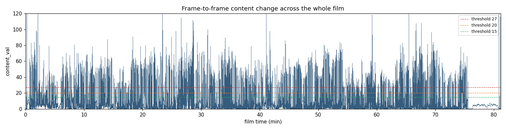
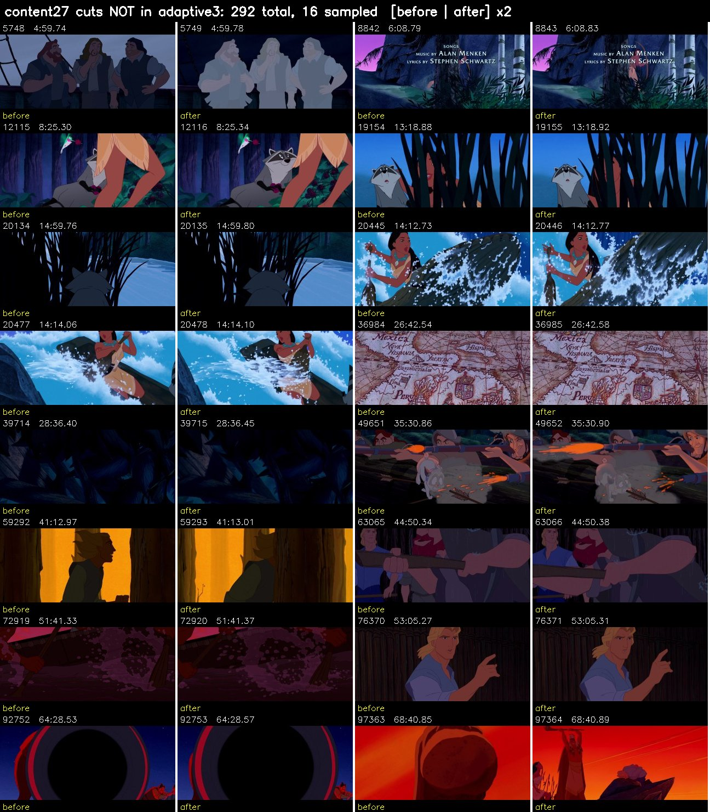
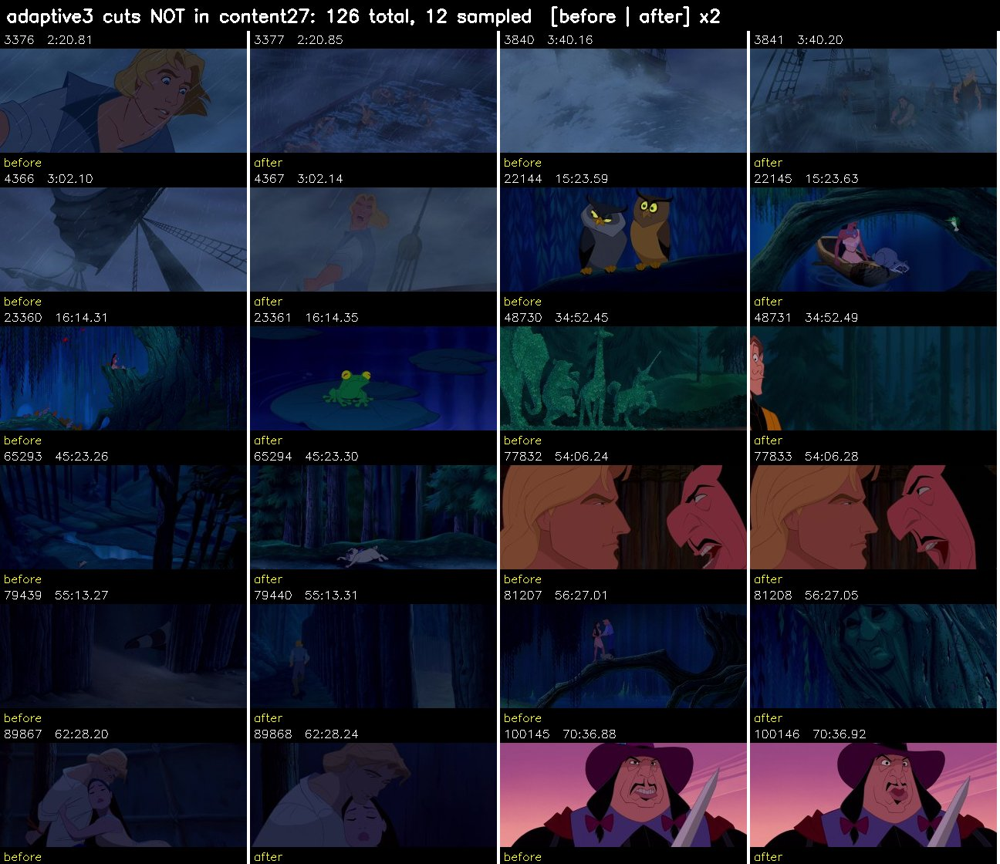
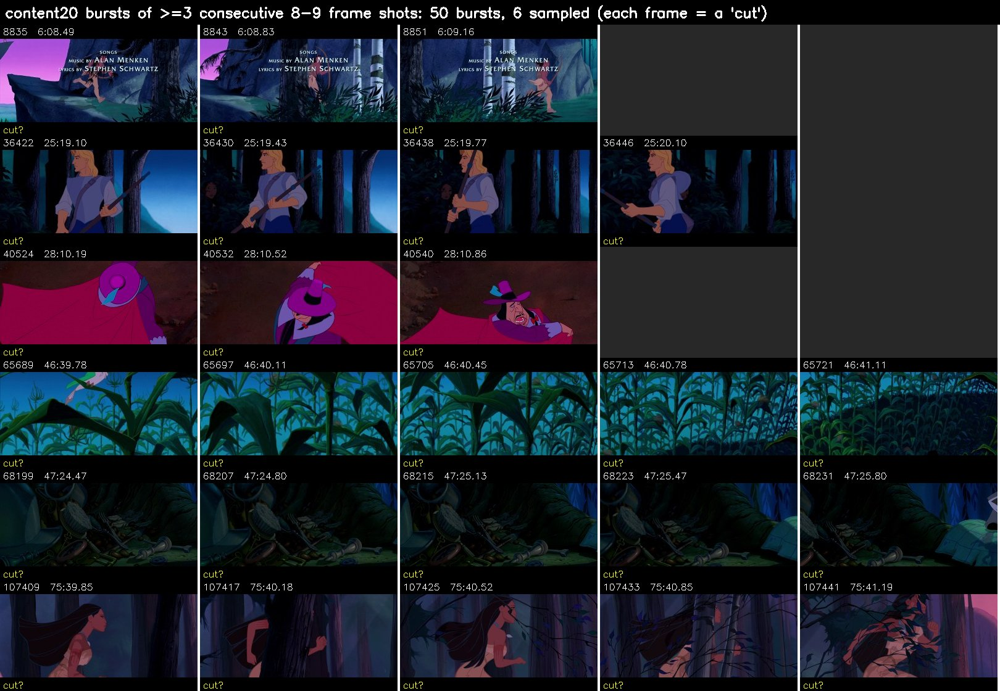
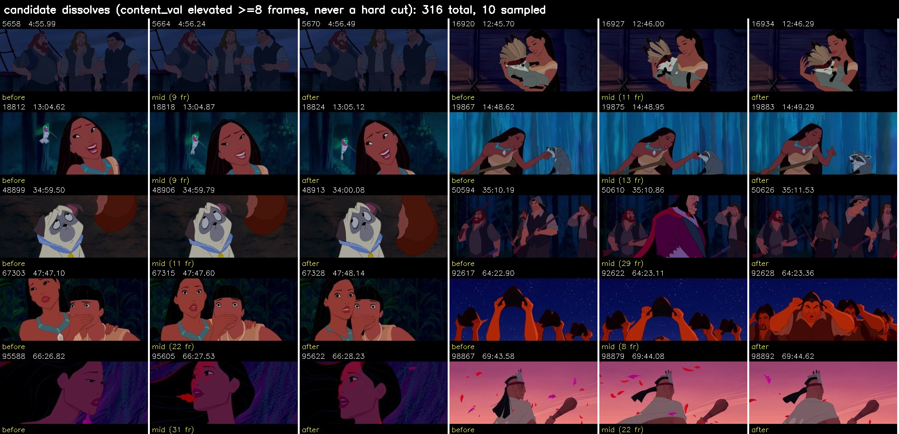
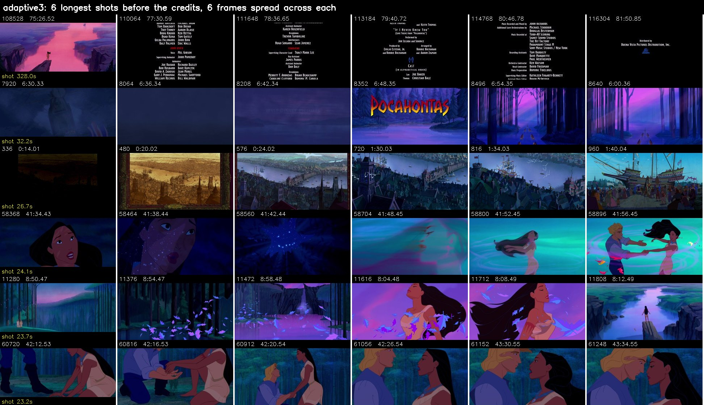
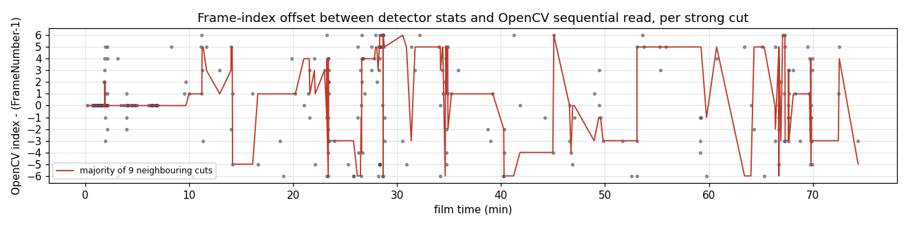
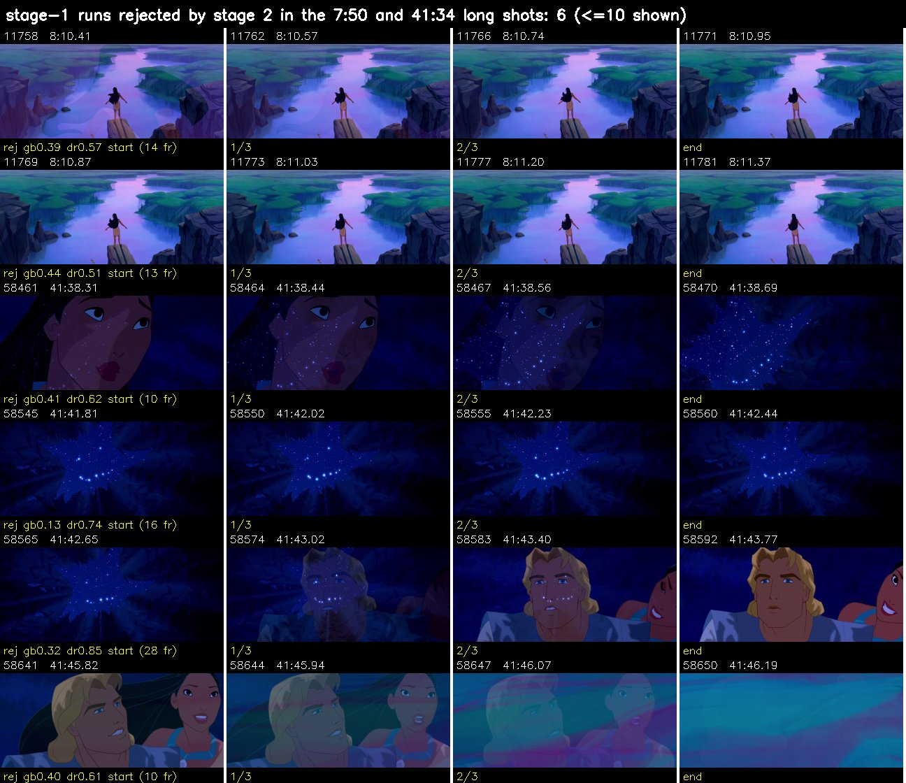
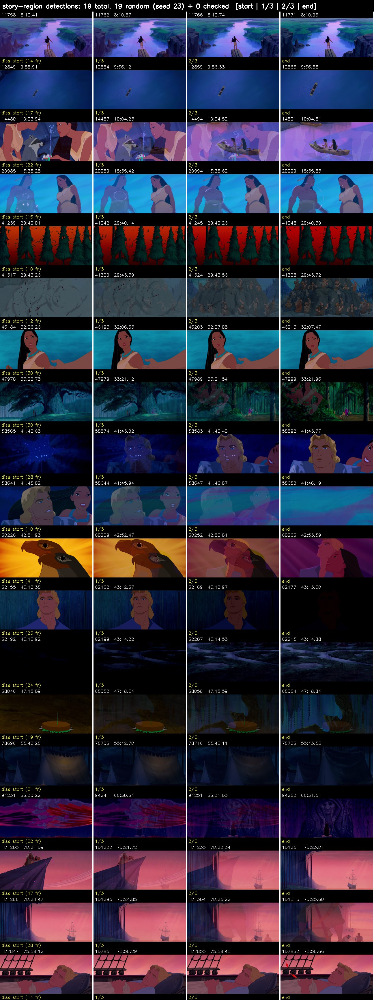

# 01 — Shot detection (full film)

**Status:** in progress, last updated 2026-09-30
**Source:** BDrip `.mkv` (see [00](00_source_selection.md)). It reports 116,734 frames, but OpenCV decodes **116,701**.
**Goal:** a frame-exact cut list for the whole film. Every later step depends on it: triage, frame extraction, SAM2 prompt frames, and pairing each mask with its source frame.

---

## Step 1 — Tooling

- **PySceneDetect 0.7.1**, installed with `pip install "scenedetect[opencv]"` (Python 3.11).
- **matplotlib 3.10.8** was already available. **pandas is not installed**, so the scripts use `csv` and numpy.
- **ffmpeg:** `%LOCALAPPDATA%\autolumelive_colab\ffmpeg.exe` (it isn't on PATH).

## Step 2 — Pass 1: decode once, record every per-frame metric

`tools/shots_pass1_stats.py <video> shots`

- Runs `ContentDetector` and `AdaptiveDetector` together, with a `StatsManager`.
- `min_scene_len=1`, so no cut is suppressed at this stage.
- Frames are auto-downscaled to about 256 px wide for speed.

**Why a stats pass:** Test 1 had to re-run detection every time it changed the threshold. Here the film is decoded **once**. Every threshold experiment afterwards reads `shots/stats.csv` and takes seconds.

**Result:** 116,734 frames in **10.1 min**, at about 200 fps on the CPU.

| Output | Contents |
|---|---|
| `shots/stats.csv` (15 MB) | One row per frame: `Frame Number, Timecode, adaptive_ratio (w=2), content_val, delta_edges, delta_hue, delta_lum, delta_sat` |
| `shots/scenes_default.csv` | 1,912 shots (both detectors combined, defaults; not used further) |
| `shots/pass1.log` | Timing |

**Gotchas hit:**
- In scenedetect 0.7 the `detect_scenes(callback=...)` argument is passed a `FrameTimecode`, not an `int`.
- That callback only fires **when a cut is detected**, so it can't be used as a progress bar. Watch the process instead.
- The stats CSV's `Frame Number` column is **1-based**. Frame 2 sits at 0.042 s, the second frame. Pass 2 converts it to 0-based.
- ffmpeg reports a few `h264 error while decoding MB` messages: isolated damaged macroblocks in the encode. Their effect on frame numbering is under investigation (step 6).

## Step 3 — Pass 2: offline thresholds

`tools/shots_pass2_cuts.py shots`

- Rule: cut at frame *i* when `metric[i] >= threshold` and *i* − (previous cut) ≥ `MIN_LEN` = 8 frames (0.33 s).
- Writes `shots/cuts_<method>.csv` with columns `shot, start_frame, end_frame, frames, start_s, end_s`, using 0-based frames.

| Method | Rule | Shots | Median | Under 1 s | Longest |
|---|---|---|---|---|---|
| `content27` | content_val ≥ 27 (PySceneDetect default) | 1,424 | 2.34 s | 22.1% | 318 s |
| `content20` | content_val ≥ 20 (the fix Test 1 suggested) | 1,872 | 1.67 s | 37.6% | 318 s |
| `content15` | content_val ≥ 15 | 2,367 | 1.00 s | 49.6% | 318 s |
| `adaptive3` | adaptive_ratio ≥ 3.0 **and** content_val ≥ 15 (AdaptiveDetector default) | 1,258 | 2.71 s | 7.8% | 328 s |

**Agreement (a cut matches if within ±2 frames):**
- 1,191 of 1,257 adaptive cuts also appear in `content20`.
- 1,130 of 1,257 adaptive cuts also appear in `content27`.
- So the adaptive cuts are mostly a **subset** of the content cuts. The question is whether the extra content cuts are real.



- From about **75.5 min to the end**, the score sits flat and low: the scrolling end credits. That's the 318–328 s "longest shot" in every method. It contains no hair and is excluded from QC.


- **The red flag:** `content27` and `content20` pile up **160 and 460 shots of exactly the 8-frame minimum length**.
- That's the signature of fast motion or effects holding the score above threshold, so the detector cuts every 8 frames: a burst of false cuts.
- `adaptive3` has almost none, because it compares each frame against its neighbours rather than a fixed level.

**Candidate dissolves:** 339 runs of 8 or more frames where the score stays at 4 or above but never reaches 27. Listed in `shots/dissolves.csv`. These are candidates only, not yet checked.

## Step 4 — Frame-exact QC thumbnails

`tools/grab_frames.py <video> shots/grab_list.txt shots/thumbs320`

- One sequential OpenCV decode that saves only the requested frames as 320×180 JPEGs, named `f<index:06d>.jpg`.
- The list covers 12,325 frames:
  - one frame every 2 s across the whole film
  - the frame before, first, middle and last frame of every shot, for all four methods
  - before, middle and after of every candidate dissolve
- **Result:** 12,324 saved in **3.3 min**. The one missing frame is past the real end; the decoder yields 116,701 frames, not the 116,734 in the header.
- Sequential reading is used instead of `-ss` seeking because seeking lands a frame or two off (see [00](00_source_selection.md)).

## Step 5 — Visual QC sheets

`tools/shots_qc_sheets.py`

- Each sheet answers one question.
- Samples use a fixed random seed (7), so the sheets are reproducible.

> ⚠️ **Sheets 5a and 5b below are under review.** Step 6 found that their before/after pairs may be one frame off later in the film. Until that's resolved, their verdicts are **not** to be trusted.

### 5a. Cuts `content27` finds that `adaptive3` doesn't (292; 16 sampled)



- **First reading:** all 16 pairs look like the same shot (fast canoe and grass-run motion, a flash, one fade at 5748). That would mean all 16 are content27 false positives.
- **Status:** suspect. See step 6.

### 5b. Cuts only `adaptive3` finds (126; 12 sampled)



- **First reading:** 3 of 12 are real cuts (3376, 3840, 4366), all in the dark storm sequence. That's exactly the low-contrast case a fixed threshold misses.
- The other 9 pairs looked identical.
- **Status:** suspect. The identical pairs are what started the step 6 investigation.

### 5c. Bursts of minimum-length `content20` shots



### 5d. Candidate dissolves



### 5e. Longest `adaptive3` shots before the credits (looking for hidden cuts)



Verdicts for 5c–5e will be written after step 6, once the sheets are confirmed to be frame-aligned.

## Step 6 — Frame-index alignment check (open)

**What raised it:** on sheet 5b, cut 23361 showed identical before/after thumbnails. A full-resolution diff around it showed two different compositions overlapping, so it **is** a real change.

**Checks so far:**

1. **Raw stats rows.** At FrameNumber 23362 the content score jumps from 0.16 to 19.8 and the adaptive ratio to 32.2. In 0-based terms that's frame 23361, which is exactly where the cut list puts it, so pass 2's arithmetic is correct.
   *(An earlier reading suggested a +1 offset in the adaptive column. That was me misreading which element of a printed window was the centre. There is no column offset.)*
2. **Start of the film:** a sequential OpenCV read of frames 0–6000, checked against 12 strong cuts. In 11 of 12, the real change is at OpenCV index = FrameNumber − 1, the mapping pass 2 uses. Thumbnail pairs agree too: the frame 331→332 pair differs by 78.1, the 332→333 pair by 0.0.
3. **Whole film:** across *all* strong cuts (score ≥ 40), the thumbnail pairs at the mapped position differ by a median of only **1.5**. That's essentially no change, so the mapping holds early on but **apparently drifts later in the film**.

**Hypothesis:** the h264 decode errors. If PySceneDetect's reader and the thumbnail reader handle a damaged frame differently (drop it, duplicate it, retry), every index after that point shifts.

### 6a. Independent change signal in OpenCV numbering

- `tools/frame_diff_scan.py` does one sequential OpenCV read of the whole film.
- For every frame it records `diff[n] = mean |frame n − frame n−1|` on 160×90 thumbnails, saved to `shots/opencv_diff.npy`.
- 116,701 frames, about 3 min.

### 6b. Per-cut peak matching within ±6 frames: inconclusive, but informative

`tools/check_alignment.py`, plot at `img/01_alignment_offset.png`.

- Up to about **10 min** the offset is exactly **0**, across 72 consecutive cuts.
- After that, offsets are spread **evenly over the whole ±6 window**, and only 272 of 1,042 strong cuts show a clear peak at all.
- An even spread means the true cut lies **outside** the window, so the matcher is picking noise. The real disagreement is larger than 6 frames.



### 6c. Cross-correlation over ±240 frames: the answer

`tools/check_alignment_xcorr.py`

- Both change signals are converted to "spikes" (each value minus its local 25-frame median), so only cuts dominate.
- Then they're cross-correlated in 2-minute segments, at lags of −240…+240 frames.
- Output: `shots/alignment_lags.csv`.


| Film time | Lag (OpenCV index − detector index) | Correlation (next-best lag) |
|---|---|---|
| 0–5 min | **0** | 0.86–0.96 (0.16–0.40) |
| 6 min | 0 (segment straddles the jump) | 0.54 (0.42) |
| 7–75 min | **−31**, constant | 0.85–0.99 (0.11–0.27) |
| 79 min (credits) | −26 (weak) | 0.52 (0.45) |

**Finding:** this isn't drift. It's **a single jump of 31 frames between about 6 and 7 min**, and constant afterwards.

From that point on, an event the detector numbers *i* is OpenCV sequential frame *i* − 31. That's consistent with the frame counts: the header says 116,734 frames, OpenCV decodes 116,701 (33 fewer).

**Working explanation, being verified next:**
- The file has a damaged stretch around 6–7 min; that's where ffmpeg's `error while decoding MB` messages come from.
- PySceneDetect numbers frames by **timestamp**, so its count skips across the hole.
- A plain sequential read counts only the **frames actually decoded**, so it loses about 31.

**What this means:**
- Every cut list, thumbnail and QC sheet that mixes the two numberings is wrong by 31 frames after about 6.5 min. That's why sheets 5a and 5b showed identical before/after pairs.
- The pipeline must use **one** frame numbering everywhere. That's decided in step 6d.

### 6d. Root cause: the source file is missing about 1.3 s of picture at 6:58.7

**Decoded timestamps** (ffmpeg's `showinfo` filter over 330–450 s, saved in `shots/showinfo_330_450.txt`; there is no ffprobe on this machine):

```
GAP after t=418.710s: 1.376s missing ~= 32 frames
GAP after t=420.086s: 0.084s missing ~= 1 frames
```

ffmpeg also logs `concealing … errors in P/B frame` there. The rip is damaged at this point.

**How the detector numbered across the hole** (`shots/stats.csv`, `Frame Number` and `Timecode`):

```
10039 06:58.668 | 10040 06:58.710 | 10042 06:58.793 | 10043 06:58.835 | 10073 07:00.086 | 10075 07:00.170 ...
```

- PySceneDetect's frame numbers are **based on timestamps**: they jump over the missing positions.
- Missing film positions: **10041, 10044–10072 and 10074**, which is **31 frames (about 1.3 s)**, in 1-based detector numbering.
- **Per-cut lag after the hole** (all strong cuts from 11,000 to 108,000; window −35…−28): −31 at **763** cuts. The rest are spread over ±4, which is motion next to cuts.
- So the offset is exactly 31, constant from 6:58.7 to the end.

**Which side was wrong:**

| Numbering | Used by | Across the hole |
|---|---|---|
| Timestamp-based: `round(pts / (1001/24000))` | PySceneDetect stats, so **all `cuts_*.csv`** | skips the 31 missing positions ✔ |
| Count of decoded frames | `grab_frames.py`, `shots_thumbs.py`, `frame_diff_scan.py`, as first written | runs 31 low after 6:58.7 ✘ |

### Decision: canonical frame numbering

**Film frame index** = `round(pts_seconds × 24000 / 1001)`, 0-based. It equals `stats Frame Number − 1`.

- It's tied to film time. That survives decoder differences, damaged spans, and any later patch from another source such as the YIFY copy, which can be aligned by time.
- The cut lists from step 3 already use it, so they're **correct as written**.
- Every tool that reads frames must derive the index from the frame's timestamp (OpenCV `CAP_PROP_POS_MSEC`), never from a counter.
- Missing positions are simply absent. Any shot that spans 10040–10075 has a hole, and **frame extraction for a shot must check for that** rather than assume continuity.

**Missing content:** film frames 10040, 10043–10071 and 10073 (0-based) have no picture in the BDrip. If that shot matters for the piece, patch it from the YIFY copy by timestamp.

### 6e. Shared reader `tools/frameio.py`, verified at the hole

- `iter_frames(video, want=…, last=…)` yields `(film_idx, frame)`.
- `film_idx = round(CAP_PROP_POS_MSEC/1000 × 24000/1001)`, forced strictly increasing.
- Every tool that reads frames now goes through it.

Verification (`last=10100`), with 0-based indices:

| Source | Indices at the hole |
|---|---|
| PySceneDetect stats | … 10039, **10041, 10042**, 10072, 10074 … |
| `frameio` | … 10039, 10072, **10073**, 10074 … |
| ffmpeg `showinfo` pts | … 10039 (418.710 s), 10072 (420.086 s), 10074 (420.170 s) … |

- **Outside the hole, all three agree exactly.** The decoded-frame counter equals `film_idx` up to 10039, and after it `film_idx = counter + 32`.
- **Inside, they disagree by at most 2 frames.** Those frames are corrupt (the decoder conceals errors), so there's no trustworthy sequence there.
- Rule: **film frames 10040–10074 are a "damaged span"**. Flag any shot that touches it, and never mask it without patching from another source.

Damaged spans are recorded in `shots/damaged_spans.csv`.

> Correction to the line above: "after it `film_idx = counter + 32`" comes from `frameio`'s own counter. PySceneDetect decoded one more concealed frame inside the hole, so *its* counter would be +31, which is the lag step 6c measured. Both counters are irrelevant from now on: everything uses `film_idx`.

### 6f. Tools switched to `film_idx`; earlier outputs set aside

| Tool | Change |
|---|---|
| `tools/grab_frames.py` | iterates `frameio.iter_frames`; saves `f<film_idx>.jpg`; reports requested indices with no picture instead of writing a substitute |
| `tools/shots_thumbs.py` | rewritten on `frameio`; if a first, middle or last frame falls in a damaged span, it uses the next decoded frame **inside the same shot** and logs the substitution |
| `tools/frame_diff_scan.py` | output array is indexed by `film_idx`, with NaN where an index has no picture |

The outputs from before the fix are kept only as evidence. They're **not to be used**:
- `shots/_old_thumbs320_counter_indexed/`: thumbnails 31 frames mislabelled after 6:58.7. This produced the bad pairs in sheets 5a and 5b.
- `shots/_old_opencv_diff_counter_indexed.npy`

The thumbnails and diff scan are being regenerated (step 7).

### 6g. Verification failed: OpenCV's timestamp is itself one frame off after the hole

**Re-grab result:** 12,323 thumbnails in 3.1 min. The only indices with no picture were 10061 and 10065, both inside the damaged span, as expected.

**Straddle test:** do the thumbnails at film indices `c−1` and `c` differ across every strong stats cut (content_val ≥ 40)?

| | Strong cuts | Median \|diff\| | Clearly different (>15) |
|---|---|---|---|
| Before the hole | 66 | 59.2 | **97%** ✔ |
| After the hole | 845 | 0.9 | **7%** ✘ |

So after the hole `frameio`'s index **still** disagrees with the stats, by one frame this time.

**Arbiter: ffmpeg's own timestamps.** Each frame's `pts` comes from `showinfo`, and the cut is located as the biggest pixel change.

| Cut (stats film index) | Seek-based measurement | Decoded from t=0, no seek |
|---|---|---|
| 332 (before hole) | 333.01 | **332.00** |
| 973, 1380, 1570, 1790 (before hole) | N + 1.01 | — |
| 20127, 69615 (after hole) | N + 0.98 | — |

- The seek-based measurement has a **+1 bias**: it gives N+1 even for known-good cuts. With that bias removed, after-hole cuts also land exactly where the stats put them.
- **Conclusion:** PySceneDetect's stats and **all `cuts_*.csv` files are correct everywhere**, matching ffmpeg's true timestamps.
- **OpenCV's `CAP_PROP_POS_MSEC` runs one frame high after the damaged span.** OpenCV is therefore unreliable for frame identity in this file, both as a counter (−31) and as a timestamp (+1).

### Decision (revised): ffmpeg is the authority on frame identity

- `frameio` will be rewritten to decode through an **ffmpeg pipe**: `-copyts` plus `showinfo`, so every frame comes with its true pts and there's no seek arithmetic.
- `film_idx = round(pts × 24000/1001)`, unchanged.
- The thumbnails from step 6f (`shots/thumbs320/`) are one frame off after 6:58.7, so they'll be regenerated.

**Lesson for later phases:** never trust a decoder's frame counter or position property on a damaged file. Get frame identity from container timestamps, and always run a straddle test across known cuts before relying on extracted frames.

### 6h. `tools/frameio.py` rewritten on an ffmpeg pipe: three bugs found while doing it

The new design:
- `ffmpeg -copyts [-ss start] -i SRC -map 0:v:0 -vf [scale,]showinfo -fps_mode passthrough -f rawvideo -`
- Frames are read from stdout.
- A thread parses each frame's `n: <k> … pts_time: <t>` from stderr.
- `film_idx = round(t × 24000/1001)`.

| # | Symptom | Cause | Fix |
|---|---|---|---|
| 1 | The test window never finished | `-to` together with `-copyts` didn't stop ffmpeg, which decoded on toward the end of the film | Stop on the Python side: break once `film_idx > end`, then kill ffmpeg |
| 2 | Zero frames written | `-t 4` is compared against **absolute** timestamps under `-copyts`, so a seek to 12 s was already past "4 s" | No `-t`/`-to` at all; the window is enforced in Python |
| 3 | The reader hung inside the damaged span, and ffmpeg reported **`dup=32`** | ffmpeg's raw-video output defaults to **constant frame rate** and **filled the 1.3 s hole with 32 duplicated frames**. Those are created after `showinfo`, so they have no timestamp line | **`-fps_mode passthrough`**: output exactly the decoded frames |

**Bug 3 matters well beyond this reader:**
- Any ffmpeg extraction across this spot without `-fps_mode passthrough`, including Test 1's `ffmpeg -ss … -frames:v N … f_%04d.png` pattern, **silently inserts 32 copies of the same frame**.
- Every frame extraction in this project must use `-fps_mode passthrough` (or `-vsync 0`) and name files by `film_idx`.

Also handled: inside the damaged span, h264 error messages can be spliced into `showinfo` lines. Timestamps are therefore matched by showinfo's own counter `n` anywhere in the stream. A frame whose line is unreadable is numbered previous + 1, with a warning; that should only ever happen inside a damaged span.

**Verification** (windows of ±1.5 s at 160×90; the cut is the biggest frame-to-frame change):

| Stats cut (film index) | `frameio` result |
|---|---|
| 332 (before the hole) | **332** ✔ |
| 20127 (after) | **20127** ✔ |
| 69615 (after) | **69615** ✔ |

Indices across the damaged span (418.4–420.6 s): `… 10037, 10038, 10039, 10072, 10073, 10074, …`. No duplicates, no stall.

Next: port `grab_frames.py`, `shots_thumbs.py` and `frame_diff_scan.py` to this API, regenerate the thumbnails, and repeat the whole-film straddle test (step 7).

### 6i. Tools ported; second set of outputs set aside

- `grab_frames.py`, `shots_thumbs.py` and `frame_diff_scan.py` now call `iter_frames(video, width=…, gray=…)`.
- Scaling to 320 px (or 160 px grey) happens inside ffmpeg.
- The OpenCV-only arguments (`want`, `last`, `retrieve_all`) are gone.

Set aside as evidence (**not to be used**):

| Folder or file | Index used | Error after 6:58.7 |
|---|---|---|
| `shots/_old_thumbs320_counter_indexed/`, `shots/_old_opencv_diff_counter_indexed.npy` | OpenCV decoded-frame counter | −31 frames |
| `shots/_old_thumbs320_opencv_posmsec/`, `shots/_old_opencv_diff_posmsec.npy` | OpenCV `CAP_PROP_POS_MSEC` | +1 frame |

Regenerating `shots/thumbs320/` and `shots/opencv_diff.npy` with the ffmpeg reader (step 7).

### 6j. Still wrong after the hole: decoding continuously through the damage shifts timestamps by +1

**Straddle test on the ffmpeg-reader thumbnails** (one continuous decode from frame 0, 5.8 min):

| | Strong cuts | Median \|diff\| | Clearly different |
|---|---|---|---|
| Before the hole | 66 | 59.3 | 97% |
| After the hole | 845 | 0.9 | **7%** ✘ |

The windowed tests in 6h were exact, but those **seeked** to each cut. This decode ran **continuously from frame 0 through the damage**.

**The two decode paths compared**, using the first strong cuts after the hole:

| Stats cut | Continuous decode from 0 | Seek to the cut (6h) |
|---|---|---|
| 10124 | 10125 | — |
| 10232 | 10233 | — |
| 10294 | 10295 | — |
| 10333 | 10334 | — |
| 20127, 69615 | (whole-film test: +1) | **exact** |

**Root cause:**
- When the h264 decoder hits the corrupted frames, it enlarges its frame-reorder buffer. From then on it pairs every output picture with a timestamp one frame late, **for the rest of the stream**.
- A seek starts a fresh decoder, and so did PySceneDetect's reads, which is why the stats are correct.
- OpenCV's `POS_MSEC` being +1 (6g) is the same effect: OpenCV decodes with the same library.

**Keyframes around the damage** (`ffmpeg -skip_frame nokey … showinfo`, 410–450 s): **410.744 s (film frame 9848)** and **420.712 s (film frame 10087)**. Every frame up to 10086 depends on the corrupted group of frames.

### Fix: never decode through a damaged span

- `shots/damaged_spans.csv` now carries the restart point:

  | start_frame | end_frame | resume_frame | resume_s |
  |---|---|---|---|
  | 10040 | **10086** | **10087** | 420.712 |

  The span is **widened to 10086**: frames up to the next keyframe depend on the damage.
- `frameio.iter_frames` reads the spans file. It decodes up to each span, **kills that decoder**, and starts a **fresh one at the span's resume keyframe** (`-ss resume_s` with `-copyts`).
- Frames inside a span are **never yielded**.

**Verification**, decoding continuously from film frame 0 at 160×90 grey:
- Indices across the span: `… 10038, 10039, 10087, 10088, …`
- Cuts:

| Stats cut | Change peaks at |
|---|---|
| 9962, 10007 (before) | 9962, 10007 ✔ |
| 10124, 10232, 10294, 10333 (after) | 10124, 10232, 10294, 10333 ✔ |

**6 of 6 exact.**

The thumbnails from 6i are still +1 after the hole, so they're set aside as `shots/_old_thumbs320_ffmpeg_continuous/`.

## Step 7 — Aligned thumbnails: verified across the whole film ✔

`tools/grab_frames.py` with the span-aware `frameio`:
- 12,322 thumbnails in 9.7 min.
- 116,685 frames decoded. That's the 116,701 OpenCV decodes, minus the frames inside the damaged span, which are now skipped rather than decoded.
- Requested indices with no picture: 10061, 10065 and 10080. All are inside the damaged span (10040–10086), as expected.

**Straddle test**: do the thumbnails at film indices `c−1` and `c` differ across every strong stats cut (content_val ≥ 40)?

| | Strong cuts | Median \|diff\| | Clearly different (>15) |
|---|---|---|---|
| Before the damaged span | 66 | 59.3 | **97%** |
| After the damaged span | 845 | 38.5 | **98%** (was 7% in 6g and 6j) |

**Frame identity is now consistent everywhere:** cut lists, thumbnails, and any future extraction through `frameio`. The remaining 2–3% are expected to be flashes and dissolves, where a high score isn't a clean cut. Sheets 5c and 5d cover those.

From here on, sheets 5a–5e are rebuilt from `shots/thumbs320/`. The earlier versions above were built from the counter-indexed thumbnails and are superseded by step 8. The old images are kept in `img/_superseded/`.

## Step 8 — QC re-judged on aligned frames

Same script (`tools/shots_qc_sheets.py`) and same seed (7), so the same cuts are sampled as in step 5. Only the frames shown are now correct.

### 8a. Cuts `content27` finds that `adaptive3` doesn't (292; 16 sampled)


| Verdict | Count | Frames | What it is |
|---|---|---|---|
| False cut | 15 | 5748, 8842, 12115, 19154, 20134, 20445, 20477, 36984, 39714, 49651, 59292, 63065, 72919, 76370, 92752 | Fast motion (splashes, a swinging prop, foreground reeds, a figure passing a tree), flashes and fire effects, a fade (5748), and a credit card fading in over a held background (8842) |
| **Real cut** | **1** | **97363** | A red close-up cuts to a wide shot with very similar overall colour |

Extrapolated: about 94% of these 292 are false. **`adaptive3` misses roughly 18 real cuts** in this group.

### 8b. Cuts only `adaptive3` finds (126; 12 sampled)


| Verdict | Count | Frames | What it is |
|---|---|---|---|
| **Real cut** | **9** | 3376, 3840, 4366, 22144, 23360, 48730, 65293, 79439, 81207 | Almost all are **dark or low-contrast** transitions: the storm at sea, the night forest |
| False cut | 3 | 77832, 89867, 100145 | Dialogue close-ups with a mouth or expression change (2), and a lighting change on a held pose (1) |

Extrapolated: about **95 real cuts that `content27` misses**, mostly in dark scenes. Those are exactly the bucket-B scenes this project cares most about.

**Correction to step 5b:** the earlier "3 of 12 real" came from misaligned frames. On aligned frames it's **9 of 12**.

### 8a + 8b together

| | `content27` | `adaptive3` |
|---|---|---|
| Real cuts it misses that the other finds | ~95 (dark scenes) | ~18 |
| False cuts it adds that the other doesn't | ~275 | ~31 |

**`adaptive3` is clearly better.** Its weak spot is a hard cut between two shots of similar overall colour, like 97363. Whether a secondary rule can catch those without letting `content27`'s false cuts back in is checked in step 9.

### 8c. Bursts of minimum-length `content20` shots (50 bursts; 6 sampled)


**All 6 bursts are single continuous shots.** Each "cut every 8 frames" is really one of:
- a camera pan under the opening credits
- a character walking past trees
- a fall with a sweeping cape
- a tracking move through tall plants
- a slow pan across scattered objects
- a run with tree trunks passing in the foreground

So the 0.33 s pile-up in the histogram is **entirely false cuts** from sustained motion and foreground occlusion. **Lower fixed thresholds are not a way to catch more real cuts**; this rejects Test 1's suggested `-t 20` fix.

### 8d. Candidate dissolves (316; 10 sampled)


**0 of 10 are dissolves.**
- All 10 are continuous motion inside one shot: gestures, head turns, raised arms, wind-blown leaves.
- The rule ("score ≥ 4 for 8 or more frames, never a hard cut") just finds **sustained motion**.
- `shots/dissolves.csv` is **not usable** and needs a different detector (step 10).

### 8e. Longest `adaptive3` shots before the credits


| Start | Length | What's inside |
|---|---|---|
| 75:26 | 328 s | The **final story shot fades into the end credits**. The cut at the fade isn't detected; the credits have no hair and will be trimmed |
| 5:30 | 32 s | The title sequence: fog, a studio card fading in, the title card, then a forest. **Several gradual transitions**, no hard cut |
| 0:14 | 27 s | The opening: dark, then a painted image, the city, the harbour. **A painting-to-animation transition and further dissolves** |
| 41:34 | 24 s | A stylised sequence: close-up, stars, swirling wind, two figures. **Continuous morphing between images** |
| 7:50 | 24 s | Forest, falling leaves, waterfall, close-up, cliff. **Gradual transitions** through blowing leaves |
| 42:12 | 23 s | Two characters in conversation with camera movement: **a genuine long take** |

**Finding:** in 5 of the 6 longest shots, the length comes from **gradual transitions that no hard-cut detector sees**. Those are dissolves, fades, and transitions animated between scenes.

**Why it matters:** SAM2 tracking breaks across them, as it did at the end of trailer shot 5, where it carried onto another character's hair through a dissolve. Every SAM2 run must start and stop at a transition, not span one.

## Step 9 — Secondary hard-cut rule: tested and rejected

**Question:** can a second rule recover the hard cuts `adaptive3` misses, like 97363, without bringing back `content27`'s false cuts?

**Per-frame scores** at the one real missed cut, against the 15 confirmed false cuts from 8a:

| Score | Real cut 97363 | 15 false cuts (range) |
|---|---|---|
| content_val | 26.2 | 17.4–40.3 |
| delta_edges | 51.6 | 7.1–125.1 |
| delta_hue | 33.4 | 1.4–61.0 |
| delta_lum | 41.4 | 11.1–89.2 |
| delta_sat | 3.9 | 16.7–56.3 |
| adaptive_ratio | **1.30** | 0.54–**1.10** |
| median content_val over the previous 12 frames | 14.4 | 3.6–40.0 |

- Only `adaptive_ratio` puts the real cut above every false one, and with a single positive example any threshold between 1.10 and 1.30 would just be fitted to that one cut.
- (`delta_sat` is also lower for the real cut, but the false cuts span a wide range and there's no reason to expect real cuts in general to have low saturation change.)

**What the candidate rule would add** among the 292 `content27`-only cuts before the credits:

| adaptive_ratio ≥ | Cuts added |
|---|---|
| 1.10 | 149 |
| 1.20 | 126 |
| 1.30 | 103 |

About 94% of this group is false (8a), so even the strictest version adds roughly **97 false cuts for about 6 real ones**.

**Decision:** keep **`adaptive3` unchanged**.
- The cost is about 18 missed hard cuts (around 1.4% of all cuts).
- They're caught downstream: phase 02 triage looks at the first, middle and last frame of every shot, so a shot whose first and last frames show different scenes gets split by hand.

**Next:**
- Step 10: build a real gradual-transition detector. The idea is to test whether frame *t* is close to a blend of frames *t−k* and *t+k*, which motion doesn't satisfy but a dissolve does.

## Step 10 — Gradual-transition (dissolve and fade) detection: in progress

### 10a. Low-resolution cache of every frame

- `tools/lowres_cache.py` does one span-aware decode of the whole film (through `frameio`). It saves a **64×36 greyscale copy of every film frame**, indexed by film frame index:
  - `shots/lowres_gray64x36.npy`: about 270 MB
  - `shots/lowres_valid.npy`: False where there's no picture
  - `shots/opencv_diff.npy`: frame-to-frame change, now derived from the cache
- Any frame-to-frame analysis, including dissolve tests, cut verification and the cross-correlation check, can then run offline in seconds.
- The separate diff scan (`tools/frame_diff_scan.py`) was stopped partway through and is superseded by this cache.

**Result:** 116,685 frames in **2.6 min**, film indices 0–116731. 47 indices have no picture: the damaged span, plus positions the source never had.

### 10b. First detector (local blend, "the blend weight must slide"): too strict, and built on a wrong assumption

First version of `tools/detect_dissolves.py`, with K=6: only **7** transitions found. It missed the hidden transitions in the long shots, but it also flagged none of the 10 motion examples.

**Signal inspection** at known locations (blend score, blend weight α and endpoint change at K = 2, 4, 8, 16) gave two corrections:

1. **Frame 5748 is a one-frame flash, not a fade.** Mean brightness jumps 32 → 58 for one frame and straight back (lightning in the storm). The step-5a/8a note calling it a "fade" is wrong; it's a **flash**.
2. **Inside a steady dissolve, α stays near 0.5.** Frame *t* is always halfway between *t−K* and *t+K*. **Slow, smooth camera moves look the same** at 64×36. That's why the long opening and title shots showed α ≈ 0.5 with a blend score of 0.5–0.8. A local test can't separate the two.

### 10c. Two-stage detector

`tools/detect_dissolves.py`, current version.

**Stage 1 (local linearity):**
- Find runs of 6 or more frames where frame *t* is close to a blend of *t±3*.
- Runs with an endpoint difference below 2/255 are excluded as static.
- `adaptive3` hard cuts split runs.
- This finds dissolves **and** smooth motion: **272 runs**.

**Stage 2 (global path):** for each run, take the outer endpoints P (2 frames before) and Q (2 frames after), and fit every frame in the run as a blend of P and Q.
- A real dissolve lies on the straight line from P to Q: a high global blend, with α falling from about 1 to about 0.
- A pan doesn't: its middle frames aren't a mix of its first and last frames.

**With the first thresholds** (global blend ≥ 0.6, α drop ≥ 0.6, α monotone in 80% of steps): **20 detections**, median 15 frames (0.63 s), longest 47.

**Checks against known cases:**
- Found inside the opening long shot (333) and the title sequence (8067, 8209, 8325).
- **None** of the 10 motion, flash and burst examples flagged.


**Verdict: 20 of 20 are real gradual transitions; 0 false positives.**

| Group | Count | Film frames |
|---|---|---|
| Studio logo animation (start and end) | 4 | 180, 285, 116519, 116559 |
| Title-sequence fades (fade from black, presentation card, landscape change, title card, credit fading in) | 5 | 333, 8067, 8209, 8325, 10127 |
| **Story dissolves and fades** | **6** | 47970, 60226, 62155, 78696, 101205, 108702 (final fade-out) |
| End-credit text fades | 5 | 108802, 109620, 109830, 116256, 116330 |

**But recall is low.** Only 6 story transitions in an 81-minute film is implausible. The stretches stage 2 rejected inside the 7:50 and 41:34 long shots:



| Run start | What it is | Global blend | α drop | Truth |
|---|---|---|---|---|
| 11758 | The tail of a dissolve into the cliff wide shot | 0.39 | 0.57 | **dissolve, missed** |
| 11769 | The same dissolve, continued | 0.44 | 0.51 | **dissolve, missed** |
| 58461 | A face dissolving into a starfield | 0.41 | 0.62 | **dissolve, missed** |
| 58545 | The starfield shimmering | **0.13** | 0.74 | not a dissolve, correctly rejected |
| 58565 | The starfield dissolving into two figures | 0.32 | **0.85** | **dissolve, missed** |
| 58641 | Two figures dissolving into abstract colour | 0.40 | 0.61 | **dissolve, missed** |

- Real dissolves in hand-animated film score only **0.32–0.44** on the global blend. Both layers keep animating while they cross-fade, so frames aren't pure mixes of the endpoints.
- The one true rejection scores 0.13.
- **Global blend ≥ 0.6 is too strict.** About 0.3 separates these cases. Retuned in 10d.

### 10d. Retuning: a naive lower threshold fails, a two-path rule works

**Attempt 1:** global blend ≥ 0.3, α drop ≥ 0.5. **133 detections**, 96 in the story section.
- It recovers all 4 missed dissolves (11758/11769, 58461, 58565, 58641) and still rejects the shimmer, the flash and all 8 motion and burst examples.
- **But a random check of 15 story detections (seed 11), plus the one at 60803, finds only 1 real transition** (92770, a fade up from black to firelight).
- The other 15 are near-static shots with small movement: faces, groups standing, falling water, slow lighting shifts.
- The 60803 detection inside the "genuine long take" is one of these false ones; the long take stands.
- **Cause:** when the endpoints P and Q are nearly identical, any frame fits as their blend.

**Endpoint difference** (rms |P−Q|, 0–255) for known true and false runs:

| | Global blend | Endpoint difference |
|---|---|---|
| The 13 transitions found at ≥ 0.6 (10c) | 0.61–0.83 | 8.0–99.1 |
| 6 real transitions with a low global blend | 0.32–0.44 | 4.6, 9.3, 13.5, **14.8, 40.7, 41.5** |
| 15 false detections | 0.31–0.51 | 4.3–**13.7** |

**Rule** (`tools/detect_dissolves.py` defaults, run with `--drop 0.5`):
- **Strong path:** global blend ≥ 0.6, **or**
- **Weak path:** global blend ≥ 0.3 **and** endpoint difference ≥ 14 (the picture really changes)
- plus α drop ≥ 0.5 and α monotone in 80% or more of steps.

The 14 cut-off was chosen from these same 34 runs, so it was **validated on everything it then produced** (below), not on the runs used to choose it.

**Result:** **45 detections**, 19 in the story section, median 15 frames (0.63 s), longest 47.
- Of the known low-blend real transitions, it keeps 11758, 58565 and 58641, and **misses** 58461 (endpoint difference 13.5) and 92770 (9.3).

**Precision check: all 19 story detections, judged by eye:**



| Verdict | Count | Film frames |
|---|---|---|
| **Real transition** | **15** | 11758, 14480, 20985, 41317, 47970, 58565, 58641, 60226, 62155, 62192, 68046, 78696, 94231, 101205, 101286 |
| False | 4 | 12849 (still water, a slow brightness change), 41239 (red-sky treeline, colour shift only), 46184 (close-up, hand moving), 107847 (held close-up, small detail change) |

**Precision 15 of 19 (about 79%).** Recall is incomplete: at least 2 known misses, and soft dissolves in dark scenes are the weak spot.

**How to use it:** dissolve spans are **flagged transitions to confirm during triage**, not ground truth. Phase 02 shows every flagged span; false ones are merged back into their shot by hand, and missed ones are added by hand.

## Step 11 — Deliverable: `shots/shots_v1.csv` ✔

`tools/shots_build_v1.py` combines:
- the hard cuts (`cuts_adaptive3.csv`)
- the flagged transitions (`dissolves_v2.csv`): each is split out of the shot it falls in, and any shot fragment shorter than 6 frames is folded into the transition
- the damaged spans (`damaged_spans.csv`)
- the film boundaries:
  - **logo:** frames 0–332, before the fade from black at 333
  - **credits:** from 108727, after the final fade-out ends at 108726

It **asserts that every film frame belongs to exactly one segment**. The first build failed that check: the cut list starts at frame 1, because the stats file has no row for frame 0, so frame 0 is now attached to the first segment.

**Columns:** `seg, kind, start_frame, end_frame, frames, start_s, end_s, damaged`. Frames are film frame indices (ffmpeg timestamps; see step 6), inclusive.

| Kind | Segments | Notes |
|---|---|---|
| `logo` | 1 | frames 0–332 |
| `shot` | **1,276** | median 2.67 s; longest 23.2 s (the genuine long take at 42:12) |
| `transition` | 31 | flagged dissolves and fades in the film itself (of the 45 detections, the rest are inside the logo and credits) |
| `credits` | 1 | frames 108727–116731 (5.6 min) |

**Damaged:** segment **114** (shot, frames 10007–10123) contains the damaged span 10040–10086. Its frames 10040–10086 have no reliable picture. Either patch them from the YIFY copy by timestamp, or exclude them.

## Phase 01 summary

| What | Result |
|---|---|
| Hard-cut detector | `adaptive3` (PySceneDetect AdaptiveDetector defaults) |
| Hard-cut accuracy (from QC) | misses about 18 real cuts (≈1.4%) between similar-colour shots; about 31 false cuts, mostly dialogue close-ups |
| Fixed-threshold detectors | rejected: bursts of false cuts on motion; miss dark low-contrast cuts |
| Gradual transitions | two-stage blend detector: 79% precision on the story section; recall incomplete (soft dark dissolves) |
| Frame identity | ffmpeg timestamp, via `tools/frameio.py`; never decode continuously through a damaged span |
| Source damage | 1.3 s missing at 6:58.7 (frames 10040–10086), in segment 114 |
| Runtime | stats pass 10 min; QC thumbnails about 10 min; low-res cache 2.6 min; everything else seconds |

**Rules carried forward to every later phase:**
1. Use `film_idx` everywhere, and extract frames only through `frameio` (ffmpeg pts, `-fps_mode passthrough`, restart after damaged spans).
2. Before trusting any extracted frames, run a straddle test across known cuts.
3. A SAM2 run starts and ends at segment boundaries in `shots_v1.csv`. **Never propagate across a `transition`**, since that's how trailer shot 5 latched onto another character's hair.

## Open items (handed to phase 02, triage)

- [ ] Confirm or reject each of the 31 `transition` segments by eye. About 21% are expected to be false; merge those back into their shot.
- [ ] Watch for missed hard cuts (a shot whose first and last frames show different scenes) and missed soft dissolves. Known misses: 58461, 92770.
- [ ] Decide on segment 114: patch from YIFY, or skip.
- [ ] The `delta_*` columns and `content15` / `content20` lists are kept for reference only.

**Why this matters:** if the drift is real and uncorrected, every mask after the drift point gets paired with the wrong source frame, and that would only show up at compositing.

---

## Open items

- [ ] Step 6: measure the drift, fix the cut lists, rebuild the thumbnails and QC sheets.
- [ ] Re-judge sheets 5a and 5b with aligned frames, then choose the method.
- [ ] Verdicts for 5c–5e.
- [ ] Decide how dissolves are handled (their own shots? split at the midpoint?).
- [ ] Final `shots/shots_v1.csv`, plus a contact sheet per shot for triage (phase 02).
