# Quantum Erasure

**How we got to the first full-film test shot (segment 224), step by step.**
*Covers Test 1 → SAM2 on the trailer → shot detection → X01 → X02. Last updated 2026-10-14.*

This is a visual summary of the technical process. Each section opens with what it means in plain terms and the images that show it. The exact parameters, numbers and file paths sit in collapsible **▸ Technical detail** blocks. The full record for each phase is in the linked phase docs.

---

## The result

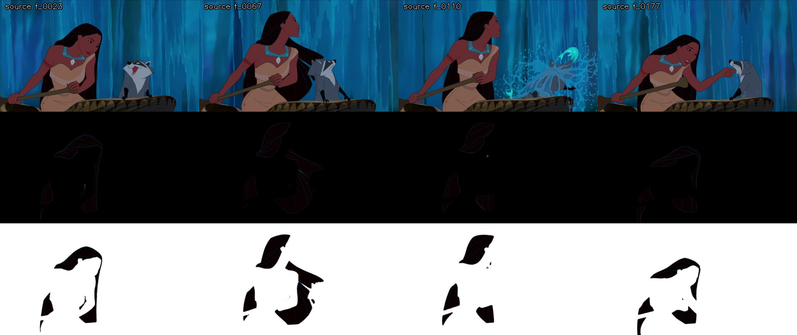

*Segment 224 (film frames 19693–19891, 8.3 s): Pocahontas paddling in front of a waterfall. Top row: the source. Middle row: everything except her hair erased to black. Bottom row: the same erased to white.*

| Animated: source → result | The hair on its own |
|---|---|
| 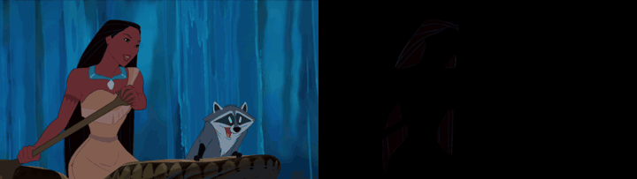 | 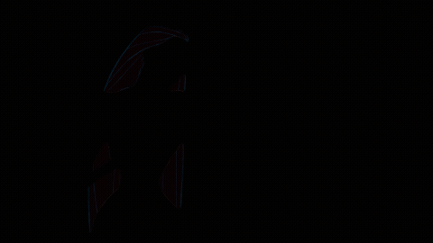 |

The black fill reads as hair hanging in a void. The white fill reads as ink on paper. Test 1 already found that both work; which one to use is a creative call, not a technical one.

---

## The route at a glance

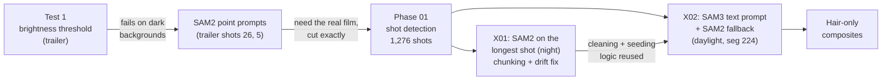

| Stage | Question it answered | Answer |
|---|---|---|
| Test 1 | Can plain brightness thresholding isolate the hair? | On light backgrounds, yes. On dark ones, never. |
| SAM2 on the trailer | Can a segmentation model tell hair from rock of the same colour? | Yes, but it needs hand-placed points and careful corrections. |
| Phase 01 | Where does every shot in the film start and end, frame-exact? | 1,276 shots, plus a hidden 1.3 s hole in the source |
| X01 | Does SAM2 hold up on a 23-second night shot? | Only after chunking, mask cleaning and seam checks |
| X02 | Can a text prompt ("long black hair") replace hand-placed points? | Yes. SAM3 passed every frame, with SAM2 kept as a safety net. |

---

## 1. Test 1: masking by brightness (trailer)

**Idea:** her hair is the darkest thing in most frames, so keep every pixel darker than a threshold and erase the rest. This needs no machine learning, just OpenCV. Source: the theatrical trailer, 1920×1080 at 50 fps.

### It took four versions to get a clean mask

| Version | Change | What happened |
|---|---|---|
| v1 | Threshold V < 95 + small clean-up | Roughly right, but the mask looked **grainy** |
| v2 | 5-frame temporal median | Barely helped, so the grain wasn't flicker |
| v3 | Wider threshold V < 172 | Holes filled, but the mask **leaked onto the face's ink lines** |
| **v4** | Strict V < 95 **+ a 17 px closing kernel** | Clean. Bridges the highlight strands, leaves the facial lines out |

**What caused the grain:** cel-animated hair is a solid dark shape with thin, *lighter* highlight strands painted on top. A strict threshold cuts the shape into islands along those strands, and the small-blob filter then deleted the islands. The fix closes gaps about as wide as a strand *before* filtering.

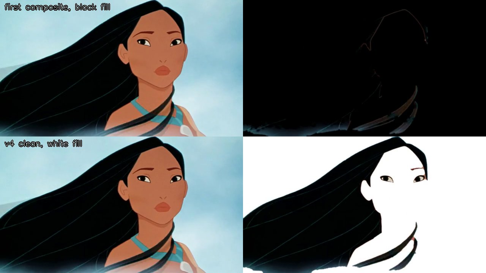

*Trailer shot 26, the easy close-up. Top: the first composite with black fill. Black hair on black nearly vanishes. Bottom: v4 with white fill. A clean silhouette, but the eyes and an eyebrow are kept too, because they're as dark as the hair.*

### Where it breaks: the cliff dive

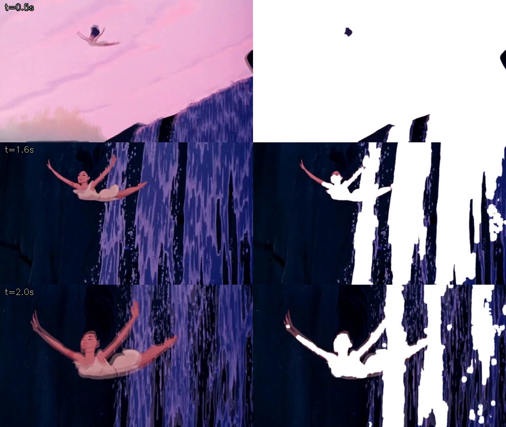

*Trailer shot 5, same v4 settings. Against the pink sky (top) only the hair survives. Against the waterfall (middle, bottom) the **rock is as dark as the hair**, so the mask keeps the whole cliff.*

**What Test 1 established:** on dark backgrounds this is not a tuning problem. The pixel values simply don't separate "hair" from "rock in shadow". Something has to understand *what* it is looking at.

<details><summary>▸ Technical detail: v4 parameters, files</summary>

```
V_STRICT = 95             # HSV value channel
CLOSE_KERNEL = 17 (ellipse), 2 iterations
OPEN_KERNEL = 3, 1 iteration
MIN_AREA_FRAC = 0.0015 of frame area
FEATHER = 2.0 px Gaussian on the alpha edge
TEMPORAL_WINDOW = 3-frame median
```

- Shots were cut with `scenedetect detect-content` (75 shots). It **missed a cut inside shot 5**, so the end of that shot is a different character.
- Scripts: `../../Test 1/Quantum Erasure/mask_hair_v4_generic.py`. Write-up: `TEST1_README.md`.
- Composite: `hair × alpha + fill × (1 − alpha)`, then `ffmpeg -c:v libx264 -crf 18`.
</details>

---

## 2. SAM2: segmenting by meaning, with point prompts (trailer)

**Idea:** [SAM2](https://github.com/facebookresearch/sam2) (Meta's *Segment Anything 2*) takes a few clicks on one frame, "this is the object, this isn't", and **tracks that object through the video**. We ran it inside **ComfyUI** using kijai's [ComfyUI-segment-anything-2](https://github.com/kijai/ComfyUI-segment-anything-2) nodes.

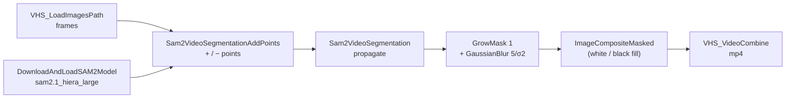

### Shot 26: cleaner than thresholding

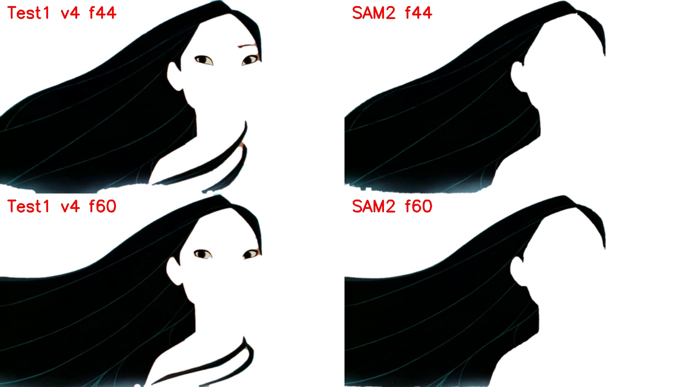

*Left: the threshold kept the eyes and an eyebrow. Right: SAM2 keeps **only the hair**. One trade-off: SAM2 drops the thinnest loose strands, which are too fine for its low-resolution mask decoder.*

### Shot 5: telling hair from rock, and a correction that backfired

SAM2 **never leaked onto the rock**, which is exactly where thresholding failed. It went wrong the other way: from about f_0075 it shrank to her scalp and **lost the long streaming hair**. That called for a corrective prompt partway through the shot.

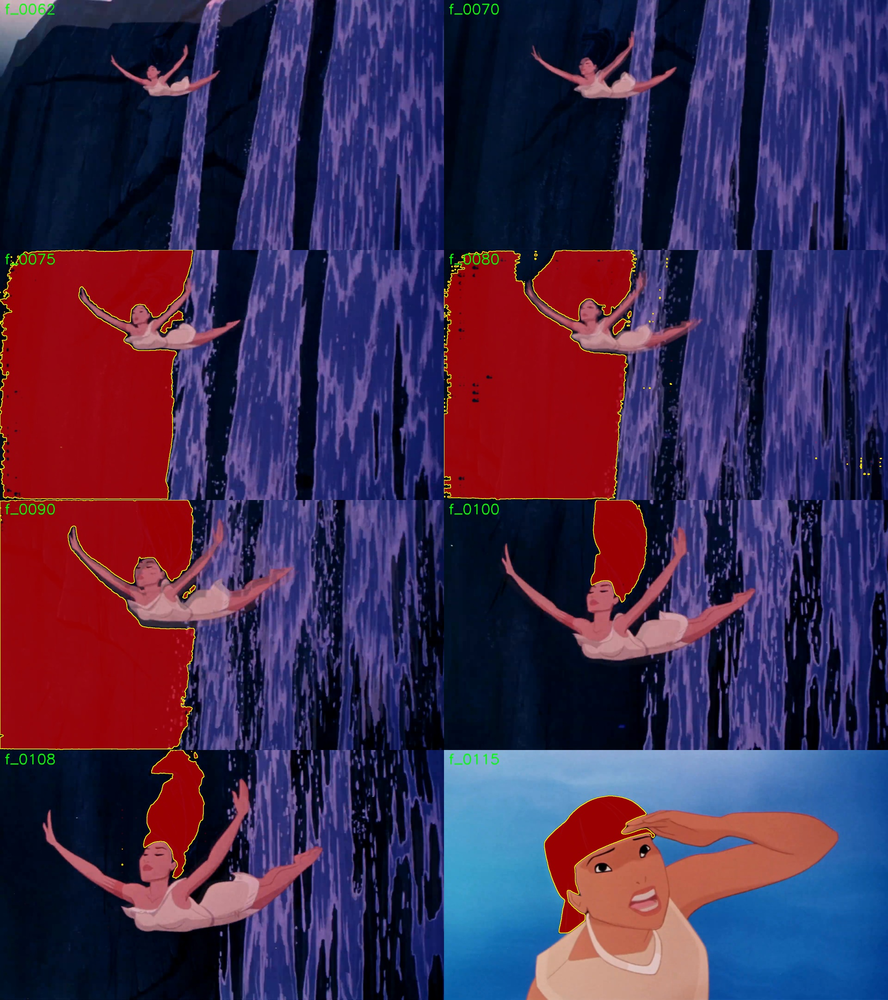

*First attempt, a correction at f_0080. SAM2 read the points as the rock face and **flooded the cliff** (red) for f_0075–0090. It also blanked f_0062–0070, earlier in the shot: a correction is used as memory in **both directions**, so it can damage frames before it.*

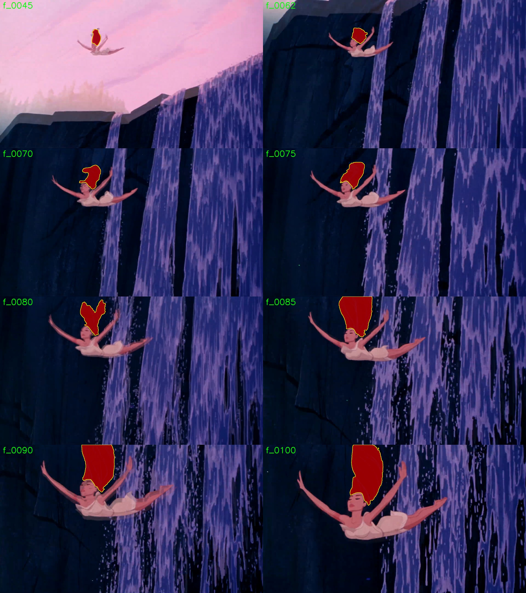

*The correction that worked: f_0100, with points chosen on a 2.6× contrast-boosted crop where hair reads near-black against navy rock. From f_0045 (sky) to f_0100 (waterfall) the mask (red) stays on the hair and grows with the streaming hair. It never touches the rock.*

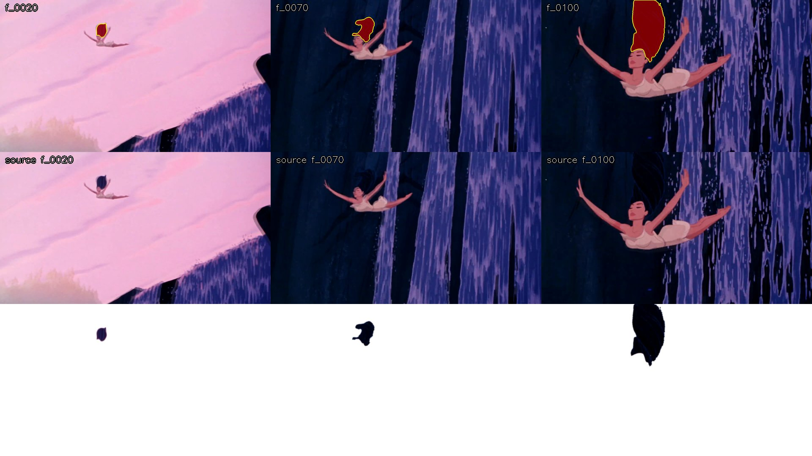

*Shot 5 after correction. Top: the mask (red, yellow edge). Middle: source. Bottom: white-fill composite. The hair survives against both the pink sky and the dark waterfall.*

<details><summary>▸ Technical detail: setup, prompts, defaults</summary>

- ComfyUI Desktop 0.37.4, RTX 3080 Laptop 16 GB. Model `sam2.1_hiera_large`, bf16. About 2 min for 139 frames at 1080p.
- The comfy-mcp tools failed (comfy-cli isn't on PATH), so `sam2_workflow.py` builds **API-format JSON** and posts it straight to `http://127.0.0.1:8188/prompt`, then polls `/history`.
- The node propagates **forward only from the earliest prompted frame**. If frame 1 is inside a dissolve, give it a light prompt too.
- Composite trick: `ImageCompositeMasked` with a 1-frame `EmptyImage` as the fill source, so no full-batch fill image is allocated (saves RAM).
- Full record: [`../SAM2_RESULTS_2026-09-30.md`](../SAM2_RESULTS_2026-09-30.md). Graphs: `workflows/shot26_sam2.json`, `workflows/shot5_sam2c2.json`.
</details>

---

## 3. Phase 01: cutting the whole film into shots

**Why:** SAM2 must run **one shot at a time**. Across a cut or dissolve it carries the track onto another character, which is how trailer shot 5 latched onto Nakoma's hair. So before masking anything in the feature, we needed a **frame-exact** list of every shot.

**Source:** the BDrip `.mkv`, 1920×1080 at 23.976 fps (see [00](00_source_selection.md)).

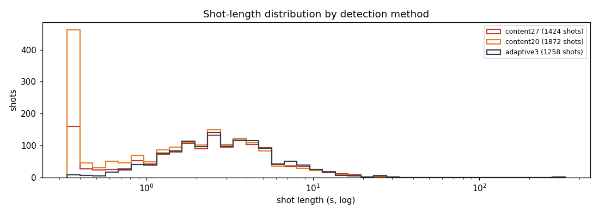

*1,276 shots. Median 2.67 s, longest 23.2 s.*

### The hidden trap: 1.3 seconds of missing picture

Thumbnails and cut lists disagreed by **exactly 31 frames** after 6:58. The cause was a damaged stretch of the rip: about 1.3 s of picture simply isn't in the file. Tools that **count** frames drift by 31 from that point on. Tools that use **timestamps** stay correct.

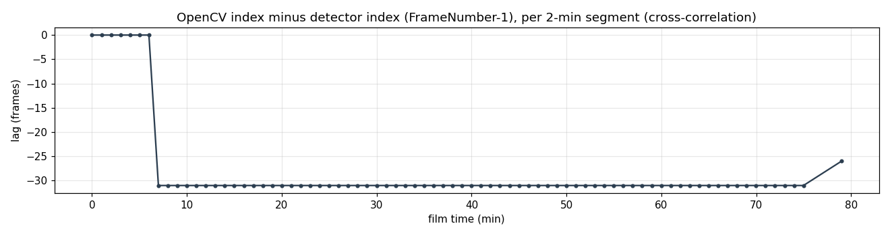

*The difference between counted and timestamp frame numbers, per 2-minute stretch of film: 0 until about 7 minutes, then a constant −31 to the end of the film. The last point is the credits, which have few distinct frames to match on.*

**The rule that came out of it:** a frame's identity is its **ffmpeg timestamp**. Every frame is read through `tools/frameio.py`, which never decodes through the damaged span: it stops there and restarts at the next keyframe. Without this, every mask after 7 minutes would be paired with the wrong source frame.

### Finding the dissolves

Hard cuts are easy to detect. Dissolves in hand-drawn animation are harder, because **both layers keep moving while they fade**. A two-stage detector tests whether each frame lies on the straight path between the frames before and after the transition. A slow camera pan doesn't; a real dissolve does.

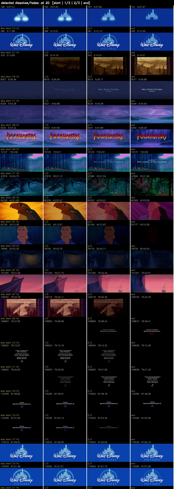

<details><summary>▸ Technical detail: detectors, numbers, deliverable</summary>

- PySceneDetect 0.7.1. **One** decode pass writes every per-frame metric to `shots/stats.csv`, so each threshold experiment afterwards takes seconds.
- Hard cuts: `AdaptiveDetector` defaults (`adaptive3`). It misses about 1.4% of cuts (between similar-coloured shots) and makes about 31 false cuts (dialogue close-ups).
- Damaged span: film frames **10040–10086** (`shots/damaged_spans.csv`), widened to the next keyframe at 420.712 s.
- Dissolves: global blend ≥ 0.6, **or** ≥ 0.3 with endpoint difference ≥ 14. **79% precision** in the story section. Recall is incomplete (soft dark dissolves).
- Deliverable: `shots/shots_v1.csv`, which has 1 logo, **1,276 shots**, 31 flagged transitions and the credits. The build asserts that every film frame belongs to exactly one segment.
- Full record: [01_shot_detection.md](01_shot_detection.md).
</details>

---

## 4. X01: SAM2 on the film's longest shot (night forest)

**The test:** segment 703. 556 frames (23.2 s), a **dark forest** behind dark hair, and John Smith beside her in near-black trousers. It is the hardest kind of shot for brightness, and the longest shot for memory.


### Problem 1: it doesn't fit in memory, so run it in chunks

556 frames at 1080p need about 14 GB of RAM and about 7 GB of VRAM. The shot runs as **4 chunks of about 140 frames**. Each chunk overlaps the last by one frame. That shared frame's mask is turned **automatically** into the next chunk's prompt points.


*A 12-frame checkpoint before committing to the full run. It looked fine, but by eye only. That was the mistake.*

### Problem 2: the mask drifted off the hair and onto the forest


*A small patch of dark forest in chunk 1 became the "fattest" part of the mask. The automatic prompt points go to the fattest part, so chunk 2 was seeded **on the forest**. By chunk 3 the mask was forest only.*


### The fixes

| Fix | Why |
|---|---|
| **Forest negatives** on the first frame | The wedge of forest between the hair and the frame corner was where the drift started |
| **Mask cleaning:** keep only pixels within 6 px of near-black (V < 25) | It's a cheap safety net: forest is blue, hair is black |
| **Seed points checked on the hair:** every positive must sit on V < 25 | Stops the "fattest region" trap |
| **Seam check images** before each new chunk | `--to-chunk K` stops so a human can look at the seam |
| **Corrective prompts always include background negatives** | Without them, a correction can flood the frame (same failure as shot 5) |
| **Compositing outside ComfyUI** | ComfyUI's composite step held every frame in RAM and crashed the machine |


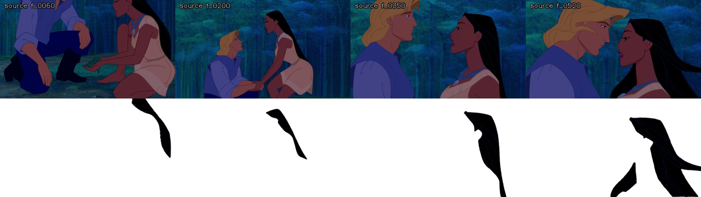

*v2 result. All four seams stay on the hair. The share of hair missed is 0.000 in the median frame.*

<details><summary>▸ Technical detail: purity, timings, seams</summary>

- `tools/run_long_shot.py <seg> [--from-chunk K] [--to-chunk K]`. It writes `shots/<seg>_chunks.json` after every chunk, so a crash can resume.
- Cleaning: an 8 px closing bridges the thin blue highlight lines, then dark components under 2% of the largest are dropped. Raw masks: `masks/seg0703_sam2_raw/`. Cleaned: `masks/seg0703_sam2/`.
- About 67 s per chunk (down from 126 s) once compositing moved out of ComfyUI.
- Seam images: `../checks/seam_seg0703_c1.jpg` … `c4.jpg`.
- **Lesson:** measure the dark-pixel **purity** of the first-frame mask. This one passed by eye at 0.56 purity.
- Full record: [X01_sam2_long_take.md](X01_sam2_long_take.md).
</details>

---

## 5. X02: SAM3 text prompt, with SAM2 as the safety net (segment 224)

**Idea:** [SAM3](https://ai.meta.com/sam3/) (*Segment Anything 3*) can find an object from a **text description**, so nobody has to place points. It's built into ComfyUI core (`SAM3_Detect`). Each frame is segmented **independently**, so an error on one frame **can't carry over** to the next, which was X01's failure mode.

**The test shot:** segment 224, 199 frames. It's **daylight**, with a bright waterfall behind the hair. The hair swings out wide, water splashes across the frame, and the dark canoe, paddle and Meeko's eye mask are all distractors.


### The wording of the prompt matters


*Bottom row, `"hair:1"`: SAM3 masks **her whole body**. Top row, `"long black hair:1"`: hair only, including the hair swinging out at f_0067. 97% of the masked pixels are near-black.*

### The pipeline

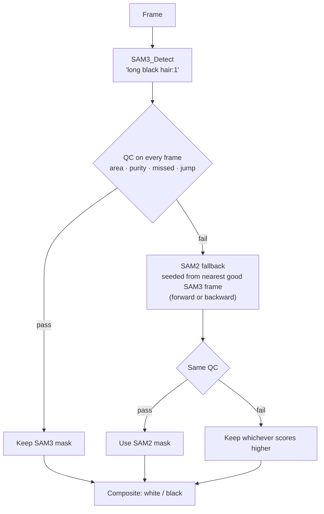

| QC test | Catches | Fails when |
|---|---|---|
| **Area** | Empty or tiny masks | < 2,000 px |
| **Purity** | Mask spilling onto background | < 85% of masked pixels are near-black (V < 40) |
| **Missed** | Hair left out of the mask | Unmasked dark blobs touching the mask > 10% of its area |
| **Jump** | Sudden changes in size | Area outside 0.6–1.6× its neighbours' median |

### Testing the safety net, and finding a hole in QC

SAM3 passed **all 199 frames** on its own. To exercise the fallback anyway, 14 frames were **forced** onto SAM2 (the first 3 and the splash, f_0105–0115). The first fallback dropped the hair that her arm cuts off from the rest, and **QC passed it**: purity can't detect a mask that's too *small*. Adding the **missed** test and seeding SAM2 with one point **per separate piece** of hair fixed both problems.


### Final masks

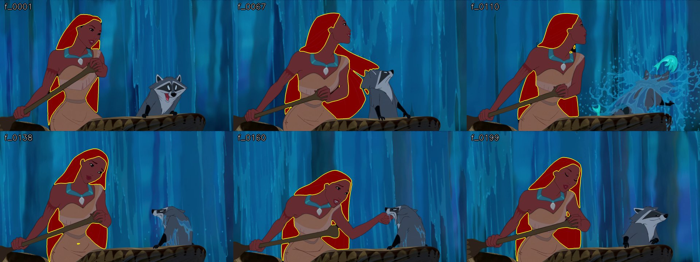

*Final masks (red, yellow edge) on 6 frames across the shot. Hair only: not the skin, paddle, canoe, Meeko or the splash.*


*185 frames from SAM3 and 14 from SAM2. Every frame passes QC: purity ≥ 0.938, missed ≤ 0.012.*

<details><summary>▸ Technical detail: models, commands, cost</summary>

- Model: `sam3.1_multiplex_fp16.safetensors` (1.75 GB, [Comfy-Org/sam3.1](https://huggingface.co/Comfy-Org/sam3.1)), loaded with `CheckpointLoaderSimple`. Nodes: `comfy_extras/nodes_sam3.py`. Base template: `utility_video_segment_sam3`.
- Run: `python tools/run_sam3_shot.py seg0224 --prompt "long black hair:1" --force-fallback 1,2,3,105..115`
- Post-process (same as the SAM2 graph): GrowMask 1, then blur 5 / σ 2.
- Threshold calibration: hair V has median 9 and 99th percentile 37. V < 25 covers 96% of hair and 2.3% of background.
- Fallback 1 (f_0001–0003) ran **backward** from f_0004, using hard-linked reversed frames. Fallback 2 ran **forward** from f_0104. Agreement with SAM3: IoU 0.93 / 0.96.
- Speed: SAM3 about **1.8 s per frame**, SAM2 about 0.5 s per frame. The whole film is feasible overnight in batches.
- Outputs: `out/seg0224_sam3.mp4`, `out/seg0224_sam3_black.mp4`, `masks/seg0224_sam3/`, `shots/seg0224_sam3.json` (per-frame source and QC scores).
- Full record: [X02_sam3_main_sam2_fallback.md](X02_sam3_main_sam2_fallback.md).
</details>

---

## What carries forward

1. **Segment by meaning, not brightness.** Thresholding can't tell hair from shadow.
2. **Text prompt first, points as backup.** SAM3 with `"long black hair"` needs no clicks and can't drift. SAM2 covers its failures.
3. **QC every frame, both ways.** Check for **extra** pixels (purity) *and* **missing** hair (missed).
4. **Brightness is still useful, as a check.** Near-black purity checks and cleaning caught every drift.
5. **Timestamps define frames.** Read everything through `tools/frameio.py`. Never run a mask across a cut or dissolve.
6. **Look at the frames.** Every failure here was found on contact sheets and overlays, not by watching the video at speed.

**Not tested yet:** a frame SAM3 genuinely fails on its own, a shot where another character has dark hair (Nakoma, Powhatan), and X01's night shot run through the SAM3 pipeline.

## References

- Meta AI, *SAM 2: Segment Anything in Images and Videos*: [github.com/facebookresearch/sam2](https://github.com/facebookresearch/sam2)
- Meta AI, *SAM 3: Segment Anything with Concepts*: [ai.meta.com/sam3](https://ai.meta.com/sam3/)
- kijai, ComfyUI SAM2 nodes: [github.com/kijai/ComfyUI-segment-anything-2](https://github.com/kijai/ComfyUI-segment-anything-2)
- ComfyUI: [github.com/comfyanonymous/ComfyUI](https://github.com/comfyanonymous/ComfyUI). VideoHelperSuite: [github.com/Kosinkadink/ComfyUI-VideoHelperSuite](https://github.com/Kosinkadink/ComfyUI-VideoHelperSuite)
- PySceneDetect: [scenedetect.com](https://www.scenedetect.com/)
- Project docs: [README](README.md) · [01 Shot detection](01_shot_detection.md) · [X01](X01_sam2_long_take.md) · [X02](X02_sam3_main_sam2_fallback.md) · [SAM2 trailer results](../SAM2_RESULTS_2026-09-30.md) · Test 1: `../../Test 1/Quantum Erasure/TEST1_README.md`
