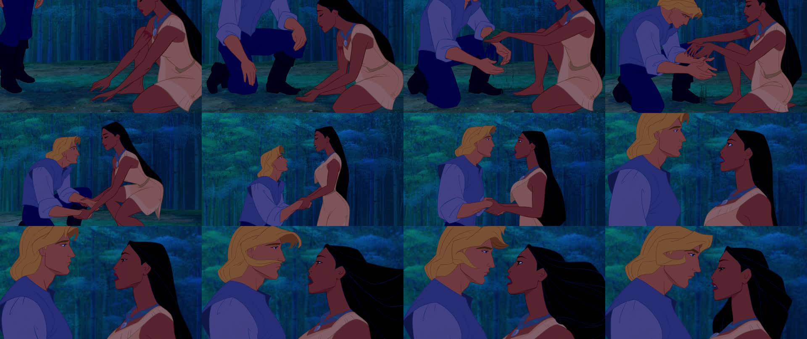
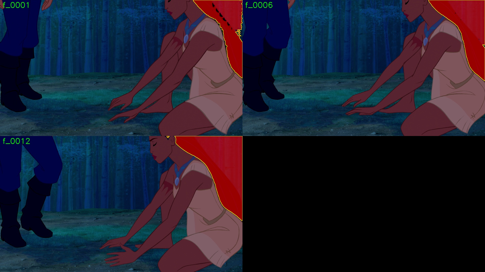
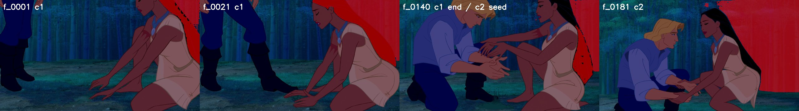
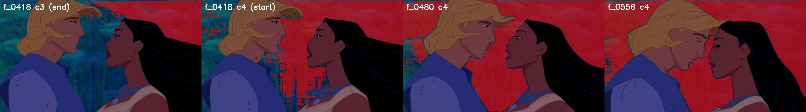
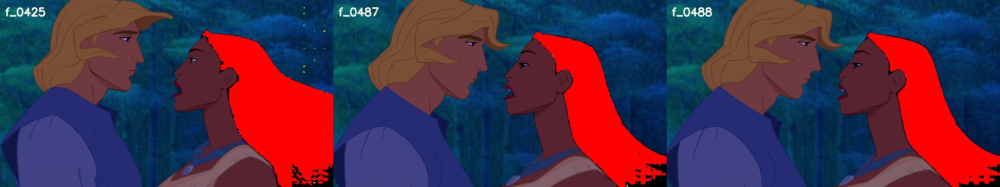
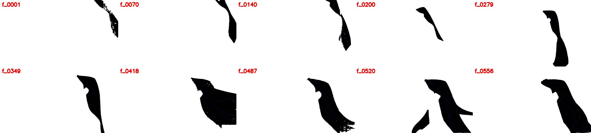

# X01 — SAM2 test on the film's longest shot (segment 703)

**Status:** done 2026-10-01 (v2 run, step 4). Started 2026-10-01
**Goal:** run one long shot from the full film (not the trailer) through the ComfyUI SAM2 workflow, and find out what breaks at real-film scale before phase 02/03 commit to a pipeline.

"X" docs are side experiments; they don't replace a numbered phase.

## Why this shot

| | |
|---|---|
| Segment | **703** in `shots/shots_v1.csv` |
| Film frames | 60702–61257 (**556 frames, 23.2 s**), starting at 42:12 |
| Content | Two characters at night in the forest, kneeling and then standing face to face. Judged a **genuine long take** in phase 01 QC (step 8e); the one dissolve detection inside it (60803) was checked and is false (step 10d) |
| Why it's a good test | The longest shot in the film. **Dark background** (bucket B, the waterfall-type problem). A second character with dark hair is right next to her |

## Step 1 — Frame extraction

`tools/extract_segment.py <video> 703` (new; goes through `tools/frameio.py`, so it uses ffmpeg timestamps and is damaged-span aware):
- writes `frames/seg0703/f_0001.png … f_0556.png`, 1-based within the segment, matching Test 1's convention
- writes `frames/seg0703/frame_map.csv` (local frame number → film index)
- **no missing film indices** in 60702–61257
- 847 MB of PNGs

## Scale problem, before running anything

Trailer shots were 88 and 139 frames. At 556 frames, a single ComfyUI pass doesn't fit:

| Resource | Needed for 556 frames at 1080p | Available |
|---|---|---|
| RAM for frames in `VHS_LoadImagesPath` (float32) | ≈ 13.8 GB, before any composite batches | ≈ 17 GB free |
| VRAM for the SAM2 video state (frames resized to 1024², float32) | ≈ 7 GB, plus the model | ≈ 5.5 GB free |

**Plan: chunked propagation.**
- 4 chunks of about 140 frames (the size that ran cleanly on trailer shot 5), each overlapping the previous chunk by **1 frame**.
- **Chunk 1** is prompted by hand, from looking at the frame.
- **Chunks 2–4** are prompted **automatically** from the previous chunk's mask at the shared frame:
  - positives: points deep inside the mask (distance-transform maxima)
  - negatives: points just outside its edge
- The seams between chunks are where to look first in QC.

## Step 2 — Chunk-1 prompts and the first-frame checkpoint

**Shot overview** (every 46th frame):

- Her hair is visible throughout but changes shape a lot: a long dark sheet down her back at the right of frame becomes loose strands streaming out to the right as the camera pushes in.
- The other character's hair is blond, so the competition is the **dark blue-teal forest**, plus his very dark trousers early in the shot.

**Picking prompts on `f_0001`.** The first attempt was by eye on a 100 px grid. Checking pixel values showed **2 of the 4 positives were wrong**: (1750, 100) and (1700, 40) are dark *blue* (V 80 and 47), the forest showing between her face and hair. Hair here is pure black (BGR 0,0,0). The positives were then taken from the hair itself:
- the largest region with V < 20 to the right of x = 1500 (bbox 1612–1920 × 0–574, 28,855 px)
- the deepest interior point in each of four vertical bands (distance transform), keeping 20 px clear of the frame edge

| Prompt | Points (x, y) | Pixel check |
|---|---|---|
| Positive | (1660, 21), (1853, 318), (1899, 413), (1899, 480) | all V = 0 |
| Negative | face (1400, 60), dress (1650, 350), forest (1000, 300), arm (1400, 450), **the other character's trousers (150, 700)** | V 88, 88, 61, 88, **13** |

The trousers are as dark as hair (V 13), so that negative matters most.

**Checkpoint: the first 12 frames only, before any long propagation.** Same workflow, `cap=12`, white fill:

- The mask covers the hair sheet and follows the dress edge cleanly.
- Face, arm, forest and trousers are all excluded.
- `f_0001` has a few pinholes along the top edge, where thin hair meets blue background. They're gone by `f_0006`.
- **Passed.** The full chunked run follows.

## Step 3 — Full chunked run (crashed, resumed, then failed QC)

**Crash and resume.** The first run (2026-10-01 00:44) finished chunks 1–2. The machine crashed during chunk 3, after ComfyUI had saved its 140 masks but while it was still compositing, so nothing from chunk 3 was copied into the project. `tools/run_long_shot.py` now has:
- `--from-chunk K`, which skips the chunks before K and seeds chunk K from the mask already on disk at its first frame
- `shots/<seg>_chunks.json`, written after **every** chunk (it used to be written only at the very end)

Resumed with `--from-chunk 3`. Chunk 3: 140/140 frames in 126 s. Chunk 4: 139/139 frames in 126 s. The output is `out/seg0703_sam2[_black].mp4`, with all 556 masks present.

**QC: the masks drift off the hair and onto the forest, starting in chunk 2.**

| Frames | What the mask covers |
|---|---|
| c1, f_0001–f_0140 | Mostly hair. A patch of dark forest at the top right comes and goes (f_0011–0031, f_0061), and it is present at f_0140 |
| c2, f_0141 onward | The forest patch grows and the hair drops out. By **f_0181** none of the masked pixels are dark (V < 25) |
| c3, c4 | Forest only (median V of masked pixels 72–95). The hair is unmasked |

**Root cause: the automatic prompts in `derive_prompts`.** Positive points go at the distance-transform maxima of the previous chunk's mask. Those land in the mask's *fattest* region, which at f_0140 was the forest patch, not the thin hair. Nothing checks that a positive point sits on a hair-dark pixel, although the negatives already filter on V > 40. Each chunk carries the previous chunk's error forward and makes it worse.

**Takeaways for phase 02/03:**
- Before a mask seeds the next chunk, it has to be cleaned: keep only V < 20 pixels and the largest dark component.
- Positive points have to be checked to sit on hair (V < 20).
- Check every seam visually before starting the next chunk; the area alone doesn't show the drift.

## Step 4 — Fixes and the v2 run (passed)

**What changed in `tools/run_long_shot.py`:**

| Fix | Detail |
|---|---|
| Chunk-1 forest negatives | Added (1800, 40) and (1845, 120), inside the forest wedge between the hair and the top-right corner. With these, the raw SAM2 masks are 92–100% hair from the first frame. **The step 2 checkpoint missed this wedge**, and it was the root of the whole drift |
| Mask cleaning | Cleaned mask = raw mask kept only within 6 px of its own near-black pixels (V < 25). Thin blue highlight lines are bridged first (8 px closing), so a V=0 hair piece cut off by a line isn't dropped (seen at f_0418), and dark components smaller than 2% of the largest are dropped. Raw masks go in `masks/seg0703_sam2_raw/`, cleaned ones in `masks/seg0703_sam2/` |
| Seed prompts | Derived from the **cleaned** mask. Every positive point is checked to sit on V < 25. Negatives go first on whatever the raw mask leaked onto, then on a ring around the hair |
| Masks only from ComfyUI | Composites are made locally from the cleaned masks. ComfyUI's compositing step held every 1080p frame in RAM and is where the first run crashed. Each chunk now takes about 67 s instead of about 126 s |
| Seam checks | `--to-chunk K` stops after chunk K. `checks/seam_seg0703_c<k>.jpg` shows the seed with its prompts, the middle frame and the end frame |
| Corrective prompts | `CORRECTIONS` table. Chunk 4, at f_0425 and f_0487: positives on hair at the bottom frame edge that SAM2 dropped, negatives on skin/dress **and forest**. Without the forest negatives, the f_0487 correction flooded that frame's raw mask across the whole forest (the same failure as the shot 5 f_0080 correction) |

**Run:** chunk by chunk, with each seam checked visually before the next one started. All four seams stayed on the hair.

| Chunk | Frames | Time | Cleaned / raw area (min, median) |
|---|---|---|---|
| c1 | f_0001–f_0140 | 70 s | 0.99, 1.00 |
| c2 | f_0140–f_0279 | 69 s | 1.00, 1.00 |
| c3 | f_0279–f_0418 | 66 s | 1.00, 1.00 |
| c4 | f_0418–f_0556 | 67 s | 0.98, 1.00 |

Cleaning now barely changes anything; it's a safety net, not a crutch.

**Missed-hair check.** This measures unmasked near-black (V < 10) regions of more than 500 px that touch the mask, as a share of the mask area.
- Before the corrections, 35 frames in chunk 4 were over 10%.
- After the corrections, 3 frames in the whole shot are over 10%: f_0001–0002 (the known first-frame pinholes) and f_0418 (the c3/c4 seam, before the f_0425 correction takes effect). The median is 0.000.

**Residuals:**
- f_0001 is speckled.
- The bottom few rows at the frame edge in about f_0420–0490 are ragged and speckled.
- Hair above her head is excluded where it touches the face outline.

**Outputs:**
- `out/seg0703_sam2.mp4` (white fill) and `out/seg0703_sam2_black.mp4`
- `out/seg0703_comp_{white,black}_sam2/`
- `shots/seg0703_chunks.json`

**Lessons for phase 02/03:**
1. Checking a checkpoint by eye isn't enough. Measure the dark-pixel purity of the mask on the very first frame; this one passed visually at 0.56.
2. Re-prompting from the previous chunk's mask only works if the seed is cleaned first.
3. Every corrective prompt needs negatives on the background too, or that conditioning frame can flood.
4. For dark-haired night shots, the V-based cleaning is cheap and catches drift automatically. For daylight shots, where hair has bright highlights, the thresholds need re-tuning.
