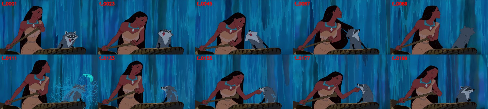
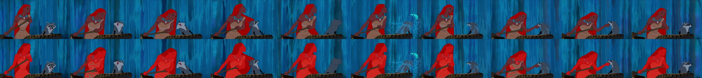
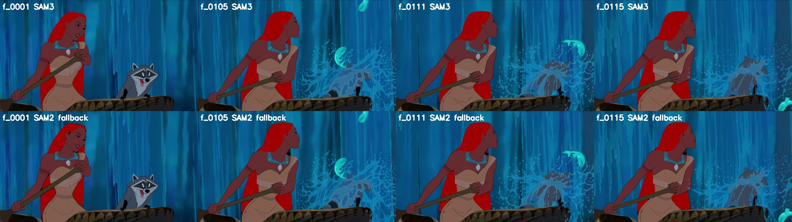
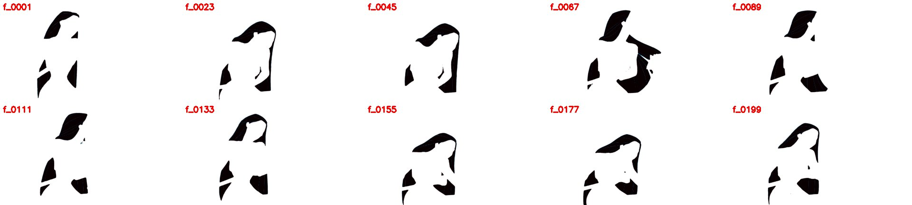

# X02 — SAM3 as the main segmenter, with SAM2 as fallback (segment 224)

**Status:** done 2026-10-01
**Goal:** test a SAM3-first pipeline on a different kind of shot from X01. SAM3 makes every mask from a text prompt; SAM2 takes over only on frames that fail QC.

This is a side experiment. It doesn't replace phase 03 (SAM3 text-prompt pilot vs SAM2 point prompts), but it gives that phase working tooling and first numbers.

## Why this shot

| | |
|---|---|
| Segment | **224** in `shots/shots_v1.csv` |
| Film frames | 19693–19891 (**199 frames, 8.3 s**) |
| Content | Pocahontas paddling a canoe in front of a waterfall, with Meeko |
| Contrast with X01 | **Daylight**, with a bright blue waterfall behind the hair, where X01 was night and dark forest. The hair **swings out** wide (f_0067). There's a **water splash** (f_0105–0115). Meeko has a black eye mask, and the canoe and paddle are dark |

How it was picked: the shot list was filtered to undamaged shots of 150–300 frames, then to middle frames with a bright background (median V > 110) and 3–30% near-black pixels. Extracted with `tools/extract_segment.py <mkv> 224`; 0 missing indices.

## Step 1 — Setting up SAM3

- ComfyUI core already has the SAM3 nodes (`SAM3_Detect`, `SAM3_VideoTrack`, `SAM3_TrackToMask`), defined in `comfy_extras/nodes_sam3.py`.
- The model is a normal checkpoint, loaded with `CheckpointLoaderSimple` (it outputs the model plus its own text encoder): **`sam3.1_multiplex_fp16.safetensors`**, 1.75 GB, from `huggingface.co/Comfy-Org/sam3.1`, saved to `ComfyUI-Shared/models/checkpoints/`.
- The official template `utility_video_segment_sam3` uses `CLIPTextEncode → SAM3_Detect` on every frame. The text supports `phrase:N`, which caps detections at N per phrase, with at most 32 tokens.

## Step 2 — Checkpoint: text prompts on 10 frames

`checks/sam3_ck.py seg0224 22 "long black hair:1" "hair:1"` (every 22nd frame, threshold 0.3):

- **"hair:1"** masks her **whole body**. Rejected.
- **"long black hair:1"** masks hair only, including the hair swinging out at f_0067. 97% of masked pixels have V < 40.

**Threshold calibration** on those masks:
- Hair V: median 9, 99th percentile 37.
- V < 25 covers 96% of the hair and 2.3% of the background. The X01 seed logic (`DARK_V` = 25) works here unchanged.
- QC purity uses V < 40, which covers 99.5% of the hair.

## Step 3 — Pipeline: `tools/run_sam3_shot.py`

1. **SAM3 (main):** `SAM3_Detect` with the text prompt on every frame, followed by the same GrowMask(1) + blur(5, σ 2) as the SAM2 graph. There's no memory between frames, so **an error can't carry over to the next frame**, which was X01's failure.
2. **QC on every frame.** A frame fails if:
   - area < 2000 px
   - **purity** < 0.85 (share of masked pixels with V < 40)
   - **missed** > 0.10 (unmasked near-black blobs over 500 px touching the mask, divided by mask area)
   - **jump**: area divided by the median of the 2 frames on each side is outside 0.6–1.6
3. **SAM2 (fallback):** each run of failed frames is re-segmented by SAM2, seeded from the nearest frame where SAM3 passed.
   - The seed prompts are X01's `derive_prompts`, **plus one positive per separate piece of the seed mask**.
   - SAM2 propagates forward from a good frame before the run, or backward (frames in reverse order, via hard links in a temporary folder) when the run starts the shot.
   - SAM2 frames are QC'd the same way. If both models fail a frame, the mask with the higher purity minus missed is kept.
4. **`--force-fallback`** marks frames as failed even when SAM3 passed, to exercise the SAM2 path. A forced frame switches to SAM2 only if SAM2 passes QC and scores within 0.02 of SAM3.

## Step 4 — Run, and the first fallback gap

`python tools/run_sam3_shot.py seg0224 --prompt "long black hair:1" --force-fallback 1,2,3,105..115`

- **SAM3 passed QC on all 199 frames on its own.** Run time 356–364 s (about 1.8 s per frame; SAM2 runs about 0.5 s per frame).
- Fallback 1 (f_0001–0003) ran **backward** from f_0004. Fallback 2 (f_0105–0115) ran **forward** from f_0104. Each took 9 s.
- SAM3's lowest frame-to-frame IoU (0.61, at f_0138/0139) is **real motion**: the animation is on twos and the drawing changes there. Area (about 100k px) and purity stay flat.

**The first version of the fallback dropped hair, and QC passed it anyway.**
- On f_0105–0115, SAM2 missed the hair that her arm cuts off from the rest (IoU with SAM3 was 0.75).
- QC still passed it, because purity and area can't detect a mask that's too small.
- The **missed** measure separates the two cleanly: SAM3 is ≤ 0.005 on every frame, while that SAM2 run was 0.07–0.27.
- Fix: add *missed* to QC, and seed SAM2 with one positive per separate piece of the mask. Rerun:

| | SAM2 vs SAM3 IoU | SAM2 missed | Used |
|---|---|---|---|
| f_0001–0003 (backward) | 0.93 | ≤ 0.008 | SAM2 |
| f_0105–0115 (forward) | 0.96 | ≤ 0.012 | SAM2 |

## Result

- **Final:** 185 frames from SAM3 and 14 from SAM2 (all 14 forced). No frame fails QC. Purity ≥ 0.938 and missed ≤ 0.012 on every frame.
- **Outputs:** `out/seg0224_sam3.mp4`, `out/seg0224_sam3_black.mp4`, `masks/seg0224_sam3/` (final), `masks/seg0224_sam3_only/` (SAM3 before fallback), and `shots/seg0224_sam3.json` (per-frame source, area, purity and missed, plus the fallback decisions).

## Lessons for phase 03

1. **SAM3 with a text prompt beats point-prompted SAM2 on this shot.** It needs no hand-picked points, never drifts, and passed QC on every frame. The prompt wording matters: "hair" means the whole person, while "long black hair" means just the hair.
2. **QC must check missing hair, not just extra hair.** Purity alone let a fallback through that dropped about 25% of the hair.
3. **SAM2 seeds must cover every separate piece of the hair** (hair split by an arm or a paddle), or SAM2 tracks only the pieces it was given.
4. **Cost:** SAM3 is about 3.5× slower per frame than SAM2. About 1,276 shots at roughly 1.8 s per frame is still feasible overnight, in batches.
5. **Not tested yet:**
   - SAM3 genuinely failing a frame, since every fallback here was forced
   - `SAM3_VideoTrack` (tracking with memory) as an alternative to per-frame detection
   - shots where another character has dark hair
   - X01's night shot through this pipeline
