# 03 — Full-film run: Pocahontas's hair only, white fill

**Status:** in progress (started 2026-10-21)
**Goal:** run every segment of `shots/shots_v1.csv` through the hair-masking pipeline, keep **only Pocahontas's hair**, fill everything else with **white**, and combine the segments into the final film with the **original soundtrack**.

- Main model: **SAM3** (text prompts, per frame).
- Fallback: **SAM2** video propagation, seeded from the nearest frame that passes QC (docs/X02).

This README is the process log and the issue list for the run. It's updated after every step. Images are in `film/img/`.

## Layout

| Path | What |
|---|---|
| `film/segments/segNNNN/` | One folder per segment: `segNNNN.mp4` (white fill, 23.976 fps), `masks/` (final alpha masks), `qc.json` (per-frame source / area / purity / missed / identity), `sheet.jpg` (QC contact sheet), `README.md` (status and issues for that segment) |
| `film/segments/STATUS.csv` | One row per segment: status, frames, SAM3/SAM2/empty counts, frames still failing QC, seconds |
| `film/img/` | Images for this README |
| `film/probe/` | 3 probe frames per segment, used for triage |
| `film/final/` | The combined film |

## Decisions (asked 2026-10-21)

| Question | Answer |
|---|---|
| Whose hair | **Pocahontas only**. Other dark-haired characters (Nakoma, Powhatan, Kocoum, villagers) must be erased |
| Fill | **White only** |
| Audio | **Original soundtrack** (BDrip English track) |
| Logo / credits / transitions | **Credits (seg 1309) kept as-is**, unerased. The logo and the 31 transitions go through the pipeline like any shot |

## Step 1 — Fixing frame extraction speed

The first probe grab ran at **7 fps**, which would have been about 4.5 h for the probes and about 4.5 h more for the film's frames.

- ffmpeg alone decodes this file at about 500 fps, and still about 250 fps when piping raw BGR.
- The cause was `bufsize=10**8` on the `Popen` in `tools/frameio.py`. With it, Python's `stdout.read()` of a 6 MB frame took about 90 ms. With the default buffer it takes about 7 ms.

| `frameio.iter_frames`, 240 frames at 1080p | Before | After |
|---|---|---|
| Time | 22.2 s (11 fps) | 1.7 s (**144 fps**) |

Frame identity isn't affected: only the buffer size changed, and the pts logic is untouched.

## Step 2 — Telling Pocahontas apart: identity prompt test 1

SAM3 can't name characters. Picking her out needs a prompt that marks *her*, intersected with the hair mask.

`python checks/sam3_prompts.py film/idtest/a film/idtest/a_sheet.jpg "Pocahontas:1" "long black hair:4" "Native American woman:1"`

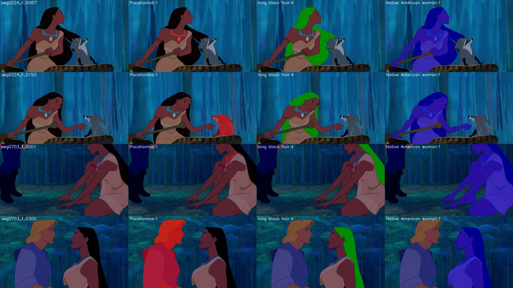

- **"Pocahontas:1"** doesn't work. SAM3 doesn't know the name and marks the necklace, Meeko, or John Smith instead.
- **"long black hair:4"** is the X02 hair prompt with up to 4 instances. It's clean here.
- **"Native American woman:1"** marks her whole body, hair included, on all 4 frames, including the night shot with John Smith.
- The open question is what it does when Nakoma or other Native women are in the shot. That needs frames from across the film (step 3).

## Step 2b — SAM3 cost per frame

`checks/sam3_bench.py seg0224 30` on the RTX 3080 Laptop (16 GB). Times include loading the PNGs.

| Prompts | refine_iterations | s / frame |
|---|---|---|
| hair:4 + woman:1 | 2 | 2.42 |
| hair:4 + woman:1 | 1 | 1.90 |
| hair:4 + woman:1 | 0 | 1.10 |
| hair:4 | 2 | 1.20 |
| hair:4 | 1 | 0.90 |
| woman:1 | 0 | 0.60 |

**Why it's slow** (`comfy_extras/nodes_sam3.py`): `SAM3_Detect` runs the full vision backbone once per prompt. Each refine pass then runs the backbone *again* on a crop around each detected instance.

**Choice:** hair at **refine 1**, woman at **refine 0**, about **1.5 s per frame**.
- Hair masks from refine 1 vs refine 2 on 30 frames: **IoU min 0.997**, median 0.998. The second pass buys nothing.
- The woman mask is only used to pick which hair is hers, so the coarse detector mask is enough.
- About 108,700 frames (credits excluded) × 1.5 s ≈ **45 h** if every segment ran SAM3. Triage (step 3) skips segments where she's absent.
- Not done: a custom node that shares one backbone pass between both prompts could save about 0.5 s per frame. It was skipped to avoid installing custom code and restarting ComfyUI during a multi-day run.

## Step 3 — Triage on probe frames: threshold 0.3 lets in everyone

**Probes:** 3 frames per segment (at 1/6, 1/2 and 5/6 of its length), 3,923 frames in all, grabbed at full resolution with `tools/grab_frames.py` into `film/probe/full/`. The list is `film/probe/probe_frames.txt`.

**First pass:** union masks at threshold 0.3 (`tools/probe_sam3.py` v1; its output was moved to `film/probe/_old/`).

The London opening, where Pocahontas never appears, already shows the problem. Hair is green, "Native American woman:1" is outlined in red, and ":4" in blue:

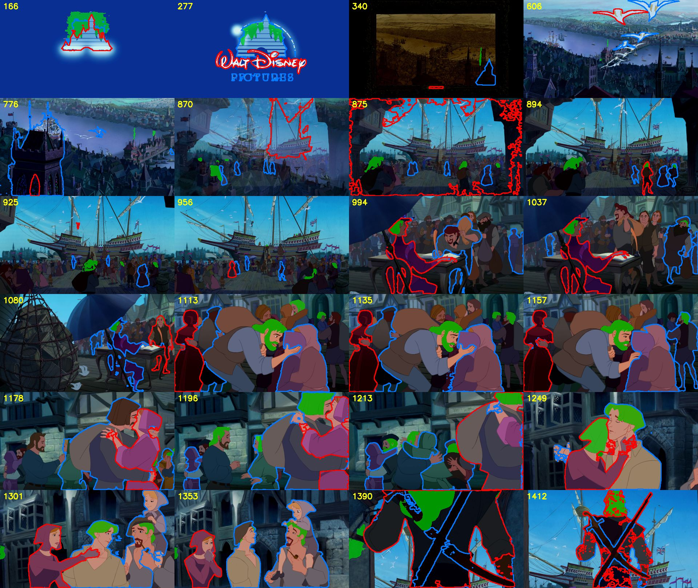

- At 0.3, **"long black hair"** fires on any hair: brown hair, beards, hoods, even the Disney castle's turrets.
- **"Native American woman"** fires on English women, on men, and on the whole frame.
- The planned rule ("keep hair near the woman mask") would have kept John Smith's hair at film frame 1249.

**Scores** (via a `PreviewAny` node on `SAM3_Detect`'s `BOUNDING_BOX` output, threshold 0.1, `film/idtest/b_out.json`):

| Frame | Best hair score | Best woman score |
|---|---|---|
| Pocahontas: seg0224 f67, f150; seg0703 f1, f300 | **0.95–0.97** | 0.88–0.94 |
| London: film frames 994, 1113, 1249, 1301 | **≤ 0.84** | ≤ 0.82 |
| John Smith, seg0703 f300 | — | **0.85** (as "woman") |

- The **hair score** separates her from these characters by a wide margin. The woman score barely does: John Smith scores 0.85.
- Next: rerun triage **per instance** (`tools/probe_sam3.py` v2: scores, boxes, area and dark share per instance) and look at how Nakoma and the village women score.

## Step 4 — Per-instance scores: the hair score can't tell her from other villagers

Per-instance triage (`tools/probe_sam3.py` v2): each hair instance outlined and labelled *score / dark share*.

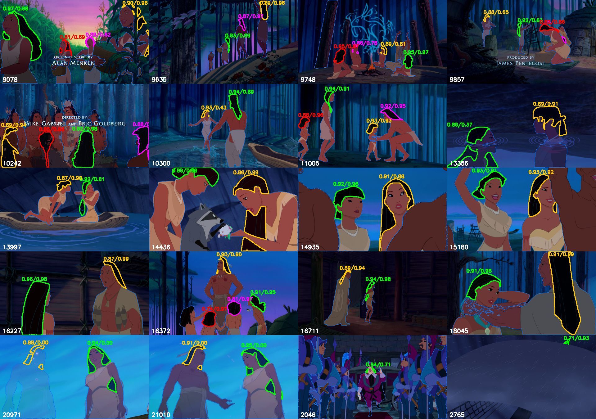

- In the village, **Nakoma scores 0.92–0.96, Powhatan 0.87–0.96, and other villagers about 0.9**, the same range as Pocahontas. The hair score means "long black hair", not "her".
- **20971 / 21010** (the blue-tinted spirit scene): her hair has a dark share of **0.00**. V-based QC (purity, missed) can't work in tinted scenes. Step 6 handles them.
- At refine 0, instance masks are rough: they cover heads and shoulders. That's fine for identity work only.

**Zero-shot CLIP ViT-L/14** (`tools/clip_id.py`, run in ComfyUI's venv, which has CUDA torch and transformers): crops around each hair instance scored against "Pocahontas from the Disney movie" vs Nakoma / old woman / man / Powhatan / child / John Smith / settler. Green means P(Pocahontas) > 0.5:

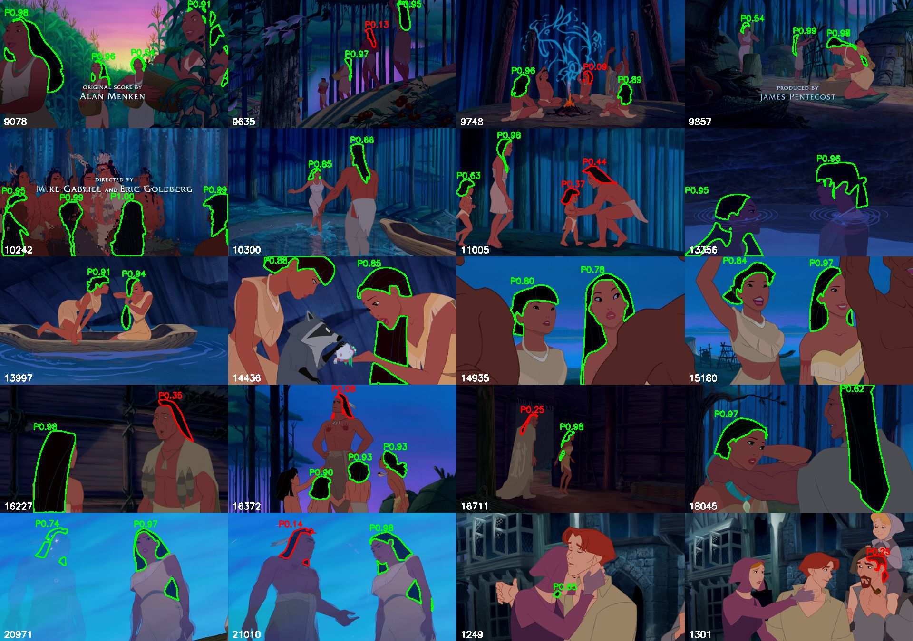

- CLIP labels almost every Native woman and child as Pocahontas. In 14935 it ranks Nakoma (0.80) above Pocahontas (0.78). It only rejects men, Powhatan and English settlers reliably.
- **Next:** a few-shot classifier on CLIP image embeddings, trained on hand-labelled hair-instance crops from the probes.

## Step 5 — Identity classifier: CLIP embeddings + hand labels

**Labelling.** `tools/id_crops.py` assigns every probe hair instance with SAM3 score ≥ 0.6 and area ≥ 4000 px a stable id, in shuffled order (`film/id/instances.csv`). It tiles square crops 8 × 5 per sheet, using the same crop the classifier embeds. Each sheet was labelled by eye with `checks/add_labels.py <sheet> "<her ids>" "<unsure ids>"` into `film/id/labels.csv` (1 = her, 0 = not her, −1 = unsure, which is left out of training).

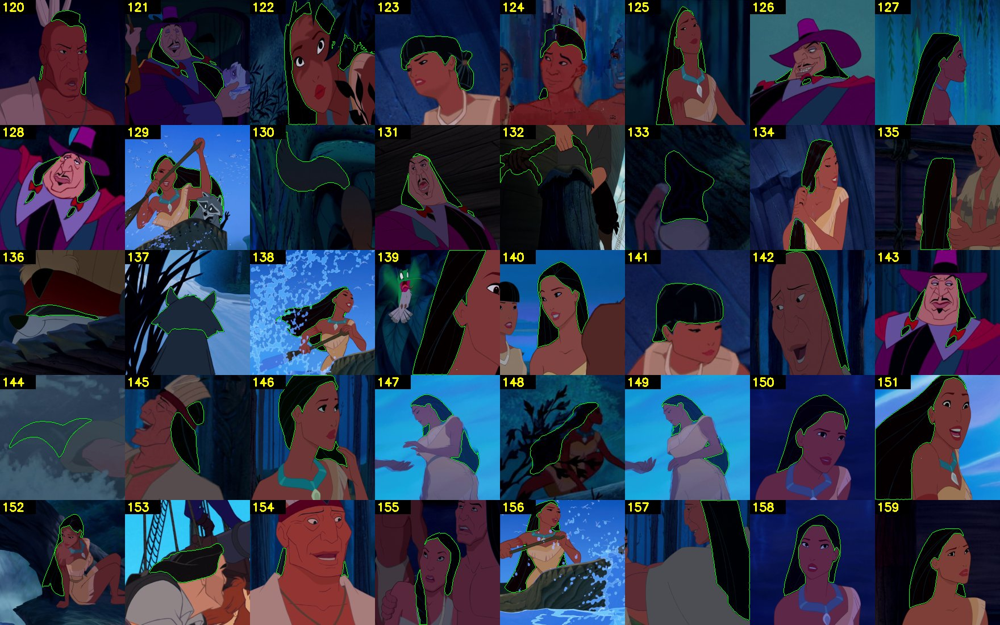

Cues for telling her apart:
- **Pocahontas:** middle part, no bangs, very long loose hair, turquoise necklace.
- **Nakoma:** bangs, white bead necklace.
- **Village women:** shoulder-length hair, often a bone necklace.
- **Powhatan / Kocoum:** men, with feathers and grey streaks.

A trap: in the blue-lit scenes her tan dress looks **white**. Instance 312 shows her face in that light, and the four earlier "white dress" crops were relabelled as her.

**Model** (`tools/id_model.py`): CLIP ViT-L/14 image embedding of the crop (`tools/id_embed.py` → `film/id/emb.npy`), then L2-regularised, class-balanced logistic regression in numpy.
- **10-fold CV on 482 labels: accuracy 0.990, precision 0.987, recall 0.980.**
- The 5 errors are hard cases: an upside-down dive, an arm next to Meeko, and a pink-tinted figure.

**Pipeline change** (`tools/run_film.py`):
- SAM3 runs one prompt, `"long black hair:5"`, at threshold 0.4 (her hair scores ≥ 0.63 on the probes), refine 1, with individual masks. Scores and boxes come back through `PreviewAny`.
- Each instance gets P(her) from the classifier. The CLIP server runs as a subprocess in ComfyUI's venv.
- Instances are linked across frames by IoU (≥ 0.3) into **tracks**. A track is kept if its area-weighted mean P ≥ 0.5. Fragments touching her hair are also kept if P ≥ 0.2.
- `missed` ignores dark pixels belonging to rejected instances, since another character's hair touching hers is not hair she's missing.
- The segment is checked first on every 6th frame. If no instance there reaches P ≥ 0.5, the segment is **absent**: all white, with no full SAM3 pass.

## Step 6 — First test run on 5 segments (run while triage still held the GPU, so timings are inflated)

| Seg | Content | Result |
|---|---|---|
| 9 | London crowd | **absent**, correct (best P 0.41), 120 s |
| 168 | Nakoma + Pocahontas at the shore | Nakoma's hair erased on all 127 frames (track P 0.28), hers kept (track P 0.88) |
| 171 | the same pair, Nakoma waving | identity correct, **but 50 frames were replaced by SAM2 masks that dropped hair** |
| 186 | Kocoum with children; a village woman at right | **wrong**: the village woman's tracks score 0.37–0.81, so she's kept on some frames |
| 240 | "Just Around the Riverbend": her reflection in blue light | identity correct (both her reflection and her close-up, P ≈ 0.99), **but all 78 frames failed QC** because tinted hair has purity 0 |

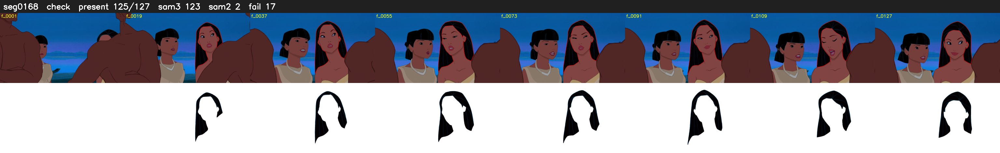

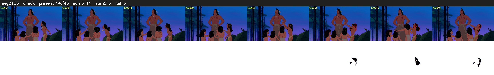
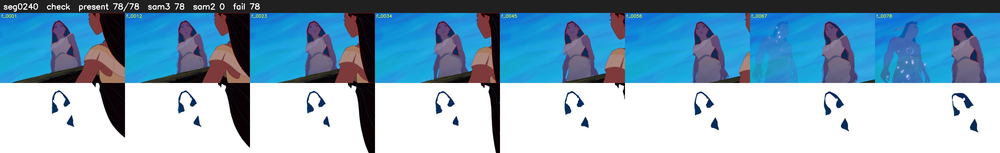

The woman at right in seg 186 (film frame 16372) is a villager with shoulder-length hair and a bone necklace:

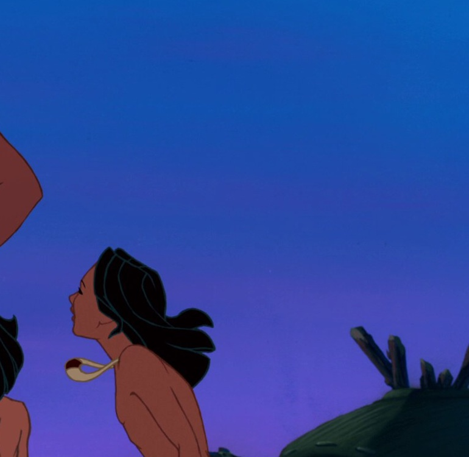

**Fixes:**
1. **Purity threshold 0.85 → 0.75.** Her daylight hair has blue highlight lines: purity was 0.79–0.85 on correct masks in seg 168 and 171, which triggered needless fallbacks.
2. **Fallback guard.** SAM2 can no longer replace a non-empty SAM3 mask with one under 85% of its area, unless SAM3 failed on an area jump. A smaller mask scores as "purer", which is how seg 171 lost hair.
3. **Tinted frames are judged per frame.** Purity < 0.5 means the hair itself isn't dark, so only the area checks apply. A spill onto background still contains her dark hair, so it keeps a purity of 0.5 or more.
4. **More labels for the classifier**, chosen by active learning from the instances it is unsure about (step 7).

## Step 7 — Active learning, a labelling bug, and test run 2

**Active learning.** All 3,133 probe instances were embedded. The 171 unlabelled ones the model was least sure about (P 0.15–0.9) were labelled on 5 sheets (`film/id/sheets/al1_*.jpg`). Many were Pocahontas in red, pink or purple song lighting, in close-ups, and in her dive.

**Bug:** `checks/add_labels.py --ids` read its arguments one position off, so it saved each sheet's "her" list as *unsure* and labelled everything else 0. CV accuracy fell from 0.990 to 0.930, which is how it was caught. The argument slicing was fixed and the 5 sheets were re-recorded.

**Mislabel:** instance 30 (film frame 16372) was labelled as her on the very first sheet. It's the village woman from seg 186. Corrected.

**Classifier now:** 623 labels (261 positive). 10-fold CV: **accuracy 0.979, precision 0.970, recall 0.981**. This set is harder than step 5's because it includes the uncertain cases.

| Track threshold | Precision | Recall |
|---|---|---|
| 0.5 (used) | 0.973 | 0.977 |
| 0.65 | 0.980 | 0.950 |
| 0.75 | 0.984 | 0.927 |

**Triage estimate:** a segment counts as having her if any probe instance has P ≥ 0.5. That gives **364 of 1,308 segments, 38,484 of 108,727 frames (35%)**.

**Test run 2** (GPU to itself; `--redo`):

| Seg | Result | Time |
|---|---|---|
| 9 | absent (best P 0.13) | 59 s for 157 frames |
| 168 | ok except 1 dropout frame, filled by SAM2 | 284 s for 127 frames (2.2 s/frame) |
| 171 | **ok**: 78 SAM3 + 2 SAM2 frames, Nakoma erased | 194 s for 80 frames (2.4 s/frame) |
| 186 | the village woman is still kept on 8 frames (track P 0.72) → manual override | 174 s |
| 240 | correct; 7 "check" frames at the tint transition (purity 0.55–0.75), and the masks are right | 168 s |

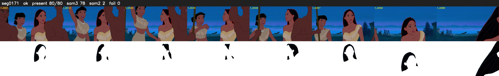

**Run estimate:** about 38.5k frames × 2.3 s plus about 940 absent segments × about 30 s ≈ **30–35 h**.

## Step 8 — Manual overrides and the full run

`film/overrides.json` holds per-segment corrections found by reviewing segment sheets:
- `{"absent": true}` erases the whole segment
- `{"drop": [track ids]}` erases specific hair tracks
- `{"keep": [...]}` keeps specific tracks

Track ids come from `qc.json` (`tracks`, `per_frame[].inst` = [track, SAM3 score, P, kept]). They're deterministic, so a segment can be rerun with `python tools/run_film.py --only N --redo`.

| Seg | Override | Why |
|---|---|---|
| 186 | absent | Only a village woman with shoulder-length hair (track P about 0.7); Pocahontas isn't in the shot |

**The full run started 2026-10-21 about 20:40:** `python tools/run_film.py >> film/segments/run.log`. Segments run in film order and the credits are skipped. Each finished segment writes its folder and a row in `film/segments/STATUS.csv`.

## Step 9 — Crash at segment 101 (2026-10-21 about 21:37)

The laptop shut down without warning during the full run. Windows logged Kernel-Power event 41 ("rebooted without cleanly shutting down"), which points to a power loss or a thermal shutdown, not a pipeline error.

- **Done:** segments 1–100 have `qc.json`, a valid segment folder and a `STATUS.csv` row. All are `absent` (London and the voyage, before Pocahontas appears). The earlier test segments 9, 168, 171, 186 and 240 are also complete.
- **Lost:** seg 101 stopped partway through frame extraction. Its half-filled `film/work/seg0101/` gets cleared by the runner on restart.
- **Safe to resume:** `qc.json` is written after the mp4 and sheet, so a segment cut off partway never counts as done.
- **Gap to fill later:** the test segments 9, 168, 171 and 240 have no rows in `STATUS.csv` (it was reset before the full run). This only affects the status table, not assembly.

**Resume:** start ComfyUI, then run `python tools/run_film.py >> film/segments/run.log` again. It skips every segment that has `qc.json`.

## Step 10 — Run stopped at seg 189: QC false alarms in night and dusk scenes

**Run state:** a restart from seg 165 was stopped by Claude Code when the laptop ran low on memory (it was not a crash). After a second restart, the run reached **seg 188** and was then stopped by hand to fix this issue. Seg 189's half-finished work folder gets redone on restart.

Out of 35 segments with her in them so far, **26 ended as `check`**. Checking the sheets shows two kinds of false alarm:

**1. `missed` in night interiors** (176, 178, 184, 187): the navy walls and sky fall below `DARK_V`, so the background blobs touching her hair count as "missed hair" (missed 0.5–2.2). It's not dark enough to trigger the `DARK_BG` 30% guard. The SAM3 masks are right, but the false fail sends the frames to the SAM2 fallback.
- **184:** SAM2 had no seed, so SAM3's correct masks were kept.

  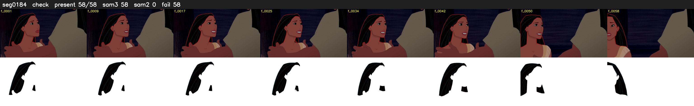
- **187:** 51 frames were replaced by SAM2, which **drifted onto the man's feathers and necklace** and dropped some of her hair. This is real damage.

  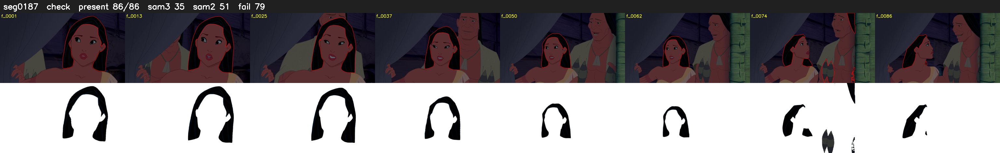

**2. `purity` in dusk and far shots** (112, 129, 130, 157, 165, 175): her hair is tinted or tiny, so purity falls between 0.5 and 0.75. That's above the 0.5 tinted cutoff but below `MIN_PURITY`. The masks are correct, and since no seed passes, nothing gets replaced.

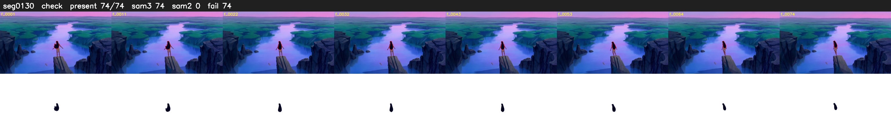

**Open:** a fix to `qc_fail` is needed, and the segments where SAM2 replaced frames after a false fail must be rerun (176, 178, 187, and possibly 137 and 172).

**Fix (2026-10-22), `scene_off()` in `tools/run_film.py`:** checks are now turned off for a **whole segment**, the same way tinted scenes already were.
- Median hair purity < 0.5 means **tinted**: purity and missed are both off, as before.
- Median hair purity < 0.75 means **dusk or a far shot**: purity is off.
- If ≥ 50% of the frames with hair fail `missed`, the segment is a **dark scene**: missed is off.
- Area checks (jump, gap) always stay on. The checks that were switched off go into `qc.json` as `qc_off`.

Replaying the new rule on the stored per-frame stats of the 24 `check` segments, the fail counts drop from 74 to 0 (seg 130), 94 to 1 (165), 58 to 0 (184), 88 to 4 (176) and 79 to 7 (187). Segments without a scene-wide pattern don't change (104, 125, 134, 157, 172). These are approximate, because the stored stats include the SAM2 frames.

**Rerun with `--redo`:** segs 112, 119, 129, 130, 137, 147, 148, 164, 165, 173, 175, 176, 178, 184 and 187, followed by the main run from seg 189. On a rerun `STATUS.csv` gets a new row appended, so **the last row for a segment is the current one**.

## Step 11 — Third low-memory stop, during the seg 165 rerun (2026-10-22 about 14:50)

Claude Code stopped the background job again because system RAM ran critically low. It happened while **seg 165 (220 frames)** was being rerun.

**Rerun results before the stop:**

| Seg | Before | After |
|---|---|---|
| 112, 129, 130, 147 | check | **ok** |
| 119 | 35 failing frames | 17 failing, still check |
| 137 | 60 failing frames | 36 failing, still check |
| 148, 164 | 4 failing | 4 failing, unchanged |

**Still to rerun:** 165, 173, 175, 176, 178, 184, 187. After those, the main run resumes from seg 189.

**Memory:** ComfyUI holds about 9 GB between jobs, and about 8.6 GB of the 31 GB stays free. A segment chunk of `CHUNK = 120` frames loads about 3 GB of float32 frames into ComfyUI. SAM3 then returns up to 5 instance masks per frame at full resolution. Long segments push the total past what's free.
- The low-memory stops happen on long segments: seg 165 and the 120-frame chunks. Processing also slowed to about 4.7 s per frame (2.3 s in test 2), which suggests the machine was swapping.
- **Proposed:** set `CHUNK` to 40. That cuts the per-submission peak by about two-thirds and costs a little extra per-call overhead.

**Applied (2026-10-22):** `CHUNK = 40`. The rerun of 165, 173, 175, 176, 178, 184 and 187 was restarted, and the main run follows it.

**Rerun results with CHUNK 40** (no memory stops; 2.6–4 s per frame):

| Seg | Failing frames before → after | Note |
|---|---|---|
| 165 | 94 → 1 | |
| 173 | 40 → 26 | to review |
| 175 | 28 → 4 | |
| 176 | 88 → **0, ok** | no SAM2 frames now (38 before) |
| 187 | 79 → 7 | no SAM2 frames now |

Seg 187's remaining fails (f71–77) are an **identity error**, not QC. Track 10 (P 0.81) is the man's feathers and necklace. Tracks 2, 5, 6 and 7 are slivers to the left of her head in f15–23. **Override added:** `"187": {"drop": [2, 5, 6, 7, 10]}`. The rerun of 187 is **pending**. It will run in a batch with the other review fixes, so it doesn't compete with the main run for RAM.

The main run resumed from seg 189 at 16:43.

## Step 12 — Fourth low-memory stop, at seg 486 (2026-10-23)

With `CHUNK = 40`, the run went from seg 189 to **seg 485** without a stop: about 300 segments and no errors. Claude Code then stopped the background job again for critically low system RAM, while seg 486 was running. Seg 486's work folder is redone on restart.
- **Done now:** 481 of 1,308 segments.
- After the stop, 13.9 GB is free and ComfyUI holds 3.8 GB. The stops come from short peaks. Claude Code's background-job guard stops the job at that moment, even though Windows would probably have swapped and kept going.
- **Recommended:** run it from your own terminal, which this guard doesn't watch, or start Claude Code with `CLAUDE_CODE_DISABLE_BG_SHELL_PRESSURE_REAP=1`.

Segs 484 and 485 (Pocahontas at night by the waterfall) are `check` with 48 and 44 failing frames, and SAM2 replaced 26 and 29 frames. Their sheets look correct, except that in 484 the hair behind her arm is partly missing. Both go on the review list.

## Step 13 — Fifth low-memory stop, at seg 844 (2026-10-23)

After the restart at seg 486, the run went to **seg 843** with no errors: about 360 segments in roughly 9.5 h. Claude Code then stopped it again for low system RAM while seg 844 was running.
- **Done:** 839 of 1,308 segments. 573 are absent, 166 ok and 100 check.
- No segment has failed twice, so `ERRORS.txt` doesn't exist.
- The stops come every 300–360 segments. The way around them is still to run outside Claude Code's background jobs (see step 12).

## Step 14 — Sixth low-memory stop, at seg 1007 (2026-10-23)

After the restart at seg 844, the run went to **seg 1006** with no errors: about 160 segments. Claude Code then stopped it again for low RAM while seg 1007 was running.
- **Done:** 1,002 of 1,308 segments. 681 are absent, 201 ok and 120 check.
- `ERRORS.txt` still doesn't exist.
- **Left:** 306 segments.

## Step 15 — Seg 1118 failed twice: SaveImage on an empty SAM3 batch (2026-10-23)

`seg1118 attempt 1/2 FAILED: ... "node_id": "sh", "node_type": "SaveImage" ... IndexError: index 0 is out of bounds for dimension 0 with size 0`.

- **Cause:** SAM3 found **no hair instance in any frame of a submission**. `SAM3_Detect` returns an empty mask batch, and `SaveImage` crashes on it. With `CHUNK = 120` this almost never happened. The 40-frame chunks introduced in step 11 make an all-empty submission more likely. It's the only such error in the run's first 1,117 segments.
- The runner logged `seg1118: failed twice` in `ERRORS.txt` and moved on.
- **Fix:** in `run_sam3()`, this specific ComfyUI error now returns "no instances" for every frame of the submission. The frame count comes from `work/f_*.png[skip::nth][:cap]`, the same order VHS loads in. Any other error is raised as before.
- The running process loaded the old code, so **seg 1118 is rerun with `--only 1118` after the main run.**

**Result:** after a restart with the fix, seg 1118 and seg 1120 (which had also failed on attempt 1) both finished as `absent` in 14–17 s. The `seg1118: failed twice` line in `ERRORS.txt` is out of date.

## Step 16 — Full run complete (2026-10-24)

**All 1,308 non-credit segments have `qc.json`**, from seg 1 through 1308. The credits (seg 1309) are kept as-is, as decided. Final restart: seg 1118 through 1308 with no errors and no memory stop.

**Seg 187 rerun with its drop override:** `ok`, 0 failing frames. The feathers and necklace are gone and only track 0 (her hair) is kept.

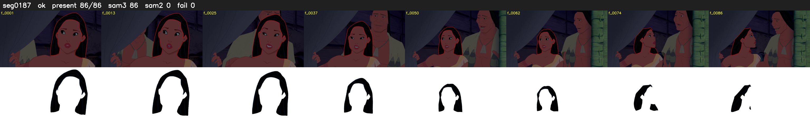

**Results** (last `STATUS.csv` row per segment; 1,304 rows, because test segments 9, 168, 171 and 240 have none):

| Status | Segments |
|---|---|
| absent (all white) | 877 |
| ok | 271 |
| check | 156, with about 2,070 failing frames in all |

Check segments with ≥ 20 failing frames, to review first:
- 134, 137, 157, 173, 232, 252, 253, 329
- 482, 484, 485, 486, 501, 511
- 670, 682, 685, 690, 691, 781
- **844 (93), 846 (87)**, 890, 924, 938, 956
- **1007 (172)**, 1234, 1250, **1292 (122)**, 1295

`ERRORS.txt` still contains `seg1118: failed twice`. That line is out of date, because 1118 was redone after the step 15 fix.

**Next:**
1. Review the check segments' sheets, worst first, and add overrides or reruns.
2. Assemble the film with `tools/assemble_film.py`.

## Step 17 — Review of the `check` segments, worst first (2026-10-24)

**Tool:** the QC `sheet.jpg` shows 8 evenly spaced frames, which often aren't the failing ones. `checks/fail_frames.py <seg> [--n 8] [--frames a,b]` reads the actual **failing** frames from the BDrip through `frameio`. Each tile shows the frame dimmed with the final mask in green, and a caption with the film frame, source (sam3/sam2/none), mask area and the failure reasons. Output goes to `film/img/03_review_segNNNN.jpg`.

Reviewed segments are listed in `film/reviewed.txt`.

### seg 844 — 93 failing frames: false alarm, accepted

Dusk outside the village: Pocahontas, Powhatan and Kocoum against dark tree trunks. **Every failure is `missed`** (0.11–4.36): the near-black trunks and night sky touch her hair. Only 48% of the frames fail, just under the 50% dark-scene cutoff from step 10, so the check stayed on.

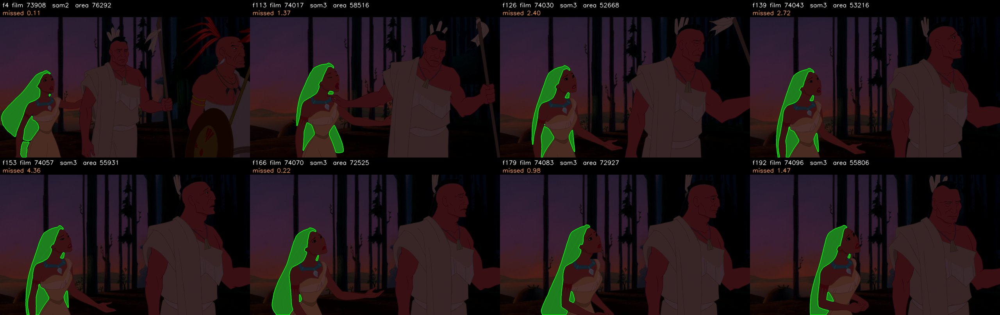

**Verdict:** the masks are right. Her hair is kept, and Powhatan's and Kocoum's hair are erased on all 192 frames. **No change.**

### seg 846 — 87 failing frames: false alarm, accepted

Close-up of her at night in front of the dark trunks. **Every failure is `missed`** (0.25–0.43). Only frames 108–195 fail, so again under 50% of the segment. The small blobs at her neck are strands of her own hair.

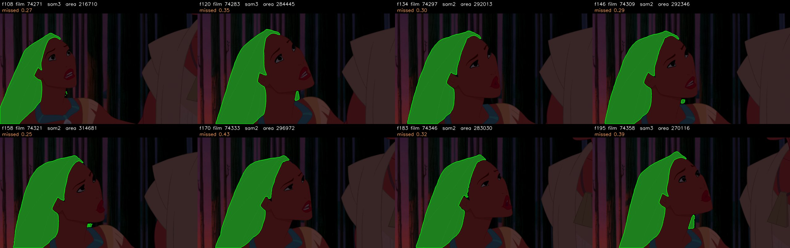

**Verdict:** the masks are right. **No change.**

### seg 1007 — 172 failing frames: SAM2 spill, rerun without SAM2

The night lake scene after Kocoum is shot, 492 frames. Every kept track has P ≥ 0.69, so identity isn't the problem.
- **The problem is the SAM2 fallback.** It replaced 100 frames (run 107–198 alone used 63), and its masks spill:
  - f201 covers a ring around her body (purity 0.50).
  - f390 covers **her whole silhouette** (purity 0.21).
- The SAM3 frames (f1, f54, f125, f303) look right. The blobs at her sides are her own hair hanging down.

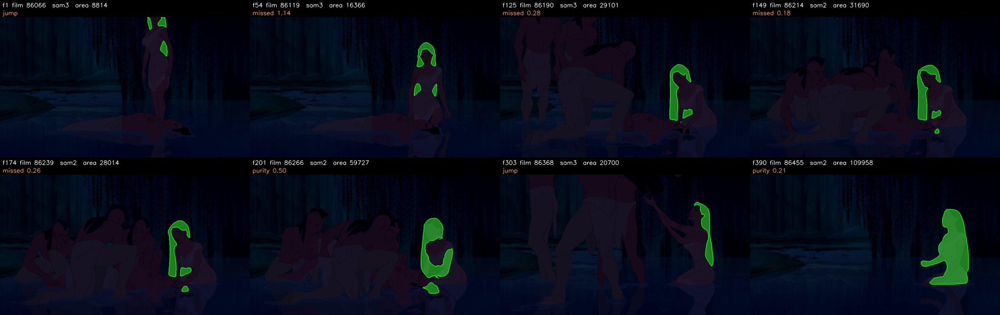

### seg 1292 — 122 failing frames: SAM2 spill and dropouts, rerun without SAM2

She runs through the night forest, 220 frames.
- **SAM2 frames spill onto tree trunks and grass.** f92's mask runs down the trunk next to her (area 58,948). f171 has a triangle on the left trunk and only part of her hair.
- **Dropouts:** at f69 and f151 the mask is empty while she's visible but small, dark and half behind a trunk.
- The SAM3 frames (f196) and the final close-ups are right.

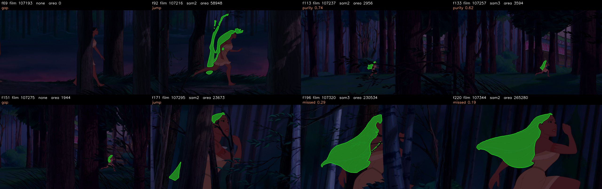

**New override, `"no_sam2": true`** (`tools/run_film.py`): it skips the SAM2 fallback for that segment and keeps SAM3's masks. Added for 1007 and 1292, which are being rerun with `--redo`.

### Results of the `no_sam2` reruns (same frames as before)

**seg 1007:** 100% SAM3. 167 frames still fail, but they're dark-scene `missed` and `jump` false alarms.
- The spills are gone. f201 and f390 are now hair only: area 26,485 instead of 59,727, and 24,850 instead of 109,958.
- f391–492 is a wide shot where she's under 2,000 px. Those frames count as "empty", but the tiny mask is still used.

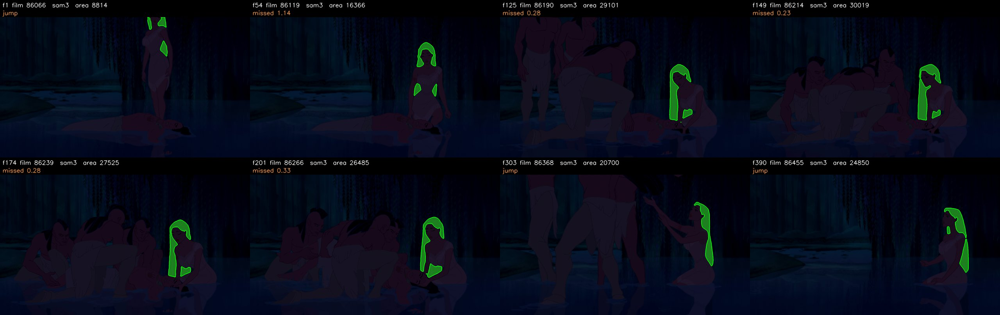

**seg 1292:** 100% SAM3. 134 frames still fail, mostly `missed` in the night forest.
- The trunk spills are gone. f92 is now her hair only (23,436 px instead of 58,948). f171 lost the triangle on the trunk.
- **Remaining, minor:** 23 scattered empty frames in f68–155, where she's small and half behind trunks. Her hair blinks out for a frame or two in a far shot. Left as is. A later temporal fill, copying the nearest mask across 1–2 frame gaps, could smooth it.

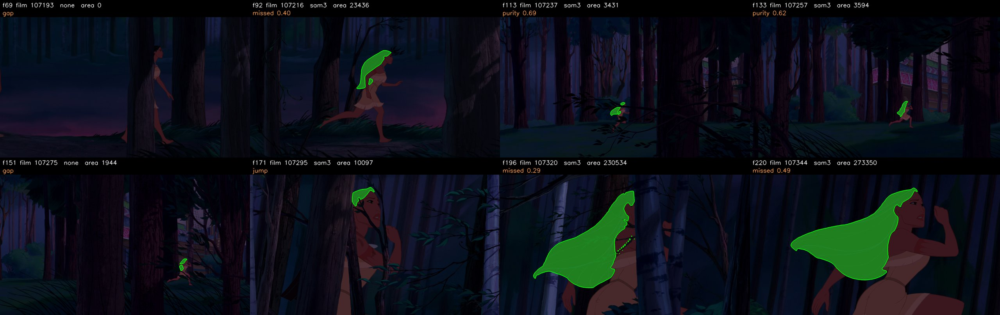

**Verdict:** both are accepted with the override.

**Pattern so far:** the high fail counts at the top of the list come from (a) `missed` false alarms in night or dusk scenes that fall just under the 50% dark-scene cutoff, and (b) **SAM2 fallback frames that spill**. In every case so far, SAM3's own mask was better than SAM2's.

### Batch 2 — next 11 segments by failing-frame count

| Seg | Fails | SAM2 | Scene | What fails | Verdict |
|---|---|---|---|---|---|
| 781 | 53 | 54 | night, with John Smith and Meeko | `missed` from dark background | **accept**: masks correct, SAM2 frames fine |
| 484 | 48 | 26 | night waterfall, sitting | `missed` | **accept** |
| 485 | 44 | 29 | night close-up, climbing | `missed` | **accept** |
| 482 | 40 | 0 | night waterfall | `missed` | **accept** |
| 329 | 44 | 0 | far shot on a fallen tree | `missed` (up to 149) and 12 gaps, all from her small size (< 2,000 px) | **accept** |
| 252 | 31 | 23 | canoe under the willow | `purity` 0.68–0.74 under blue night light | **accept** |
| 685 | 33 | 27 | sunset silhouette run with the deer | `jump`, as her silhouette size changes behind trunks; f146 SAM2 has a small 2,228 px sliver on a trunk | **accept** (minor) |
| 253 | 49 | 31 | night, on the stump with Meeko | **SAM2 f106 covers the sky beside her** (199,150 px, purity 0.00) | **`no_sam2`** |
| 486 | 44 | 67 | night run through the rocks | **SAM2 f127–134 spills onto her body and the bushes** (purity 0.47, missed 10–15) | **`no_sam2`** |
| 501 | 45 | 27 | windy close-up (*Colors of the Wind*) | `purity` 0.50–0.70 from blue highlights, and the masks are right. SAM2 frames f44 and f50 lose strands across her face | **`no_sam2`** |
| 1250 | 34 | 0 | misty finale line-up | **26 empty frames**: SAM3 loses her in the mist, so her hair blinks on and off | **`hold_gaps`** (new) |

Accepted, with failing frames:

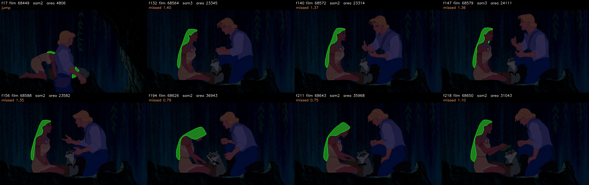
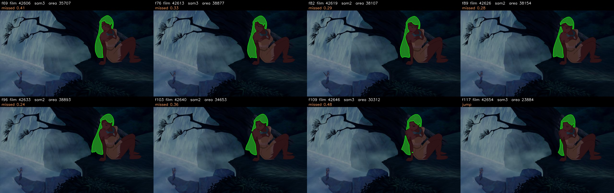
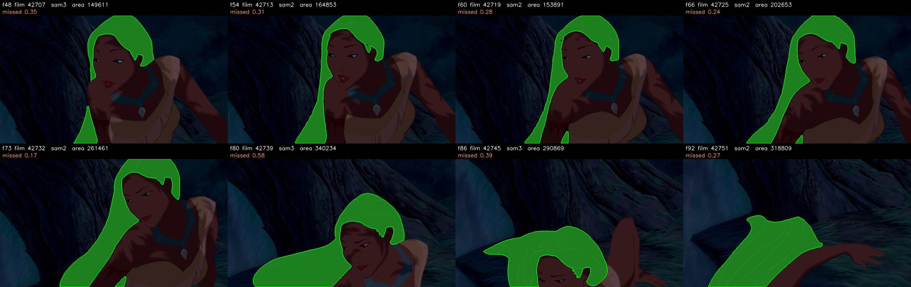
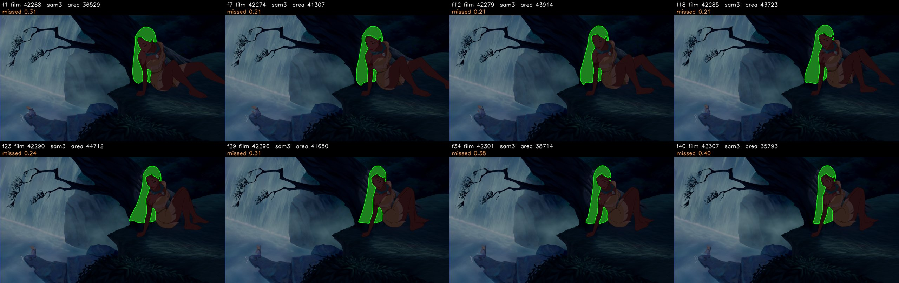
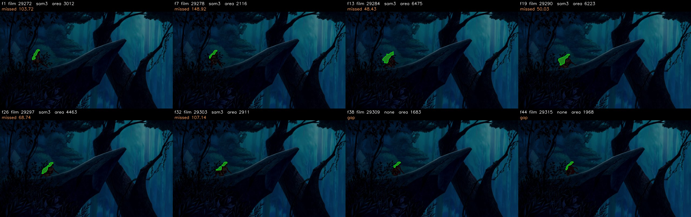
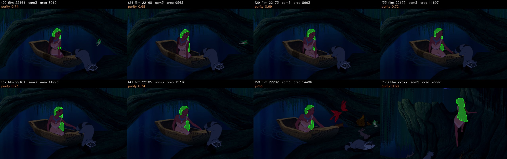
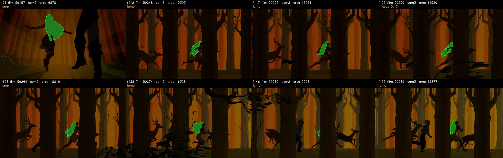

To fix, before the rerun:

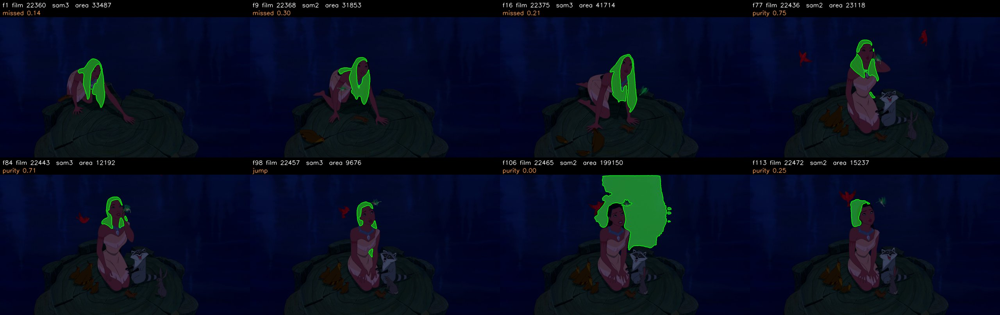
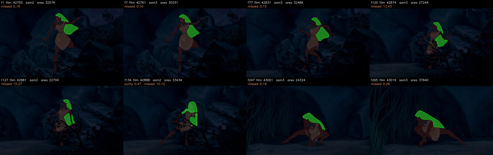
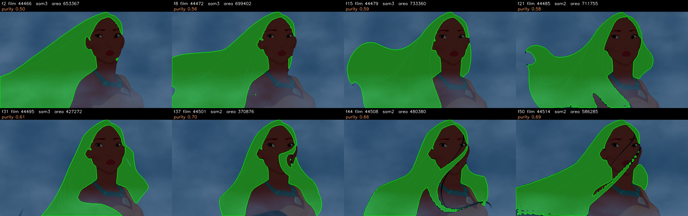
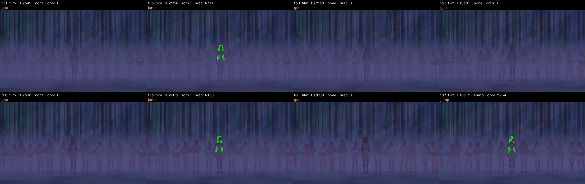

**New override, `"hold_gaps": true`:** an empty run of up to `MAX_GAP` (12) frames with her hair on both sides now holds the previous frame's mask. Those frames get source `hold` in `qc.json`. It's also added to 1292 for its 23 dropouts. 253, 486, 501, 1250 and 1292 are being rerun.

### Batch 2 results after the reruns (same frames as before)

| Seg | Override | Result |
|---|---|---|
| 253 | `no_sam2` | **Fixed.** The sky spill in f106 is gone: 9,164 px of hair instead of 199,150. 51 frames still fail, all night-light `purity` and `missed` false alarms |
| 486 | `no_sam2` | **Fixed.** The spill in f134 is gone (9,451 px instead of 33,434). f127 keeps a SAM3 blob at her side, which is her hair behind her arm. The remaining 94 fails are `missed` (13–36) from the near-black rocks |
| 501 | `no_sam2` | **Accepted.** SAM3 masks on every frame. Where the wind blows strands across her face (f44, f50), the mask still has small holes along the strand, but it's no worse than SAM2 was. The remaining fails are blue-highlight `purity` |
| 1250 | `hold_gaps` | **Fixed.** 26 dropout frames hold the previous mask, so her hair no longer blinks in the mist, and only 1 frame fails. 15 frames are still empty, at the start of the shot and in runs longer than 12 frames |
| 1292 | `no_sam2` + `hold_gaps` | **Fixed.** All 23 dropouts are held, leaving 0 empty frames |

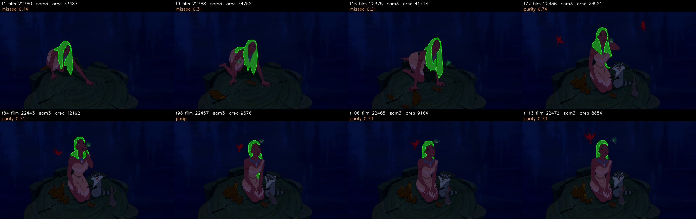
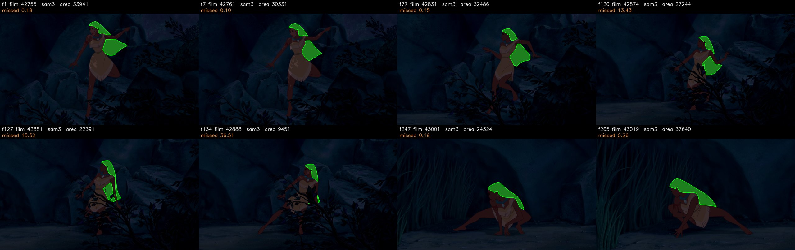
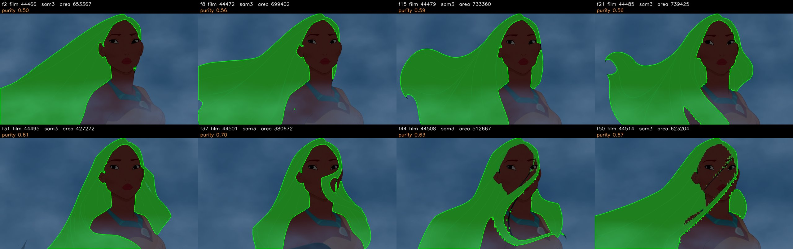
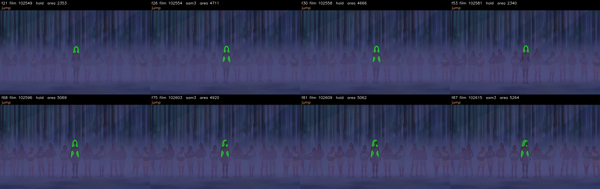

**Tally after 2 batches (20 segments reviewed):**
- 12 accepted unchanged.
- 6 fixed with `no_sam2`: 1007, 1292, 253, 486, 501.
- 2 fixed with `hold_gaps`: 1250, 1292.
- 1 fixed with `drop`: 187.

In every segment reviewed, **SAM2 frames were either as good as SAM3's or worse. None was better.** The fail counts are dominated by `missed` and `purity` false alarms in night, dusk and blue-lit scenes.

**Still to review (≥ 20 failing frames):** 134, 137, 157, 173, 232, 511, 670, 682, 690, 691, 890, 924, 938, 956, 1234, 1295. Below those are about 120 segments with fewer than 20 failing frames.

## Step 18 — SAM2 fallback off by default (2026-10-24)

The review found that SAM2 never beat SAM3 (step 17), so the fallback is now **opt-in**. `tools/run_film.py` runs SAM2 only when a segment's override has `"sam2": true`. The old `no_sam2` entries in `overrides.json` are now redundant but harmless, and they keep their `why` as review notes. Failing frames keep their SAM3 mask, or stay empty, and are still listed in `fail_after`.

**Rerun:** these are the 114 segments whose `qc.json` had at least one SAM2 frame. They're rerun with `--redo --only ...`, and the log is in `film/segments/run.log` under `=== step 18 rerun ===`:

104, 105, 119, 128, 132, 134, 137, 148, 157, 164, 168, 171, 172, 183, 186, 194, 196, 197, 204, 205, 212, 213, 215, 217, 218, 221, 232, 234, 235, 237, 252, 254, 290, 326, 346, 368, 404, 484, 485, 489, 490, 499, 511, 513, 514, 595, 607, 638, 642, 648, 654, 657, 663, 666, 670, 671, 677, 678, 683, 685, 686, 688, 690, 691, 693, 697, 765, 767, 768, 781, 804, 824, 835, 842, 844, 846, 850, 890, 892, 895, 926, 936, 938, 956, 965, 972, 973, 980, 982, 987, 989, 999, 1033, 1034, 1036, 1038, 1039, 1041, 1111, 1125, 1126, 1138, 1146, 1159, 1169, 1170, 1173, 1193, 1225, 1256, 1259, 1281, 1294, 1295

**Results** (finished 2026-10-24, no errors, all 114 done):

| | Before | After |
|---|---|---|
| SAM2 frames | 828 | 0 |
| Failing frames | 1,144 | 1,423 |
| ...of which empty (`gap`) | – | 148 |
| ...of which keep a SAM3 mask | – | 1,275 |

- **Status:** 104 stayed `check`. 6 went from `ok` to `check` (205, 213, 218, 368, 666, 987). 186 went to `absent`, because its override is now applied. 1 stayed `ok`.
- **Why fail counts rose:** frames that SAM2 used to replace now keep their SAM3 mask, and are flagged.

**Spot-check sheets** for the segments whose fail count rose most (172, 148, 671) and those with the most empty frames (685, 119):

| Seg | What the sheet shows |
|---|---|
| 172 | **Fine.** SAM3 is right on every failing frame, which is Pocahontas with Powhatan in the blue night forest. All are `missed` false alarms (0.46–0.89), because the dark-scene switch needs 50% of frames and this shot has fewer |
| 671 | **Acceptable.** In the magenta *Colors of the Wind* leaves, f242–246 are correct and only flagged for purity. f231 and f235 are empty and f233 is a fragment, but her hair is tiny there and behind leaves |
| 685 | **Mostly fine.** In the sunset forest run, f119–152 are rightly empty because she's behind trees. **But f23 and f29 are misses**: her silhouette hair is visible and the mask is empty |
| 148 | **Real misses.** In the night splash, f201–234 have her hair visible on the left, but the mask is empty while splashes cross her face |
| 119 | **Real misses.** In the night canoe scene, f38–47 have her hair visible but the mask is empty. f50 and f52 cover only part of it |

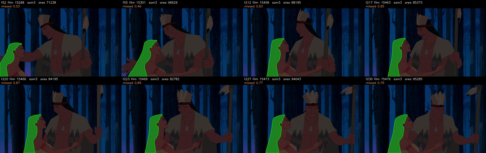
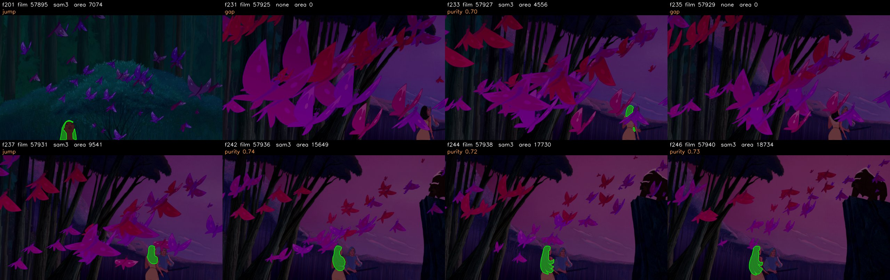
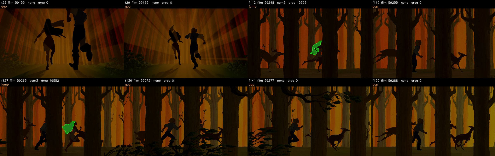
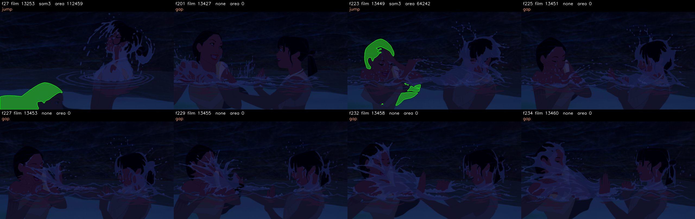
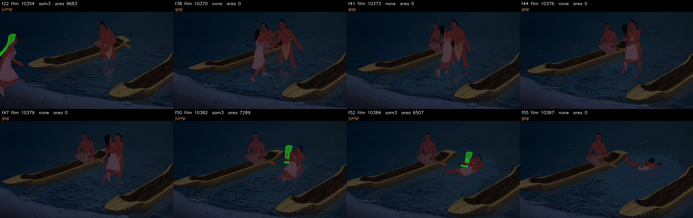

**Lesson:** turning SAM2 off removes its spills, but SAM3 alone leaves gaps where her hair is dark, splashed or in silhouette. In those spots SAM2 may have been filling correctly. The old SAM2 masks were overwritten by the rerun, so that can't be checked from the files. The empty frames (148 in all) need a look, segment by segment. Each one can get `"sam2": true` (with a review afterwards) or `hold_gaps`.

## Step 19 — review of empty-frame (`gap`) segments (2026-10-25)

I reviewed the 12 rerun segments with ≥ 5 empty failing frames, using sheets of the empty frames only (`checks/fail_frames.py N --frames ...`). The question for each: is her hair visible while the mask is empty?

| Seg | Empty frames | What's there | Decision |
|---|---|---|---|
| 804 | 69–79 | John Smith and Grandmother Willow. Pocahontas isn't in the shot | **Correct.** Leave empty |
| 691 | 16–26 | Underwater turmoil of splashes and limbs, with no recognisable hair | Accept |
| 137 | 165–173 | Tiny figure diving underwater at night | Accept |
| 326 | 10–14, 27–29 | Running behind trees at night, hair only a sliver | Accept |
| 511 | 5–7, 26–27 | Running behind trees at night, hair small or partly hidden | Accept |
| 217 | 74–81, 130 | Hidden behind reeds; then f130, behind birds | Accept |
| 234 | 71–75, 119 | Canoe in the rapids, with spray and rock in front of her | Accept |
| 1033 | 384–395 | Tiny, distant figures walking at night | Accept |
| **1034** | 11–22 | She stands beside Nakoma at night with her hair **clearly visible**, but the mask is empty | **`hold_gaps`**, since she doesn't move |
| **148** | 201–234 | Night splash with Nakoma. Her hair is **visible** while splashes cross her face | **`hold_gaps`**, since she stays in place |
| **119** | 37–55 | Night canoe. She walks into the water and hugs, and her hair is **visible** | **`"sam2": true`**, since she moves; compare after |
| **685** | 23–30 | Sunset run in silhouette, her hair **visible** | **`"sam2": true`**; compare after. f114–152 are correctly empty (she's behind trees) |

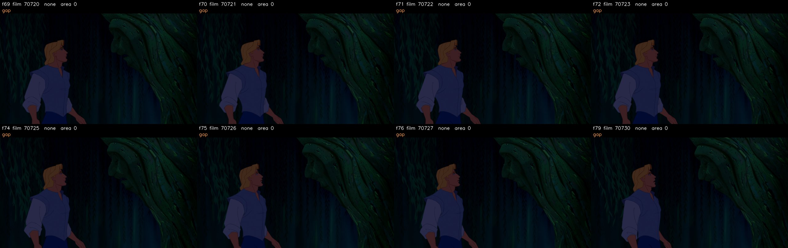
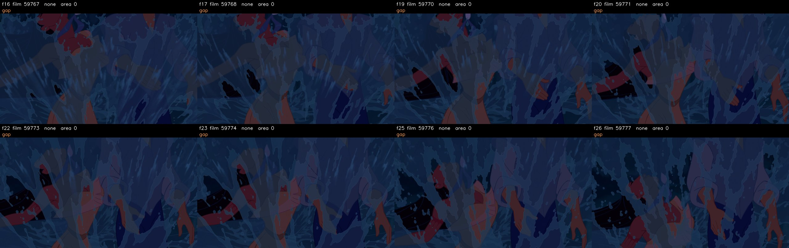
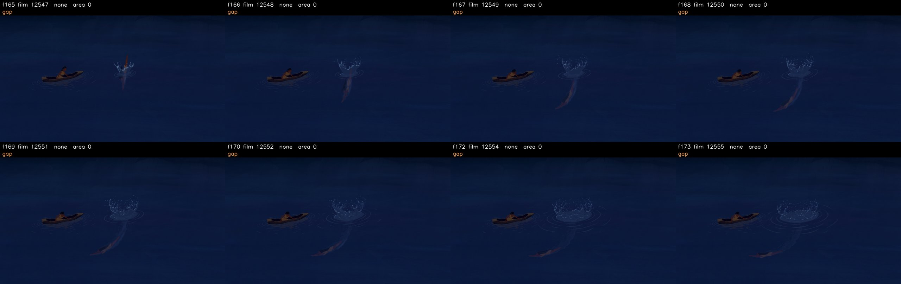
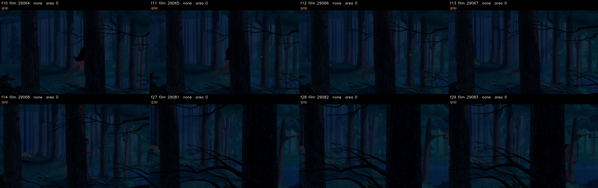
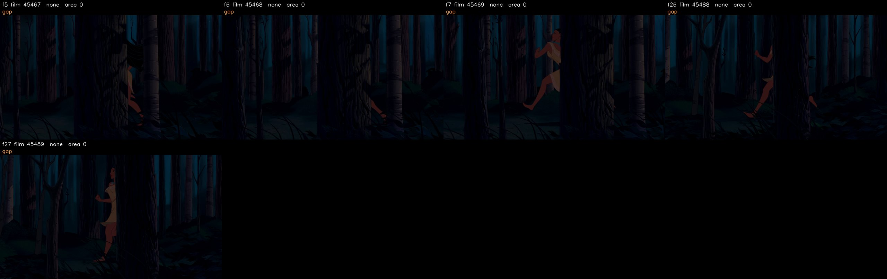
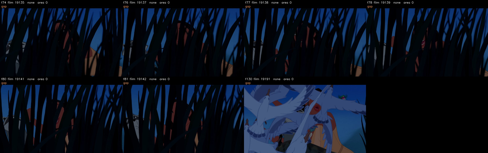
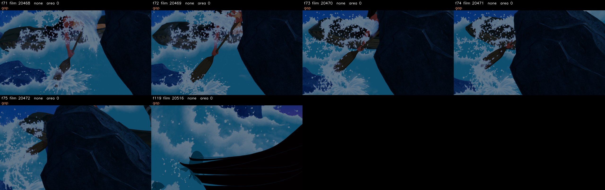
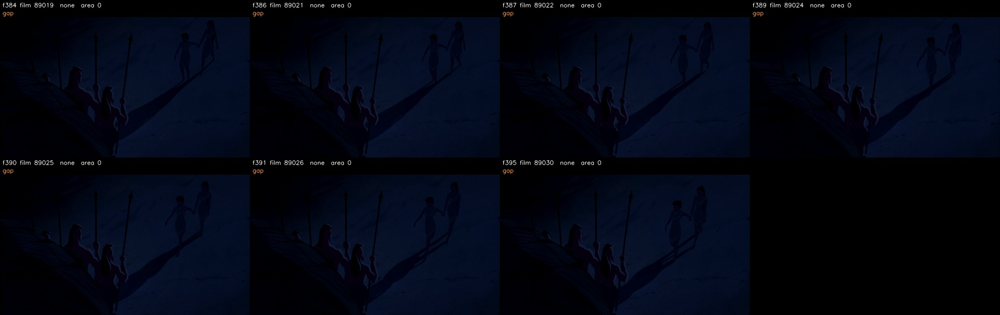
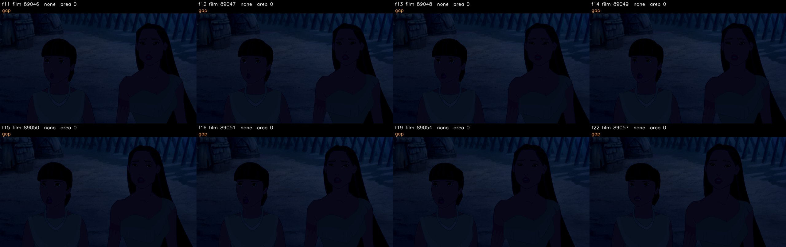

The sheets for 148, 119 and 685 are in step 18. Before the rerun, the versions of 119, 685, 148 and 1034 were copied to the session scratchpad so they can be compared.

### Step 19 results (reruns on 2026-10-25)

| Seg | Override | Result |
|---|---|---|
| 1034 | `hold_gaps` | **Fixed.** 8 frames hold the previous mask, which fits her hair because she doesn't move. Status is now `ok` with 0 failing frames |
| 148 | `hold_gaps` | **Fixed.** 12 frames are held and none is empty. The held mask carries a small blob on her hand, which was already in the SAM3 mask it holds (f223), so it's no worse than before |
| 685 | `"sam2": true` | **Better.** SAM2 now covers her silhouette hair in f23–30 and her running hair in f116–151. f136 and f140 are small slivers at a tree edge (about 4,000 px) |
| 119 | `"sam2": true` | **Partly.** SAM2 covers f22 and f36–38, which are roughly on her head. But f40–55 are still empty: SAM2 had no seed, because the nearest SAM3 mask was too small (3,150 px). About 16 frames of her hair stay missing as she wades into the water. Accepted as a known gap |

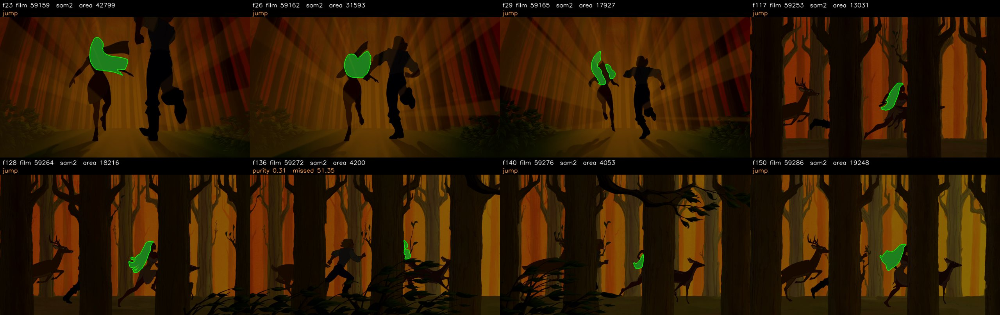

**Rule that came out of steps 17–19:**
- Keep SAM2 off by default.
- Use `hold_gaps` when she stands still.
- Use `"sam2": true` only for moving shots where SAM3 loses her hair, and review it afterwards.

## Step 20 — film assembled (2026-10-26)

`python tools/assemble_film.py` wrote **`film/final/Pocahontas_hair_only.mp4`** (650 MB): 1920×1080, 23.976 fps, H.264, with the BDrip's English AC3 5.1 track copied in. The log is in `film/final/assemble.log`.

- **Fix needed first:** `nframes()` counted frames with `-c copy` and no output file. With `-c copy`, this ffmpeg build prints no `frame=` line, so every segment read as -1 and the check stopped the assembly. It now decodes to `-f null -` and reads `-progress pipe:1`, which takes under a second per segment.
- **Checks:**
  - All 1,308 segment videos have their exact frame counts.
  - The joined video has **116,732 frames, as expected**.
  - The duration is **1:21:08.77, identical to the BDrip**.
- **Sync:** source and final frames at the same timestamps match (Powhatan f15466, the sunset run f59159, the `hold_gaps` fix in seg 1034 at f89050, and the credits at f113000):

- **Other files in `film/final/`:** `credits.mp4` (credits re-encoded as-is), `_video.mp4` (the joined video before the audio was added, which can be deleted) and `concat.txt`.
- **Known imperfections:**
  - Seg 119 f40–55: her hair is missing as she wades in.
  - About 100 `check` segments are unreviewed. Their flags are mostly dark-scene false alarms; see steps 17–19.

## Step 21 — "her cut": only the segments she's in, no audio (2026-10-26)

A separate output from the full film. `python tools/assemble_her_cut.py` writes to `film/her_cut/`:

- **`Pocahontas_her_cut.mp4`**: 98 MB, 1080p, 23.976 fps, video only. It holds **429 segments, 44,703 frames, 31:04.49**, and the frame count is checked after joining.
- **`index.csv`**: one row per segment, giving its status, frame count, start time in the cut, start time in the film, and film frame range. Use it to look up where a moment in the cut comes from.
- **Which segments:** every segment whose `qc.json` status isn't `absent`, which is 267 `ok` plus 162 `check`, in film order. The credits are left out.
- **How it's built:** the segment files are stream-copied as they are, so nothing is re-encoded and the full film in `film/final/` is untouched.

Twelve stills across the cut, from 1:00 to 30:04:

- **Blank frames:** the cut works at segment level, so it also keeps the stretches of those segments where she's off-screen. **9,987 of the 44,703 frames (22%) are blank white**, as at 14:12 above.
- **Trimming option:** a frame-level version could drop those frames, leaving about 34,700 frames (24 min). It would have to re-encode, because the cuts would no longer fall on keyframes.
