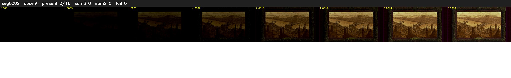

# Segment 2 (transition)

Film frames 333-348 (16 frames, 0:13.9-0:14.6).

**Status: absent**

| | |
|---|---|
| Frames with her hair | 0 / 16 |
| Mask source | SAM3 0, SAM2 fallback 0 |
| Frames still failing QC | 0 [] |
| Film indices with no picture (held) | 0 |
| Time | 6 s |

Top: source with the final mask outlined in red. Bottom: white-fill output.

## Issues

- hair on 1/3 presence frames, none of it hers (best P 0.00)
