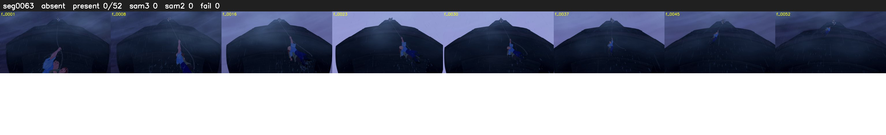

# Segment 63 (shot)

Film frames 5218-5269 (52 frames, 4:37.6-4:39.8).

**Status: absent**

| | |
|---|---|
| Frames with her hair | 0 / 52 |
| Mask source | SAM3 0, SAM2 fallback 0 |
| Frames still failing QC | 0 [] |
| Film indices with no picture (held) | 0 |
| Time | 18 s |

Top: source with the final mask outlined in red. Bottom: white-fill output.

## Issues

- hair on 8/9 presence frames, none of it hers (best P 0.00)
