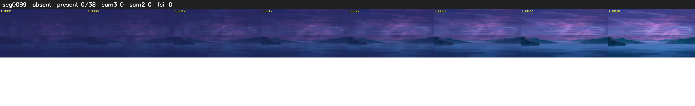

# Segment 89 (transition)

Film frames 8209-8246 (38 frames, 6:42.4-6:44.0).

**Status: absent**

| | |
|---|---|
| Frames with her hair | 0 / 38 |
| Mask source | SAM3 0, SAM2 fallback 0 |
| Frames still failing QC | 0 [] |
| Film indices with no picture (held) | 0 |
| Time | 10 s |

Top: source with the final mask outlined in red. Bottom: white-fill output.

## Issues

- hair on 4/7 presence frames, none of it hers (best P 0.00)
