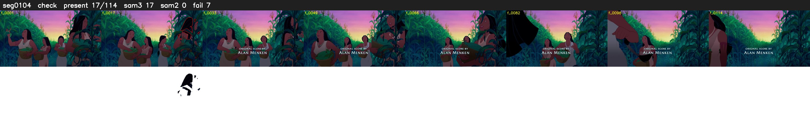

# Segment 104 (shot)

Film frames 9021-9134 (114 frames, 6:16.3-6:21.0).

**Status: check**

| | |
|---|---|
| Frames with her hair | 17 / 114 |
| Mask source | SAM3 17, SAM2 fallback 0 |
| Frames still failing QC | 7 [15, 21, 39, 42, 85, 86, 87] |
| Film indices with no picture (held) | 0 |
| Time | 322 s |

Top: source with the final mask outlined in red. Bottom: white-fill output.

## Issues

- other characters' hair erased on 113 frames
