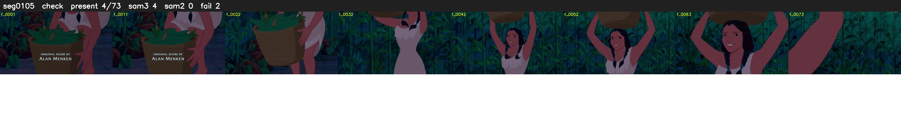

# Segment 105 (shot)

Film frames 9135-9207 (73 frames, 6:21.0-6:24.1).

**Status: check**

| | |
|---|---|
| Frames with her hair | 4 / 73 |
| Mask source | SAM3 4, SAM2 fallback 0 |
| Frames still failing QC | 2 [67, 70] |
| Film indices with no picture (held) | 0 |
| Time | 121 s |

Top: source with the final mask outlined in red. Bottom: white-fill output.

## Issues

- other characters' hair erased on 57 frames
