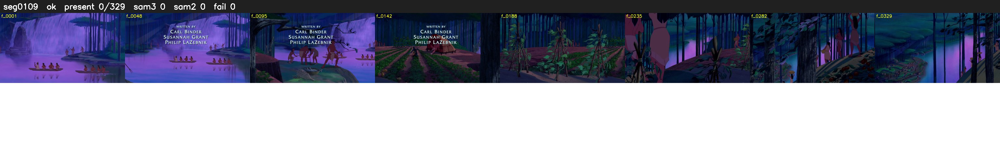

# Segment 109 (shot)

Film frames 9362-9690 (329 frames, 7:30.5-7:44.2).

**Status: ok**

| | |
|---|---|
| Frames with her hair | 0 / 329 |
| Mask source | SAM3 0, SAM2 fallback 0 |
| Frames still failing QC | 0 [] |
| Film indices with no picture (held) | 0 |
| Time | 1007 s |

Top: source with the final mask outlined in red. Bottom: white-fill output.

## Issues

- other characters' hair erased on 282 frames
