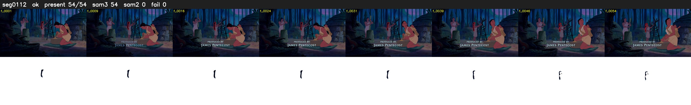

# Segment 112 (shot)

Film frames 9848-9901 (54 frames, 7:50.7-7:53.0).

**Status: ok**

| | |
|---|---|
| Frames with her hair | 54 / 54 |
| Mask source | SAM3 54, SAM2 fallback 0 |
| Frames still failing QC | 0 [] |
| Film indices with no picture (held) | 0 |
| Time | 253 s |

Top: source with the final mask outlined in red. Bottom: white-fill output.

## Issues

- dusk scene: median hair purity 0.55 < 0.75, purity QC off
- other characters' hair erased on 54 frames
