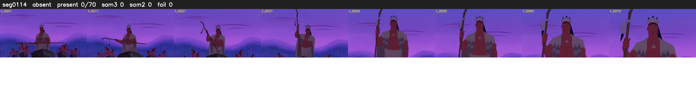

# Segment 114 (shot)

Film frames 10007-10123 (117 frames, 7:57.4-7:02.3).

**Status: absent**

| | |
|---|---|
| Frames with her hair | 0 / 70 |
| Mask source | SAM3 0, SAM2 fallback 0 |
| Frames still failing QC | 0 [] |
| Film indices with no picture (held) | 47 |
| Time | 33 s |

Top: source with the final mask outlined in red. Bottom: white-fill output.

## Issues

- 47 film indices have no picture (damaged source): 10040-10086; the previous frame is held
- hair on 12/12 presence frames, none of it hers (best P 0.01)
