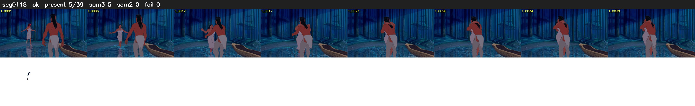

# Segment 118 (shot)

Film frames 10294-10332 (39 frames, 7:09.3-7:11.0).

**Status: ok**

| | |
|---|---|
| Frames with her hair | 5 / 39 |
| Mask source | SAM3 5, SAM2 fallback 0 |
| Frames still failing QC | 0 [] |
| Film indices with no picture (held) | 0 |
| Time | 85 s |

Top: source with the final mask outlined in red. Bottom: white-fill output.

## Issues

- tinted scene: median hair purity 0.40 < 0.5, purity/missed QC off (README step 6)
- other characters' hair erased on 37 frames
