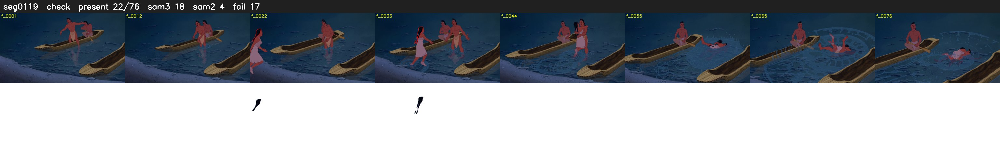

# Segment 119 (shot)

Film frames 10333-10408 (76 frames, 7:11.0-7:14.1).

**Status: check**

| | |
|---|---|
| Frames with her hair | 22 / 76 |
| Mask source | SAM3 18, SAM2 fallback 4 |
| Frames still failing QC | 17 [39, 40, 41, 42, 43, 44, 45, 46, 47, 48, 49, 50, 51, 52, 53, 54, 55] |
| Film indices with no picture (held) | 0 |
| Time | 216 s |

Top: source with the final mask outlined in red. Bottom: white-fill output.

## SAM2 fallbacks

| Frames | Anchor | Direction | SAM2 used |
|---|---|---|---|
| 22-22 | 23 | backward | 1/1 |
| 36-38 | 35 | forward | 3/3 |

## Issues

- manual override: step 18 gaps: night canoe, she walks into the water and SAM3 drops her dark hair f37-55
- dusk scene: median hair purity 0.64 < 0.75, purity QC off
- fallback 40-55: no seed prompts (cleaned seed too small (3150 px): hair lost)
- other characters' hair erased on 75 frames
