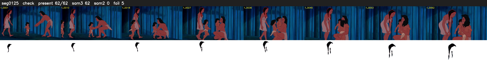

# Segment 125 (shot)

Film frames 10995-11056 (62 frames, 8:38.6-8:41.2).

**Status: check**

| | |
|---|---|
| Frames with her hair | 62 / 62 |
| Mask source | SAM3 62, SAM2 fallback 0 |
| Frames still failing QC | 5 [1, 2, 3, 4, 5] |
| Film indices with no picture (held) | 0 |
| Time | 199 s |

Top: source with the final mask outlined in red. Bottom: white-fill output.

## SAM2 fallbacks

| Frames | Anchor | Direction | SAM2 used |
|---|---|---|---|
| 1-5 | 6 | backward | 0/5 |

## Issues

- other characters' hair erased on 62 frames
