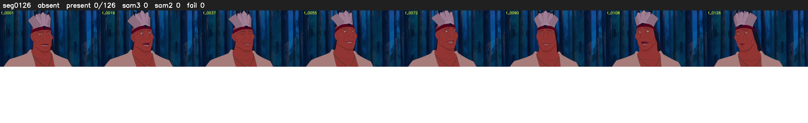

# Segment 126 (shot)

Film frames 11057-11182 (126 frames, 8:41.2-8:46.4).

**Status: absent**

| | |
|---|---|
| Frames with her hair | 0 / 126 |
| Mask source | SAM3 0, SAM2 fallback 0 |
| Frames still failing QC | 0 [] |
| Film indices with no picture (held) | 0 |
| Time | 48 s |

Top: source with the final mask outlined in red. Bottom: white-fill output.

## Issues

- hair on 21/21 presence frames, none of it hers (best P 0.01)
