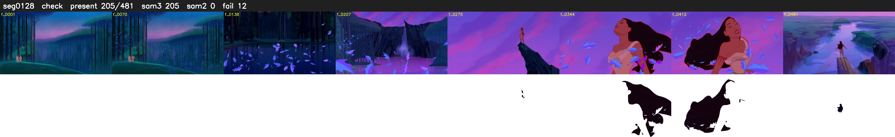

# Segment 128 (shot)

Film frames 11277-11757 (481 frames, 8:50.3-8:10.4).

**Status: check**

| | |
|---|---|
| Frames with her hair | 205 / 481 |
| Mask source | SAM3 205, SAM2 fallback 0 |
| Frames still failing QC | 12 [277, 278, 279, 280, 320, 328, 462, 463, 477, 478, 480, 481] |
| Film indices with no picture (held) | 0 |
| Time | 726 s |

Top: source with the final mask outlined in red. Bottom: white-fill output.

## Issues

- other characters' hair erased on 72 frames
