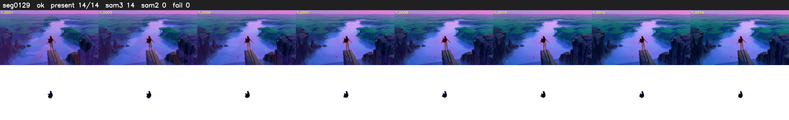

# Segment 129 (transition)

Film frames 11758-11771 (14 frames, 8:10.4-8:11.0).

**Status: ok**

| | |
|---|---|
| Frames with her hair | 14 / 14 |
| Mask source | SAM3 14, SAM2 fallback 0 |
| Frames still failing QC | 0 [] |
| Film indices with no picture (held) | 0 |
| Time | 29 s |

Top: source with the final mask outlined in red. Bottom: white-fill output.

## Issues

- dusk scene: median hair purity 0.70 < 0.75, purity QC off
