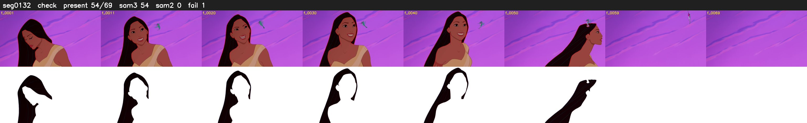

# Segment 132 (shot)

Film frames 11950-12018 (69 frames, 8:18.4-8:21.3).

**Status: check**

| | |
|---|---|
| Frames with her hair | 54 / 69 |
| Mask source | SAM3 54, SAM2 fallback 0 |
| Frames still failing QC | 1 [54] |
| Film indices with no picture (held) | 0 |
| Time | 101 s |

Top: source with the final mask outlined in red. Bottom: white-fill output.

## Issues

- other characters' hair erased on 4 frames
