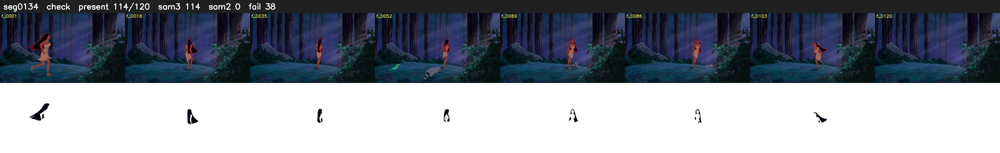

# Segment 134 (shot)

Film frames 12193-12312 (120 frames, 8:28.6-9:33.6).

**Status: check**

| | |
|---|---|
| Frames with her hair | 114 / 120 |
| Mask source | SAM3 114, SAM2 fallback 0 |
| Frames still failing QC | 38 [1, 2, 56, 57, 58, 59, 62, 63, 66, 67, 68, 69, 70, 71, 72, 73, 74, 75, 76, 77] |
| Film indices with no picture (held) | 0 |
| Time | 194 s |

Top: source with the final mask outlined in red. Bottom: white-fill output.

## Issues

- other characters' hair erased on 6 frames
