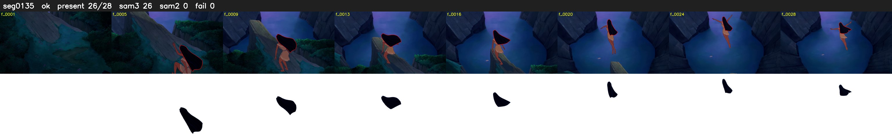

# Segment 135 (shot)

Film frames 12313-12340 (28 frames, 9:33.6-9:34.7).

**Status: ok**

| | |
|---|---|
| Frames with her hair | 26 / 28 |
| Mask source | SAM3 26, SAM2 fallback 0 |
| Frames still failing QC | 0 [] |
| Film indices with no picture (held) | 0 |
| Time | 42 s |

Top: source with the final mask outlined in red. Bottom: white-fill output.

## Issues

- other characters' hair erased on 2 frames
