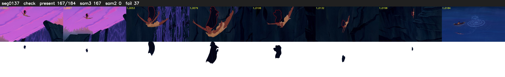

# Segment 137 (shot)

Film frames 12383-12566 (184 frames, 9:36.5-9:44.1).

**Status: check**

| | |
|---|---|
| Frames with her hair | 167 / 184 |
| Mask source | SAM3 167, SAM2 fallback 0 |
| Frames still failing QC | 37 [41, 59, 60, 70, 71, 91, 93, 97, 98, 99, 106, 107, 108, 109, 110, 114, 116, 117, 120, 121] |
| Film indices with no picture (held) | 0 |
| Time | 282 s |

Top: source with the final mask outlined in red. Bottom: white-fill output.

## Issues

- dusk scene: median hair purity 0.71 < 0.75, purity QC off
- other characters' hair erased on 6 frames
