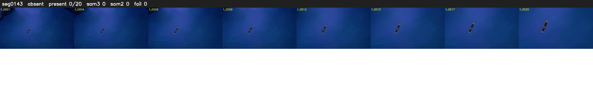

# Segment 143 (transition)

Film frames 12849-12868 (20 frames, 9:55.9-9:56.7).

**Status: absent**

| | |
|---|---|
| Frames with her hair | 0 / 20 |
| Mask source | SAM3 0, SAM2 fallback 0 |
| Frames still failing QC | 0 [] |
| Film indices with no picture (held) | 0 |
| Time | 9 s |

Top: source with the final mask outlined in red. Bottom: white-fill output.

## Issues

- hair on 4/4 presence frames, none of it hers (best P 0.00)
