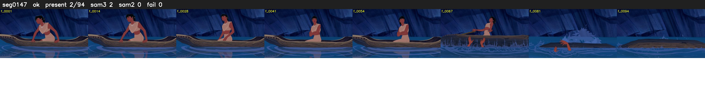

# Segment 147 (shot)

Film frames 13133-13226 (94 frames, 9:07.8-9:11.7).

**Status: ok**

| | |
|---|---|
| Frames with her hair | 2 / 94 |
| Mask source | SAM3 2, SAM2 fallback 0 |
| Frames still failing QC | 0 [] |
| Film indices with no picture (held) | 0 |
| Time | 176 s |

Top: source with the final mask outlined in red. Bottom: white-fill output.

## Issues

- dusk scene: median hair purity 0.68 < 0.75, purity QC off
- other characters' hair erased on 86 frames
