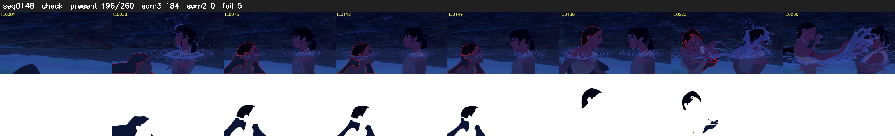

# Segment 148 (shot)

Film frames 13227-13486 (260 frames, 9:11.7-9:22.5).

**Status: check**

| | |
|---|---|
| Frames with her hair | 196 / 260 |
| Mask source | SAM3 184, SAM2 fallback 0 |
| Frames still failing QC | 5 [27, 204, 219, 235, 236] |
| Film indices with no picture (held) | 0 |
| Time | 547 s |

Top: source with the final mask outlined in red. Bottom: white-fill output.

## Issues

- manual override: step 18 gaps: night splash with Nakoma, splashes cross her face f201-234, she stays in place
- tinted scene: median hair purity 0.34 < 0.5, purity/missed QC off
- hold_gaps: 12 dropout frames hold the previous mask
- other characters' hair erased on 260 frames
