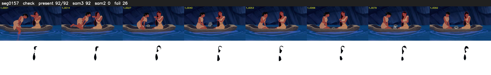

# Segment 157 (shot)

Film frames 13982-14073 (92 frames, 10:43.2-10:47.0).

**Status: check**

| | |
|---|---|
| Frames with her hair | 92 / 92 |
| Mask source | SAM3 92, SAM2 fallback 0 |
| Frames still failing QC | 26 [19, 20, 21, 22, 23, 24, 32, 37, 38, 39, 40, 71, 72, 75, 76, 77, 78, 79, 80, 81] |
| Film indices with no picture (held) | 0 |
| Time | 196 s |

Top: source with the final mask outlined in red. Bottom: white-fill output.

## Issues

- other characters' hair erased on 92 frames
