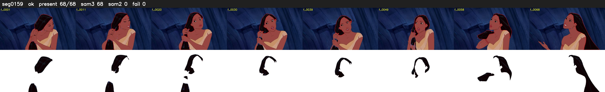

# Segment 159 (shot)

Film frames 14179-14246 (68 frames, 10:51.4-10:54.2).

**Status: ok**

| | |
|---|---|
| Frames with her hair | 68 / 68 |
| Mask source | SAM3 68, SAM2 fallback 0 |
| Frames still failing QC | 0 [] |
| Film indices with no picture (held) | 0 |
| Time | 115 s |

Top: source with the final mask outlined in red. Bottom: white-fill output.
