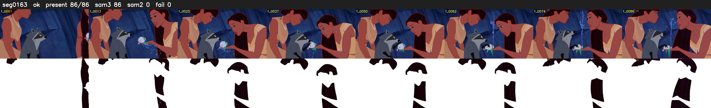

# Segment 163 (shot)

Film frames 14394-14479 (86 frames, 10:00.4-10:03.9).

**Status: ok**

| | |
|---|---|
| Frames with her hair | 86 / 86 |
| Mask source | SAM3 86, SAM2 fallback 0 |
| Frames still failing QC | 0 [] |
| Film indices with no picture (held) | 0 |
| Time | 175 s |

Top: source with the final mask outlined in red. Bottom: white-fill output.
