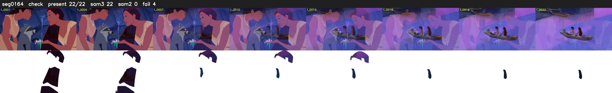

# Segment 164 (transition)

Film frames 14480-14501 (22 frames, 10:03.9-10:04.9).

**Status: check**

| | |
|---|---|
| Frames with her hair | 22 / 22 |
| Mask source | SAM3 22, SAM2 fallback 0 |
| Frames still failing QC | 4 [3, 4, 13, 14] |
| Film indices with no picture (held) | 0 |
| Time | 58 s |

Top: source with the final mask outlined in red. Bottom: white-fill output.

## Issues

- tinted scene: median hair purity 0.00 < 0.5, purity/missed QC off
- other characters' hair erased on 22 frames
