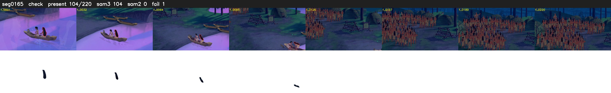

# Segment 165 (shot)

Film frames 14502-14721 (220 frames, 10:04.9-10:14.0).

**Status: check**

| | |
|---|---|
| Frames with her hair | 104 / 220 |
| Mask source | SAM3 104, SAM2 fallback 0 |
| Frames still failing QC | 1 [104] |
| Film indices with no picture (held) | 0 |
| Time | 874 s |

Top: source with the final mask outlined in red. Bottom: white-fill output.

## Issues

- dusk scene: median hair purity 0.58 < 0.75, purity QC off
- fallback 104-104: no seed prompts (cleaned seed too small (2025 px): hair lost)
- other characters' hair erased on 161 frames
