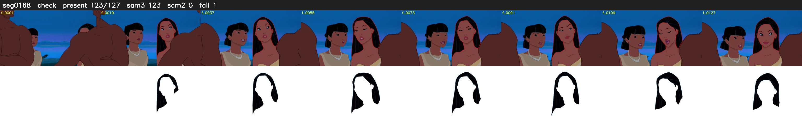

# Segment 168 (shot)

Film frames 14914-15040 (127 frames, 10:22.0-10:27.3).

**Status: check**

| | |
|---|---|
| Frames with her hair | 123 / 127 |
| Mask source | SAM3 123, SAM2 fallback 0 |
| Frames still failing QC | 1 [5] |
| Film indices with no picture (held) | 0 |
| Time | 253 s |

Top: source with the final mask outlined in red. Bottom: white-fill output.

## Issues

- other characters' hair erased on 127 frames
