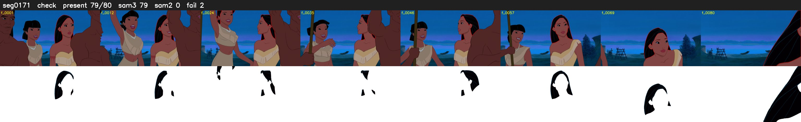

# Segment 171 (shot)

Film frames 15167-15246 (80 frames, 11:32.6-11:35.9).

**Status: check**

| | |
|---|---|
| Frames with her hair | 79 / 80 |
| Mask source | SAM3 79, SAM2 fallback 0 |
| Frames still failing QC | 2 [27, 45] |
| Film indices with no picture (held) | 0 |
| Time | 166 s |

Top: source with the final mask outlined in red. Bottom: white-fill output.

## Issues

- other characters' hair erased on 66 frames
