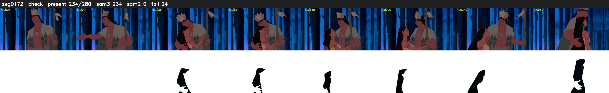

# Segment 172 (shot)

Film frames 15247-15526 (280 frames, 11:35.9-11:47.6).

**Status: check**

| | |
|---|---|
| Frames with her hair | 234 / 280 |
| Mask source | SAM3 234, SAM2 fallback 0 |
| Frames still failing QC | 24 [52, 53, 54, 55, 56, 57, 211, 212, 215, 216, 217, 218, 219, 220, 221, 222, 223, 224, 225, 226] |
| Film indices with no picture (held) | 0 |
| Time | 543 s |

Top: source with the final mask outlined in red. Bottom: white-fill output.

## Issues

- other characters' hair erased on 216 frames
