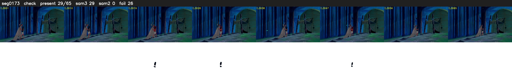

# Segment 173 (shot)

Film frames 15527-15591 (65 frames, 11:47.6-11:50.3).

**Status: check**

| | |
|---|---|
| Frames with her hair | 29 / 65 |
| Mask source | SAM3 29, SAM2 fallback 0 |
| Frames still failing QC | 26 [13, 29, 31, 32, 33, 34, 37, 38, 39, 40, 43, 44, 45, 48, 49, 50, 53, 54, 55, 56] |
| Film indices with no picture (held) | 0 |
| Time | 167 s |

Top: source with the final mask outlined in red. Bottom: white-fill output.

## Issues

- dusk scene: median hair purity 0.75 < 0.75, purity QC off
- fallback 13-13: no seed prompts (cleaned seed too small (3711 px): hair lost)
- fallback 29-29: no seed prompts (cleaned seed too small (3463 px): hair lost)
- fallback 31-34: no seed prompts (cleaned seed too small (3374 px): hair lost)
- fallback 37-40: no seed prompts (cleaned seed too small (2990 px): hair lost)
- fallback 43-45: no seed prompts (cleaned seed too small (2926 px): hair lost)
- fallback 48-50: no seed prompts (cleaned seed too small (2484 px): hair lost)
- fallback 53-62: no seed prompts (cleaned seed too small (2264 px): hair lost)
- other characters' hair erased on 4 frames
