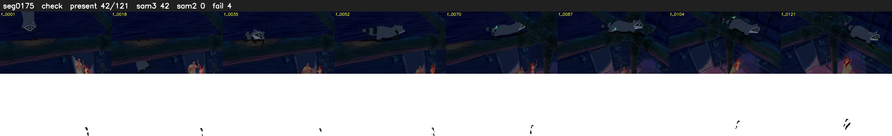

# Segment 175 (shot)

Film frames 15676-15796 (121 frames, 11:53.8-11:58.9).

**Status: check**

| | |
|---|---|
| Frames with her hair | 42 / 121 |
| Mask source | SAM3 42, SAM2 fallback 0 |
| Frames still failing QC | 4 [18, 19, 52, 53] |
| Film indices with no picture (held) | 0 |
| Time | 315 s |

Top: source with the final mask outlined in red. Bottom: white-fill output.

## Issues

- dusk scene: median hair purity 0.72 < 0.75, purity QC off
- fallback 18-19: no seed prompts (cleaned seed too small (835 px): hair lost)
- fallback 52-53: no seed prompts (cleaned seed too small (534 px): hair lost)
- other characters' hair erased on 6 frames
