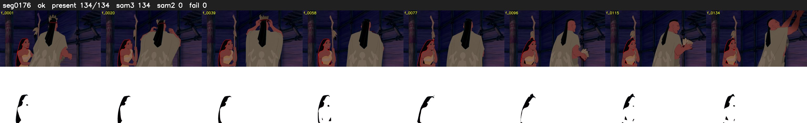

# Segment 176 (shot)

Film frames 15797-15930 (134 frames, 11:58.9-11:04.5).

**Status: ok**

| | |
|---|---|
| Frames with her hair | 134 / 134 |
| Mask source | SAM3 134, SAM2 fallback 0 |
| Frames still failing QC | 0 [] |
| Film indices with no picture (held) | 0 |
| Time | 390 s |

Top: source with the final mask outlined in red. Bottom: white-fill output.

## Issues

- dark scene: 66% of frames fail 'missed', missed QC off
- other characters' hair erased on 123 frames
