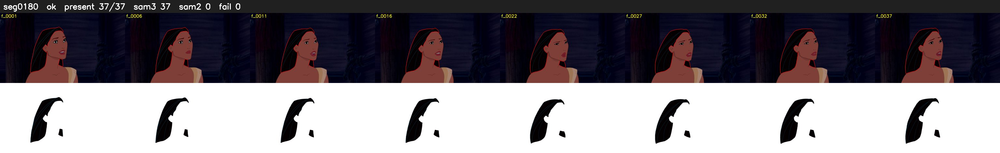

# Segment 180 (shot)

Film frames 16114-16150 (37 frames, 11:12.1-11:13.6).

**Status: ok**

| | |
|---|---|
| Frames with her hair | 37 / 37 |
| Mask source | SAM3 37, SAM2 fallback 0 |
| Frames still failing QC | 0 [] |
| Film indices with no picture (held) | 0 |
| Time | 71 s |

Top: source with the final mask outlined in red. Bottom: white-fill output.
