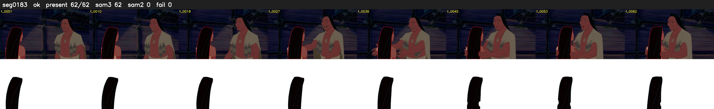

# Segment 183 (shot)

Film frames 16217-16278 (62 frames, 11:16.4-11:19.0).

**Status: ok**

| | |
|---|---|
| Frames with her hair | 62 / 62 |
| Mask source | SAM3 62, SAM2 fallback 0 |
| Frames still failing QC | 0 [] |
| Film indices with no picture (held) | 0 |
| Time | 127 s |

Top: source with the final mask outlined in red. Bottom: white-fill output.

## Issues

- dark scene: 89% of frames fail 'missed', missed QC off
- other characters' hair erased on 62 frames
