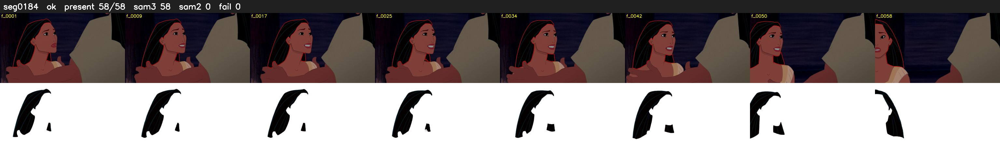

# Segment 184 (shot)

Film frames 16279-16336 (58 frames, 11:19.0-11:21.4).

**Status: ok**

| | |
|---|---|
| Frames with her hair | 58 / 58 |
| Mask source | SAM3 58, SAM2 fallback 0 |
| Frames still failing QC | 0 [] |
| Film indices with no picture (held) | 0 |
| Time | 146 s |

Top: source with the final mask outlined in red. Bottom: white-fill output.

## Issues

- dark scene: 100% of frames fail 'missed', missed QC off
- other characters' hair erased on 44 frames
