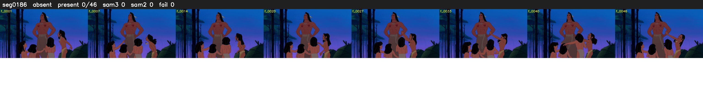

# Segment 186 (shot)

Film frames 16365-16410 (46 frames, 11:22.6-11:24.5).

**Status: absent**

| | |
|---|---|
| Frames with her hair | 0 / 46 |
| Mask source | SAM3 0, SAM2 fallback 0 |
| Frames still failing QC | 0 [] |
| Film indices with no picture (held) | 0 |
| Time | 28 s |

Top: source with the final mask outlined in red. Bottom: white-fill output.

## Issues

- manual override: only a village woman with shoulder-length hair (P ~0.7); Pocahontas not in shot
- hair on 8/8 presence frames, none of it hers (best P 0.61)
