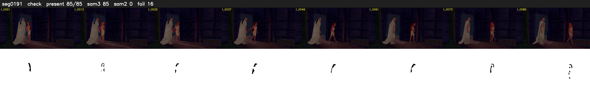

# Segment 191 (shot)

Film frames 16669-16753 (85 frames, 12:35.2-12:38.8).

**Status: check**

| | |
|---|---|
| Frames with her hair | 85 / 85 |
| Mask source | SAM3 85, SAM2 fallback 0 |
| Frames still failing QC | 16 [9, 10, 11, 12, 13, 14, 15, 16, 17, 18, 19, 20, 21, 22, 23, 24] |
| Film indices with no picture (held) | 0 |
| Time | 237 s |

Top: source with the final mask outlined in red. Bottom: white-fill output.

## Issues

- fallback 9-24: no seed prompts (cleaned seed too small (3846 px): hair lost)
- other characters' hair erased on 67 frames
