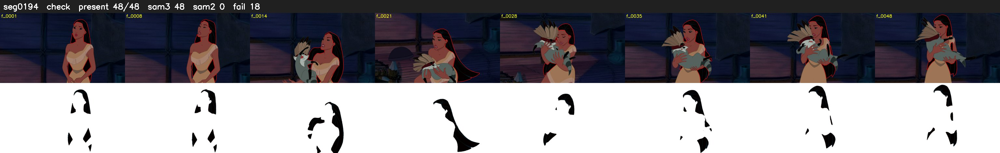

# Segment 194 (shot)

Film frames 16819-16866 (48 frames, 12:41.5-12:43.5).

**Status: check**

| | |
|---|---|
| Frames with her hair | 48 / 48 |
| Mask source | SAM3 48, SAM2 fallback 0 |
| Frames still failing QC | 18 [17, 18, 19, 21, 22, 23, 24, 25, 29, 30, 31, 32, 33, 34, 35, 36, 39, 40] |
| Film indices with no picture (held) | 0 |
| Time | 86 s |

Top: source with the final mask outlined in red. Bottom: white-fill output.
