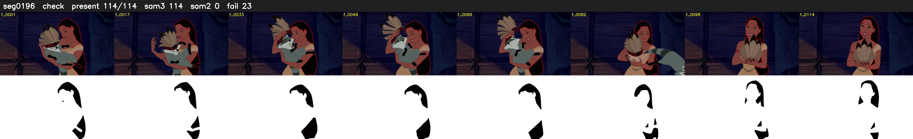

# Segment 196 (shot)

Film frames 16920-17033 (114 frames, 12:45.7-12:50.5).

**Status: check**

| | |
|---|---|
| Frames with her hair | 114 / 114 |
| Mask source | SAM3 114, SAM2 fallback 0 |
| Frames still failing QC | 23 [2, 4, 11, 13, 14, 78, 79, 81, 82, 83, 93, 94, 95, 96, 97, 98, 99, 100, 103, 104] |
| Film indices with no picture (held) | 0 |
| Time | 206 s |

Top: source with the final mask outlined in red. Bottom: white-fill output.
