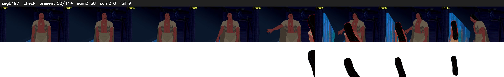

# Segment 197 (shot)

Film frames 17034-17147 (114 frames, 12:50.5-12:55.2).

**Status: check**

| | |
|---|---|
| Frames with her hair | 50 / 114 |
| Mask source | SAM3 50, SAM2 fallback 0 |
| Frames still failing QC | 9 [65, 66, 67, 69, 70, 71, 72, 73, 74] |
| Film indices with no picture (held) | 0 |
| Time | 200 s |

Top: source with the final mask outlined in red. Bottom: white-fill output.

## Issues

- other characters' hair erased on 112 frames
