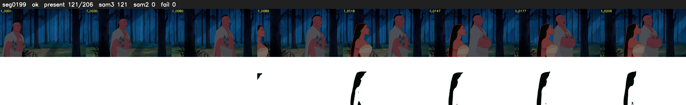

# Segment 199 (shot)

Film frames 17324-17529 (206 frames, 12:02.6-12:11.1).

**Status: ok**

| | |
|---|---|
| Frames with her hair | 121 / 206 |
| Mask source | SAM3 121, SAM2 fallback 0 |
| Frames still failing QC | 0 [] |
| Film indices with no picture (held) | 0 |
| Time | 444 s |

Top: source with the final mask outlined in red. Bottom: white-fill output.

## Issues

- dark scene: 88% of frames fail 'missed', missed QC off
- other characters' hair erased on 206 frames
