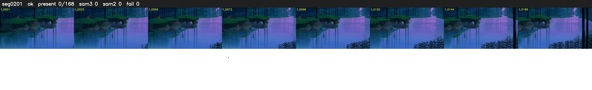

# Segment 201 (shot)

Film frames 17743-17910 (168 frames, 12:20.0-12:27.0).

**Status: ok**

| | |
|---|---|
| Frames with her hair | 0 / 168 |
| Mask source | SAM3 0, SAM2 fallback 0 |
| Frames still failing QC | 0 [] |
| Film indices with no picture (held) | 0 |
| Time | 259 s |

Top: source with the final mask outlined in red. Bottom: white-fill output.

## Issues

- other characters' hair erased on 36 frames
