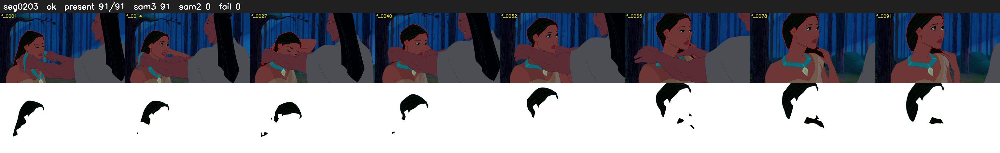

# Segment 203 (shot)

Film frames 18030-18120 (91 frames, 13:32.0-13:35.8).

**Status: ok**

| | |
|---|---|
| Frames with her hair | 91 / 91 |
| Mask source | SAM3 91, SAM2 fallback 0 |
| Frames still failing QC | 0 [] |
| Film indices with no picture (held) | 0 |
| Time | 190 s |

Top: source with the final mask outlined in red. Bottom: white-fill output.

## Issues

- other characters' hair erased on 62 frames
